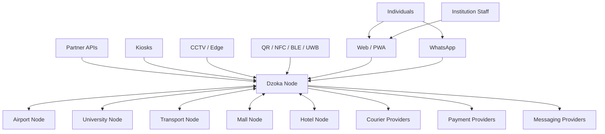
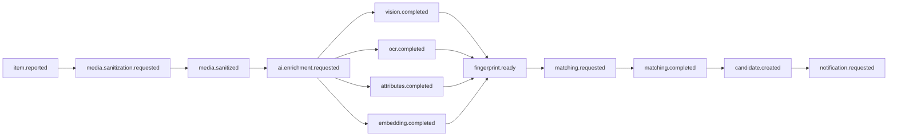
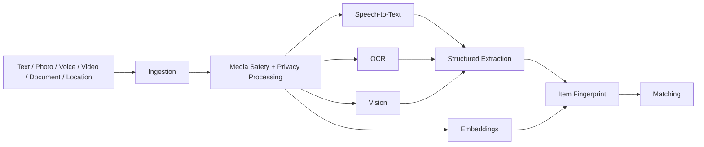
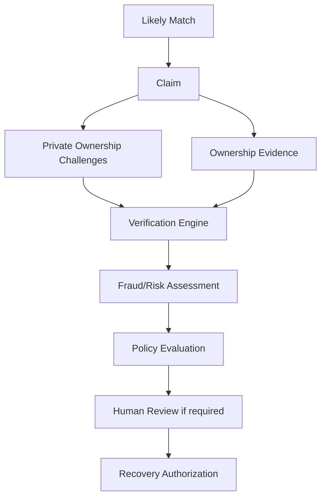
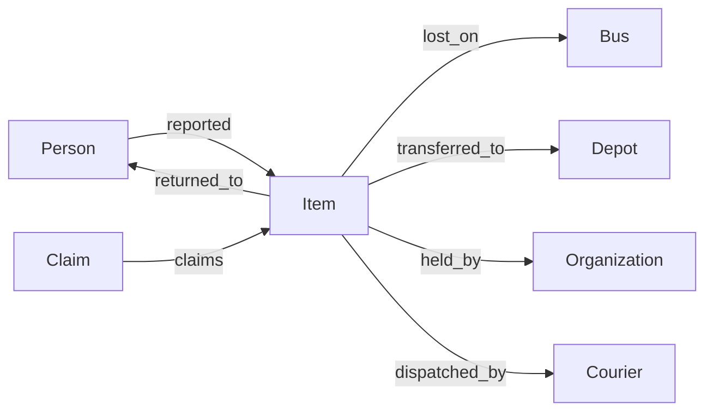
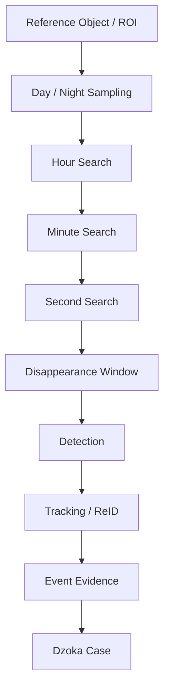
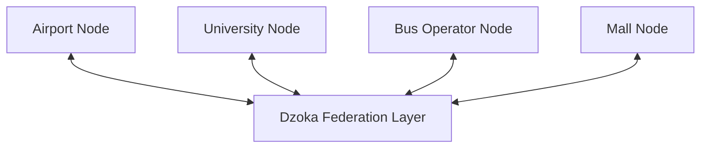

> **Current architecture authority (2026-10-26):** [Accepted baseline](architecture/baseline.md) and its linked ADRs govern implementation. This supplied document is preserved below as detailed research/design material. Where examples or diagrams conflict with the baseline, use the baseline; no runtime capability is implied.

# Dzoka Architecture

> **Dzoka — The Open Recovery Network**
>
> An open-source, federated, multimodal AI network for finding, matching, verifying, tracking, and recovering lost physical property.

---

## 1. Purpose

This document defines the target architecture of **Dzoka**.

Dzoka is not a conventional lost-and-found listing application.

It is a production-grade physical-object recovery platform designed to support:

- individuals;
- universities;
- airports;
- malls;
- transport operators;
- hotels;
- hospitals;
- event venues;
- government institutions;
- authorized public-safety organizations;
- courier partners;
- other independent organizations.

Dzoka combines:

- multimodal AI;
- structured item identity;
- visual search;
- OCR;
- speech understanding;
- geospatial reasoning;
- temporal reasoning;
- instance-level object matching;
- ownership verification;
- fraud detection;
- chain of custody;
- secure communications;
- federated institutional search;
- CCTV-assisted investigations;
- recovery logistics;
- rewards;
- recovery-event intelligence;
- machine-learning feedback.

The core product principle is:

> **Report once → understand automatically → search everywhere authorized → rank likely matches → prove ownership → recover securely → learn from the outcome.**

---

# 2. Architectural Goals

Dzoka MUST support both simple local deployments and large federated recovery networks.

The architecture therefore prioritizes:

1. strong domain boundaries;
2. privacy by default;
3. evidence-based matching;
4. explainability;
5. replaceable AI providers;
6. replaceable infrastructure providers;
7. asynchronous AI processing;
8. institutional interoperability;
9. offline-capable institutional nodes;
10. auditable custody and recovery;
11. horizontal scalability;
12. deployment independence;
13. human oversight for sensitive recovery decisions;
14. model/version traceability;
15. source-audit-driven architectural decisions.

---

# 3. Architectural Invariants

These rules are architectural contracts.

They MUST NOT be violated without an ADR.

### INV-001 — Matching does not prove ownership

A high match probability means:

> two reports may describe the same physical object.

It does not mean:

> the claimant is the legitimate owner.

Matching and ownership verification are separate subsystems.

---

### INV-002 — Missing evidence is not negative evidence

If one side has no image:

```text
image_score = unavailable
```

not:

```text
image_score = 0
```

Available evidence is re-normalized and evidence coverage is calculated separately.

---

### INV-003 — Raw input is immutable evidence

AI normalization MUST NOT destroy or overwrite what the user originally submitted.

Dzoka stores both:

```text
raw_input
normalized_input
```

---

### INV-004 — Hard identity contradictions override similarity

A high semantic or image score cannot override evidence such as:

```text
different IMEI
different serial number
incompatible passport number
impossible chronology
```

---

### INV-005 — Every vector is model-aware

Every embedding MUST carry:

```text
provider
model
model_version
dimensions
content_hash
generated_at
```

Vectors from incompatible model spaces MUST NOT be compared.

---

### INV-006 — AI decisions are traceable

Dzoka must be able to explain:

- which model produced an output;
- which input generated it;
- what evidence affected a match;
- which algorithm version scored it;
- what policy was applied;
- who ultimately approved recovery.

---

### INV-007 — AI cannot independently release property

LLMs and ML models may:

- retrieve;
- rank;
- explain;
- generate questions;
- interpret responses;
- flag fraud.

Property release requires:

- deterministic policy;
- authorized staff approval;
- or an explicitly configured trusted recovery workflow.

---

### INV-008 — Federation does not require centralizing PII

Independent organizations retain control of sensitive data.

Federated search should exchange the minimum safe information necessary.

---

### INV-009 — Raw scores from independent nodes are not assumed comparable

A score of `0.91` at one institution may not mean the same thing as `0.91` at another.

Federated reconciliation must use calibrated evidence or a common reranker.

---

### INV-010 — Heavy AI is asynchronous

User-facing API requests MUST NOT block on chains of expensive OCR, vision, LLM, vector search, or notification work unless the operation is specifically designed for synchronous interaction.

---

# 4. System Context

Dzoka consists of a global logical recovery network built from independent Dzoka deployments.



A **Dzoka Node** may operate:

- completely standalone;
- as a SaaS tenant;
- as an independent institutional deployment;
- as a member of one or more federated recovery networks.

---

# 5. Logical Architecture

Dzoka is organized into seven major logical domains.

```text
┌──────────────────────────────────────────────────────────────┐
│                         EXPERIENCE                           │
│ Web · PWA · WhatsApp · Voice · API · Kiosk · QR/NFC        │
├──────────────────────────────────────────────────────────────┤
│                          RECOVERY                            │
│ Cases · Claims · Verification · Custody · Return · Rewards  │
├──────────────────────────────────────────────────────────────┤
│                         PERCEPTION                           │
│ Vision · OCR · Speech · Translation · Attribute Extraction  │
├──────────────────────────────────────────────────────────────┤
│                        INTELLIGENCE                          │
│ Retrieval · Matching · Reranking · Fraud · ML Feedback      │
├──────────────────────────────────────────────────────────────┤
│                           CONTEXT                            │
│ Geography · Time · Routes · Recovery Graph · Prediction     │
├──────────────────────────────────────────────────────────────┤
│                            TRUST                             │
│ Identity · Policy · Privacy · Audit · Ownership Verification │
├──────────────────────────────────────────────────────────────┤
│                         FEDERATION                           │
│ Nodes · Trust · Remote Search · Interoperability · EPCIS    │
└──────────────────────────────────────────────────────────────┘
```

---

# 6. Deployment Units

Dzoka should avoid unnecessary microservice fragmentation.

The transactional core should begin as a **modular monolith**, while computationally specialized or independently deployable concerns may run separately.

Primary deployable components are:

```text
dzoka-web
dzoka-core
dzoka-ai
dzoka-matching
dzoka-messaging
dzoka-federation
dzoka-edge
dzoka-workers
```

## 6.1 `dzoka-web`

Recommended technology:

```text
Next.js
TypeScript
PWA
```

Responsibilities:

- public reporting;
- user portal;
- finder workflows;
- candidate review;
- ownership challenges;
- secure recovery chat;
- institutional operations;
- administration;
- analytics;
- federation management;
- CCTV investigation interface;
- ML/AI administration.

---

## 6.2 `dzoka-core`

Recommended technology:

```text
Java 21+
Spring Boot
```

The Core Platform is the authoritative transactional domain layer.

Modules include:

```text
identity
tenancy
organizations
locations
items
reports
media
fingerprints
matching
claims
verification
fraud
custody
recovery
rewards
logistics
messaging
notifications
federation
traceability
audit
policy
integrations
ml-feedback
```

This is preferably a modular monolith rather than dozens of independently deployed microservices.

---

## 6.3 `dzoka-ai`

Recommended technology:

```text
Python
FastAPI
```

Responsibilities:

- image detection;
- segmentation;
- OCR;
- visual embeddings;
- local visual features;
- text embeddings;
- speech transcription;
- translation;
- attribute extraction;
- distinctive-feature extraction;
- multimodal inference;
- question generation;
- claim-answer interpretation.

AI providers MUST sit behind interfaces.

---

## 6.4 `dzoka-matching`

The matching subsystem may initially share deployment with `dzoka-ai`, but its domain interface must remain distinct.

Responsibilities:

```text
candidate retrieval
rank fusion
hard conflicts
feature scoring
instance reranking
confidence calculation
evidence coverage
explanations
match decisions
```

---

## 6.5 `dzoka-messaging`

Handles channel-specific communication.

Providers may include:

```text
WhatsApp
SMS
Email
Web Push
Mobile Push
Webhook
```

WhatsApp is a first-class interaction channel rather than only a notification mechanism.

---

## 6.6 `dzoka-federation`

Responsibilities:

- node identity;
- trust relationships;
- peer authentication;
- remote candidate search;
- privacy-safe metadata exchange;
- protocol negotiation;
- federation auditing;
- result reconciliation;
- inter-node recovery workflows.

---

## 6.7 `dzoka-edge`

Optional institutional edge service.

Responsibilities:

- CCTV access;
- local video processing;
- object-presence analysis;
- disappearance detection;
- object tracking;
- local ReID;
- privacy redaction;
- event evidence extraction.

Large raw CCTV archives should normally remain at the institution.

---

# 7. Primary Data Architecture

Dzoka uses specialized storage technologies according to workload.

## 7.1 PostgreSQL

PostgreSQL is the authoritative system of record.

Recommended extensions:

```text
PostGIS
pgvector
pg_trgm
```

Core relational data includes:

```text
users
tenants
organizations
organization_units
roles
locations
location_aliases

cases
item_records
lost_reports
found_reports
registered_items

item_attributes
item_media
item_identifiers
item_fingerprints

embedding_records
matching_runs
match_candidates
match_evidence
match_conflicts
match_decisions

claims
claim_evidence
ownership_challenges
challenge_responses
verification_runs

custody_events
recovery_events
handover_tokens

courier_jobs
shipments
reward_offers
reward_transactions

federation_nodes
federation_trust
federated_queries
federated_candidates

model_runs
model_feedback

audit_logs
```

---

# 8. Vector Storage

The default vector implementation is:

```text
PostgreSQL + pgvector
```

Advantages:

- fewer infrastructure components;
- transactional consistency;
- mature HNSW support;
- joins with structured attributes;
- easier local/self-hosted deployment.

However, vector infrastructure MUST be abstracted.

```text
VectorSearchProvider
├── PgVectorProvider
└── QdrantProvider
```

Qdrant is the preferred scale-out option where:

- collections become extremely large;
- multivector search becomes important;
- independent vector scaling is required;
- federation gateways need dedicated search capacity.

Business logic MUST NOT depend directly on a particular vector engine.

---

# 9. Geospatial Architecture

PostGIS provides the primary spatial capability.

Dzoka location intelligence includes more than latitude and longitude.

```text
Location
├── country
├── province/state
├── city
├── district
├── facility
├── building
├── floor
├── zone
├── room
├── entrance
├── station
├── terminal
├── platform
├── route
├── vehicle
└── coordinates
```

Locations form hierarchical relationships.

Example:

```text
Zimbabwe
└── Harare
    └── Joina City
        └── Level 2
            └── Food Court
```

Matching may consider:

- physical distance;
- common ancestor;
- facility boundaries;
- transport routes;
- movement plausibility;
- organizational transfer routes;
- historical recovery patterns.

---

# 10. Media Storage

Object storage:

```text
S3-compatible storage
```

Default self-hosted implementation:

```text
MinIO
```

Used for:

- photographs;
- videos;
- voice messages;
- receipts;
- ownership evidence;
- identity evidence;
- CCTV excerpts;
- generated redacted media;
- model artifacts where appropriate.

The database stores metadata and object keys, not large binary blobs.

---

# 11. Redis

Redis may be used for:

```text
short-lived cache
rate limits
OTP
one-time recovery tokens
distributed locks
idempotency state
short-lived channel sessions
temporary workflow state
```

Redis must not become the authoritative persistence layer.

---

# 12. Event Architecture

Expensive or long-running workflows use asynchronous events.

Preferred event backbone:

```text
Kafka-compatible infrastructure
```

Example event flow:



Other events include:

```text
case.created
report.updated
claim.submitted
claim.risk-assessed
verification.requested
verification.completed
ownership.verified
custody.transferred
handover.created
courier.requested
shipment.updated
reward.authorized
reward.released
item.recovered
case.closed
ml.feedback.created
```

Events should carry:

```text
event_id
event_type
schema_version
occurred_at
producer
tenant_id
correlation_id
causation_id
entity_id
payload
```

Critical transactional event publication should use an outbox pattern.

Consumers must be idempotent.

---

# 13. Item Fingerprint Architecture

The central AI domain object is the:

# `ItemFingerprint`

The fingerprint represents evidence about a particular physical object.

```text
ItemFingerprint
│
├── Identity
│   ├── category
│   ├── subcategory
│   ├── brand
│   ├── model
│   ├── variant
│   ├── colour
│   ├── material
│   └── dimensions
│
├── Global Visual Identity
│   ├── image_embeddings[]
│   ├── perceptual_hashes[]
│   └── visual_descriptions[]
│
├── Local Visual Identity
│   ├── patch_embeddings[]
│   ├── distinctive_regions[]
│   ├── stickers[]
│   ├── scratches[]
│   ├── cracks[]
│   ├── wear_patterns[]
│   └── texture_features[]
│
├── Text Identity
│   ├── raw_description
│   ├── normalized_description
│   ├── canonical_description
│   ├── semantic_embeddings[]
│   └── keywords[]
│
├── Extracted Identity
│   ├── OCR
│   ├── detected_objects
│   ├── logos
│   ├── labels
│   └── structured_attributes
│
├── Protected Identity
│   ├── serial_hashes[]
│   ├── imei_hashes[]
│   ├── document_identifier_hashes[]
│   └── secret_attributes[]
│
├── Context
│   ├── locations[]
│   ├── time_intervals[]
│   ├── environment
│   ├── route
│   └── provenance
│
└── Model Provenance
    ├── provider
    ├── model
    ├── version
    ├── dimensions
    ├── content_hash
    ├── confidence
    └── generated_at
```

Lost reports and found reports both produce ItemFingerprints.

Matching operates primarily against fingerprints rather than raw reports.

---

# 14. Multimodal Intake Pipeline



Possible provider abstractions:

```text
DetectionProvider
SegmentationProvider
OCRProvider
SpeechProvider
TranslationProvider
TextEmbeddingProvider
ImageEmbeddingProvider
LocalFeatureProvider
LLMProvider
RerankerProvider
```

Recommended initial open defaults include:

```text
PaddleDetection
PaddleOCR
OpenCLIP-compatible embeddings
multilingual sentence embeddings
local/patch instance features
```

---

# 15. Matching Architecture

Matching uses multiple stages.

## Stage 1 — Candidate generation

Candidate generation should be fast and broad.

Possible retrieval routes:

```text
exact protected identifier
category
structured attributes
full-text search
trigram similarity
semantic vector
image vector
text-to-image vector
location
time
distinctive features
federated nodes
```

Each route returns candidate IDs and retrieval evidence.

Rank fusion may use:

```text
Reciprocal Rank Fusion
```

or another documented method.

---

## Stage 2 — Conflict analysis

Candidates are checked for contradictions.

Examples:

```text
IMEI mismatch
serial mismatch
document-number mismatch
major model mismatch
brand conflict
category conflict
impossible chronology
```

Conflict severities:

```text
CRITICAL
MAJOR
MINOR
```

A critical conflict can:

- reject a candidate;
- or limit the maximum possible match confidence.

---

## Stage 3 — Evidence scoring

Evidence dimensions include:

```text
category
attributes
location
time
distinctive traits
semantic similarity
lexical similarity
global image similarity
local visual similarity
OCR
provenance
movement plausibility
```

A conceptual score is:

```text
MatchScore =
    Σ(weight_i × reliability_i × score_i)
    ────────────────────────────────────
        Σ(weight_i × reliability_i)
```

Only available evidence participates.

---

# 16. Evidence Coverage

A match score is insufficient without knowing how much evidence produced it.

Example:

```text
Candidate A
score    = 94
coverage = 28%

Candidate B
score    = 91
coverage = 86%
```

Candidate B may be substantially more trustworthy.

Therefore store separately:

```text
match_score
evidence_coverage
match_confidence
```

---

# 17. Heavy Reranking

The expensive stage should operate only against a bounded shortlist.

Potential techniques:

```text
global embedding similarity
patch/local similarity
instance-level reranking
cross-modal models
LLM reasoning over structured evidence
```

LLMs MUST NOT override hard conflicts.

---

# 18. Match Evidence

Every candidate must be explainable.

Example:

```text
Candidate #M872

Category
  backpack ↔ backpack
  score: 100

Brand
  Lenovo ↔ Lenovo
  score: 100

Colour
  black ↔ black
  score: 100

Location
  Joina City ↔ Joina City security office
  score: 94

Time
  14:00 ↔ 14:23
  score: 97

Global visual
  cosine: 0.87

Distinctive feature
  yellow internal tag detected on both
  score: 96

Conflict
  none

Evidence coverage
  82%

Final score
  93.4
```

---

# 19. Ownership Verification

The ownership subsystem begins only after a plausible match exists.



Ownership evidence may include:

- private questions;
- secret attributes;
- purchase receipts;
- prior images;
- serial fragments;
- IMEI;
- bag contents;
- lock-screen description;
- stickers;
- damage;
- accessories;
- institutional records.

---

# 20. AI-Generated Ownership Challenges

The system may generate ownership questions from features deliberately withheld from public listings.

Example hidden evidence:

```text
yellow sticker underneath
scratch beside USB-C port
missing rear rubber foot
partial serial suffix 9247
```

The Challenge Generator considers:

```text
discriminative value
privacy
answerability
safety
evidence confidence
previously disclosed information
```

Example:

> What distinguishing mark is located beside the charging port?

The correct answer remains protected.

The generated question itself becomes auditable AI output.

---

# 21. Fraud and Claim Risk

Fraud risk is separate from matching.

```text
ClaimRiskScore
```

Possible signals include:

```text
failed claim history
high claim frequency
brute-force challenge attempts
geographic impossibility
copied answers
account/device abuse
suspicious timing
identity inconsistencies
known malicious accounts
```

The risk engine can:

```text
ALLOW_STANDARD_FLOW
REQUIRE_EXTRA_EVIDENCE
REQUIRE_HUMAN_REVIEW
BLOCK
```

---

# 22. WhatsApp Architecture

WhatsApp is treated as an application surface.


Supported interactions include:

```text
report lost item
report found item
send photo
send voice note
share location
search
review match
answer verification question
receive notifications
arrange pickup
request courier
receive recovery OTP
confirm return
```

Business logic MUST remain independent of Meta, Twilio, or another specific WhatsApp provider.

---

# 23. Chain of Custody

Dzoka records the complete custody lifecycle.

Possible states:

```text
FOUND
RECEIVED
STORED
TRANSFERRED
MATCHED
CLAIM_PENDING
VERIFIED
READY_FOR_PICKUP
DISPATCHED
IN_TRANSIT
DELIVERED
RETURNED
ARCHIVED
DISPOSED
```

Every transition records:

```text
item
previous custodian
new custodian
location
actor
timestamp
reason
evidence
correlation ID
```

Custody events should be append-oriented and auditable.

---

# 24. Secure Handover

Supported mechanisms:

```text
OTP
QR code
one-time token
staff confirmation
digital signature
courier proof of delivery
```

Recovery tokens must:

- expire;
- be single-use;
- be protected against replay;
- be auditable.

---

# 25. Recovery Logistics

Courier integration uses:

```text
CourierProvider
```

Provider contract should support:

```text
quote()
createPickup()
createShipment()
getTracking()
cancelShipment()
handleWebhook()
confirmDelivery()
```

The domain must not depend on a specific courier company.

---

# 26. Rewards

Rewards are optional.

Logical flow:


Providers:

```text
PaymentProvider
RewardEscrowProvider
```

Blockchain is not required.

The default design should use conventional payment integrations and an internal auditable ledger.

---

# 27. Recovery Event Model

Dzoka maintains an append-oriented recovery history.

A recovery event records:

```text
WHAT
WHEN
WHERE
WHO
WHY
HOW
```

Example events:

```text
ITEM_REPORTED_LOST
ITEM_OBSERVED
ITEM_FOUND
ITEM_RECEIVED
ITEM_TRANSFERRED
MATCH_CREATED
CLAIM_SUBMITTED
OWNERSHIP_VERIFIED
ITEM_DISPATCHED
ITEM_DELIVERED
ITEM_RETURNED
```

This event model should be compatible where practical with concepts from GS1 EPCIS 2.0.

An optional:

```text
EPCISAdapter
```

provides standards-based interoperability.

---

# 28. Recovery Knowledge Graph

Recovery events form a logical graph.



The initial implementation may remain relational in PostgreSQL.

A dedicated graph database is introduced only when graph workloads justify additional complexity.

---

# 29. Recovery Movement Intelligence

Institutional object movement is modeled mainly as state transitions rather than continuous physical trajectories.

Example:

```text
BUS_SEAT
    ↓
PASSENGER
    ↓
DRIVER
    ↓
DEPOT
    ↓
LOST_PROPERTY_DESK
```

The:

```text
RecoveryTransitionModel
```

estimates:

```text
P(next_state |
  item_type,
  current_state,
  organization,
  location,
  environment,
  route,
  time,
  historical_recoveries)
```

Possible use cases:

- rank likely next locations;
- suggest which depot to contact;
- prioritize federation nodes;
- estimate recovery delay;
- identify abnormal custody paths.

The model learns from confirmed recovery histories.

---

# 30. CCTV Edge Architecture

CCTV is optional and authorization-bound.

Dzoka should avoid blindly processing every video frame.

Preferred investigation flow:



Edge processing should attempt to send only relevant derived evidence to the central platform.

Typical central record:

```text
camera_id
timestamp
object_category
fingerprint
trajectory
zone
event_type
evidence_reference
```

not weeks of continuous raw video.

---

# 31. CCTV Privacy

Edge nodes should support:

```text
face blurring
plate redaction
metadata stripping
short retention
authorized-case binding
audited footage access
encrypted evidence transport
```

Dzoka is not a general surveillance platform.

Facial recognition is not part of the default architecture.

---

# 32. Federation Architecture

Independent nodes can form trusted recovery networks.



Federation does not necessarily require a single central broker.

Peer-to-peer or hierarchical federation modes may be supported.

---

# 33. Federation Protocol

Federation must support:

```text
node identity
node trust
allowlists
capability negotiation
protocol versioning
authenticated requests
signed messages
nonce/replay protection
timeouts
circuit breakers
rate limiting
source attribution
federation audit
```

Representative operations:

```text
SEARCH_ITEM
MATCH_CANDIDATES
GET_SAFE_EVIDENCE
REQUEST_VERIFICATION
VERIFICATION_RESULT
REQUEST_CUSTODY_TRANSFER
CUSTODY_TRANSFERRED
RECOVERY_CONFIRMED
```

---

# 34. Federation Data Minimization

Safe information may include:

```text
anonymous fingerprint ID
category
safe attributes
coarse location
time range
model-versioned vectors
node identifier
safe match evidence
```

Restricted data should remain local unless explicitly authorized.

Examples:

```text
owner name
phone number
email
national ID
passport
full serial
exact sensitive location
verification answers
receipts
raw private photographs
```

---

# 35. Federated Result Reconciliation

Different nodes may use different models.

Therefore remote scores are never merged naïvely.

Remote response:

```text
FederatedCandidate
├── source_node
├── source_candidate_id
├── algorithm_version
├── model_versions
├── local_score
├── evidence
├── evidence_coverage
└── calibration_metadata
```

The requesting node can apply:

```text
canonical feature conversion
        ↓
network-compatible reranker
        ↓
local confidence calculation
```

---

# 36. Multi-Tenancy

Cloud deployments support multiple organizations.

Every tenant-owned record requires explicit tenancy.

Examples:

```text
tenant_id
organization_id
organization_unit_id
```

Controls include:

- row-level enforcement;
- authorization;
- storage namespace isolation;
- secret isolation;
- tenant-scoped cache keys;
- tenant-scoped event processing;
- tenant-scoped vector filters.

Cross-tenant access must be impossible unless explicitly mediated through federation.

---

# 37. Identity and Access Management

Recommended identity architecture:

```text
OIDC / OAuth2
```

Potential default:

```text
Keycloak-compatible identity provider
```

Actors include:

```text
individual user
finder
institution staff
reviewer
organization admin
system admin
service account
federation node
integration client
```

Authorization may combine:

```text
RBAC
ABAC
policy engine
```

Open Policy Agent may be introduced where policies justify it.

---

# 38. Privacy Architecture

Data classification:

```text
PUBLIC
RESTRICTED
SECRET
```

### PUBLIC

May contain:

```text
general category
broad area
safe image
safe description
general date
```

### RESTRICTED

May contain:

```text
precise recovery location
finder identity
claim history
internal match evidence
custody details
```

### SECRET

Includes:

```text
serials
IMEI
identity documents
receipts
private photos
verification answers
contact details
private account/device data
```

---

# 39. Media Privacy Pipeline

Before public exposure:

```text
upload
 ↓
malware validation
 ↓
MIME validation
 ↓
metadata extraction
 ↓
EXIF removal
 ↓
privacy detection
 ↓
face / plate / ID redaction
 ↓
safe derivative
 ↓
public display
```

Original evidence may remain protected when legitimately required.

---

# 40. Secure Anonymous Communication

Dzoka MUST NOT expose finder contact information by default.

```text
Owner
  ↕
Dzoka Secure Relay
  ↕
Finder
```

Features:

```text
message moderation
blocking
abuse reports
attachment policy
retention
identity protection
audit
```

---

# 41. Registered Items

Items may optionally exist before they are lost.

```text
RegisteredItem
```

Possible identifiers:

```text
internal UUID
QR tag
NFC tag
RFID
enterprise asset ID
GS1 Digital Link
future DID
```

Registered items can accumulate:

```text
ownership history
known photographs
serial hashes
fingerprints
receipts
tags
service history
```

This improves later recovery.

---

# 42. Digital Item Passport

An optional:

```text
ItemIdentityProvider
```

supports persistent item identity.

Implementations may eventually include:

```text
InternalIdentityProvider
QRIdentityProvider
GS1IdentityProvider
DIDIdentityProvider
EnterpriseAssetProvider
```

DIDs and Verifiable Credentials are optional, not architectural dependencies.

---

# 43. AI Model Governance

Every AI invocation should be recordable as:

```text
ModelRun
├── provider
├── model
├── version
├── prompt_version
├── configuration
├── input_hash
├── output_schema_version
├── started_at
├── completed_at
├── latency
├── confidence
├── cost
└── status
```

Silent production model replacement is prohibited.

---

# 44. Model Feedback Loop

Confirmed outcomes become labelled evidence.


Metrics include:

```text
Recall@K
Precision@K
MRR
NDCG
false-match rate
false-negative rate
verification false-positive rate
candidate-generation recall
recovery rate
median time-to-recovery
```

The ultimate metric is:

> **verified successful recovery.**

---

# 45. MLflow

MLflow may support:

```text
experiments
datasets
evaluation
model registry
promotion
rollback
```

Production model changes should pass evaluation before promotion.

---

# 46. Observability

Use:

```text
OpenTelemetry
Prometheus
Grafana
Loki
```

A single trace should be able to follow:

```text
incoming report
 ↓
media processing
 ↓
AI inference
 ↓
fingerprint generation
 ↓
retrieval
 ↓
reranking
 ↓
candidate notification
 ↓
claim
 ↓
verification
 ↓
custody
 ↓
courier
 ↓
recovery
```

Every request/event should support:

```text
trace_id
correlation_id
causation_id
```

---

# 47. Security Architecture

Security controls include:

```text
OIDC
MFA where applicable
RBAC
ABAC
tenant isolation
service identities
API keys
rate limits
upload validation
malware scanning
signed URLs
TLS
encryption at rest
secret management
CSRF protection
SSRF protection
webhook signatures
replay protection
audit trails
session controls
brute-force protection
dependency scanning
container scanning
SAST
secret scanning
```

Secrets must never be committed.

---

# 48. API Architecture

Primary external APIs are versioned:

```text
/api/v1/...
```

API conventions:

```text
JSON
OpenAPI
pagination
filtering
sorting
idempotency keys
request IDs
consistent errors
optimistic concurrency where required
field-level authorization
signed webhooks
```

Potential public API resources:

```text
cases
items
reports
media
matches
claims
verifications
custody
shipments
federation
webhooks
```

---

# 49. Connector Architecture

External systems integrate through provider interfaces.

```text
MessagingProvider
CourierProvider
PaymentProvider
StorageProvider
IdentityProvider
VectorSearchProvider
VisionProvider
OCRProvider
SpeechProvider
LLMProvider
CCTVProvider
ExternalSourceConnector
```

No core domain module should depend directly on a single vendor SDK.

---

# 50. Reliability

Dzoka must tolerate partial failure.

Examples:

```text
AI unavailable
vector search unavailable
Kafka unavailable
federation node down
WhatsApp outage
courier API outage
payment outage
corrupt media
missing CCTV footage
OCR failure
```

Graceful degradation is required.

Example:

```text
AI service unavailable
        ↓
report still accepted
        ↓
case stored
        ↓
enrichment marked pending
        ↓
automatic retry later
```

---

# 51. Idempotency

Operations requiring explicit idempotency include:

```text
case submission
event consumption
claim creation
custody transfer
handover
courier booking
payment authorization
reward release
webhook processing
federation requests
recovery confirmation
```

---

# 52. Consistency Model

Strong transactional consistency is required for:

```text
ownership approval
custody transfer
handover
payment state
reward release
case closure
```

Eventual consistency is acceptable for:

```text
AI enrichment
embeddings
search indexing
candidate discovery
analytics
notifications
federation caches
```

---

# 53. Search Scalability

Dzoka avoids O(N²) global matching.

The required pattern is:

```text
millions of items
      ↓
cheap indexed retrieval
      ↓
100–500 candidates
      ↓
feature scoring
      ↓
20–50 candidates
      ↓
heavy multimodal reranking
      ↓
top candidates
```

Search architecture must remain bounded.

---

# 54. Offline and Institutional Resilience

Independent institutional nodes should continue functioning without federation.

Local operations include:

```text
reporting
search
matching
claims
verification
custody
recovery
```

When connectivity returns:

```text
federation queues
event synchronization
approved metadata sharing
```

resume.

---

# 55. Production Deployment

Supported modes:

## Local development

```text
Docker Compose
```

## Small institution

```text
Docker Compose
single PostgreSQL
MinIO
Redis
Kafka-compatible broker
```

## Large deployment

```text
Kubernetes
Helm
HA PostgreSQL
distributed object storage
Kafka cluster
optional Qdrant
autoscaled AI workers
GPU node pools
```

Kubernetes must not be required for normal development.

---

# 56. CI/CD

Required pipeline stages include:

```text
format
lint
unit tests
integration tests
API contract tests
migration tests
security tests
tenant-isolation tests
license checks
secret scanning
SAST
dependency scanning
container scanning
build
benchmark smoke tests
```

---

# 57. Testing Architecture

Required test categories:

```text
unit
integration
end-to-end
API contract
event-contract
authorization
tenant isolation
matching
retrieval
verification
fraud
federation
CCTV
upload security
failure recovery
concurrency
migration
benchmark
```

A feature is not complete merely because the frontend exists.

---

# 58. Source Audit Relationship

The architecture is evidence-driven.

External source decisions are recorded under:

```text
docs/source-audit/
```

Each project is classified:

```text
ADOPT
ADAPT
REFERENCE
REJECT
```

The machine-readable audit lock:

```text
docs/source-audit/source-audit.lock.json
```

pins exact audited revisions.

Architecture changes resulting from source audits require corresponding ADR updates.

---

# 59. Major Upstream Influences

Current architectural influences include:

```text
globalenglish01/lostfound
    → structured retrieval/scoring/conflict architecture

ILIAS
Patchwise Retrieval
    → instance-level and local visual identity

OpenCLIP
    → multimodal embeddings

pgvector
    → initial vector retrieval

Qdrant
    → scale-out vector provider

PaddleOCR
    → OCR

PaddleDetection
    → permissive object detection/tracking foundation

CCTV Theft Finder
    → coarse-to-fine disappearance search

Mycel
    → federation concepts

OpenEPCIS
    → physical-object event interoperability

FindBack
KWASU Lost & Found
La2eet
Lost-and-Found-Tracking-System
    → claims, handover, WhatsApp and operational workflow patterns
```

Upstream influence never automatically means code reuse.

Licensing determines whether code may be adopted.

---

# 60. Repository Structure

Target repository organization:

```text
dzoka/
│
├── apps/
│   ├── web/
│   ├── core/
│   ├── ai/
│   ├── messaging/
│   ├── federation/
│   └── edge/
│
├── workers/
│   ├── enrichment/
│   ├── matching/
│   ├── notifications/
│   ├── logistics/
│   └── ml-evaluation/
│
├── packages/
│   ├── contracts/
│   ├── event-schemas/
│   ├── federation-protocol/
│   ├── item-fingerprint/
│   └── shared-types/
│
├── infrastructure/
│   ├── docker/
│   ├── helm/
│   ├── monitoring/
│   └── migrations/
│
├── models/
│   ├── configs/
│   ├── evaluations/
│   └── manifests/
│
├── docs/
│   ├── source-audit/
│   ├── architecture/
│   ├── adr/
│   ├── api/
│   ├── ai/
│   ├── federation/
│   ├── security/
│   ├── privacy/
│   ├── deployment/
│   ├── operations/
│   ├── testing/
│   └── runbooks/
│
├── scripts/
├── tests/
│
├── ARCHITECTURE.md
├── AGENTS.md
├── STATUS.md
├── SECURITY.md
├── CONTRIBUTING.md
├── CODE_OF_CONDUCT.md
├── CHANGELOG.md
├── LICENSE
└── README.md
```

---

# 61. Detailed Architecture Documents

`ARCHITECTURE.md` is the top-level architecture contract.

Specialized details belong in:

```text
docs/architecture/
├── system-context.md
├── container-architecture.md
├── component-architecture.md
├── domain-architecture.md
├── data-architecture.md
├── event-architecture.md
├── ai-architecture.md
├── item-fingerprint.md
├── matching-architecture.md
├── verification-architecture.md
├── trust-architecture.md
├── security-architecture.md
├── privacy-architecture.md
├── federation-architecture.md
├── traceability-architecture.md
├── cctv-edge-architecture.md
├── recovery-graph.md
├── movement-intelligence.md
├── whatsapp-architecture.md
├── logistics-architecture.md
├── rewards-architecture.md
├── observability.md
├── multi-tenancy.md
├── deployment-architecture.md
└── integration-architecture.md
```

---

# 62. ADR Governance

Major architectural decisions are recorded under:

```text
docs/adr/
```

Expected ADRs include:

```text
PostgreSQL as authoritative store
PostGIS for spatial intelligence
pgvector as initial vector backend
Qdrant behind provider abstraction
modular monolith for transactional core
Java/Spring Boot core
Python AI services
Kafka-compatible event backbone
separation of retrieval and matching
separation of matching and ownership
missing evidence does not equal mismatch
model-aware embeddings
global + local Item Fingerprints
provider-based AI architecture
permissive default detector
federated node architecture
federation score non-comparability
EPCIS adapter
human/policy recovery authorization
coarse-to-fine CCTV search
recovery transition prediction
no blockchain by default
```

---

# 63. End-to-End Reference Flow

A representative complete Dzoka recovery journey:

```text
1. User leaves a black Lenovo backpack on a bus.

2. User opens WhatsApp and sends a voice message.

3. Messaging Gateway receives it.

4. Speech provider transcribes it.

5. Language detection identifies the language.

6. AI extracts:
   category = backpack
   brand = Lenovo
   colour = black
   route/location
   approximate time.

7. User uploads an old photograph.

8. Dzoka sanitizes the media.

9. Vision extracts:
   global embedding
   local patch features
   visual attributes
   distinctive marks.

10. OCR extracts visible text.

11. Dzoka builds an ItemFingerprint.

12. Local retrieval searches:
    structured attributes
    semantic text
    lexical text
    global image vectors
    local visual identity
    location
    time.

13. No strong local result exists.

14. Federation is invoked.

15. Trusted transport/depot nodes receive privacy-safe search evidence.

16. A bus operator has a similar found backpack.

17. Safe evidence returns to the requesting node.

18. Dzoka reranks the candidate locally.

19. No hard conflicts exist.

20. Match confidence is high.

21. User is notified through WhatsApp.

22. Ownership verification begins.

23. AI identifies a hidden yellow sticker underneath the bag.

24. Challenge generator asks an appropriate private question.

25. User answers.

26. Verification engine combines:
    answer
    prior photograph
    hidden attributes
    other evidence.

27. Fraud/risk policy passes.

28. Authorized staff approves recovery.

29. Custody transfer is recorded.

30. User selects courier return.

31. CourierProvider creates shipment.

32. User receives tracking.

33. Courier performs OTP/QR handover.

34. Delivery is confirmed.

35. Optional finder reward is released.

36. Case is marked recovered.

37. Recovery event history is finalized.

38. Confirmed match becomes ML feedback.

39. Recovery graph learns:
    route → depot → recovery desk.

40. Future reports benefit from this historical transition knowledge.
```

---

# 64. Production Readiness Definition

Dzoka is not considered production-ready merely because users can submit and match items.

Production readiness requires:

```text
secure authentication
tenant isolation
privacy controls
auditable matching
ownership verification
custody tracking
event reliability
provider failures handled
backups tested
restore tested
metrics available
logs available
distributed tracing
security testing
load testing
dependency scanning
secret scanning
federation security
runbooks
incident procedures
model rollback
database migrations
data retention
deletion workflows
```

---

# 65. Architectural Philosophy

Dzoka should not attempt to invent every underlying technology.

Its innovation comes from combining mature foundations into a coherent recovery network.

```text
Multimodal Search
       +
Instance-Level Object Identity
       +
Private Ownership Verification
       +
Institutional Federation
       +
Physical-Object Traceability
       +
CCTV Recovery Intelligence
       +
Recovery Logistics
       +
Historical Recovery Learning
       =
DZOKA
```

The architectural objective is not simply:

> find visually similar items.

It is:

> **Build an open recovery infrastructure capable of understanding a lost physical object, discovering it across authorized networks, proving ownership safely, orchestrating its return, and learning how physical objects move through recovery systems.**

---

# 66. Final Architecture Principle

Every major Dzoka feature should ultimately answer one of six questions:

```text
WHAT is the item?

WHERE could it be?

IS this the same physical item?

DOES this claimant own it?

HOW do we get it back safely?

WHAT can this recovery teach future searches?
```

Everything else exists to make those answers accurate, private, auditable, scalable, and interoperable.

---

**Project:** Dzoka  
**Identity:** The Open Recovery Network  
**Architecture type:** Federated, event-driven, multimodal AI recovery platform  
**Primary transactional architecture:** Modular monolith  
**Primary database:** PostgreSQL + PostGIS + pgvector  
**Core backend:** Java / Spring Boot  
**AI runtime:** Python / FastAPI  
**Event backbone:** Kafka-compatible  
**Object storage:** S3 / MinIO  
**Default vector backend:** pgvector  
**Scale-out vector backend:** Qdrant  
**Primary interaction surfaces:** Web/PWA + WhatsApp  
**Federation model:** Independent trusted nodes  
**Recovery authorization:** Policy/human controlled  
**Deployment:** Self-hosted + SaaS + federated institutional nodes