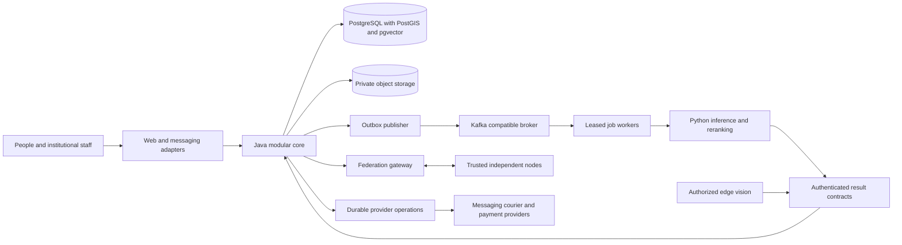

# Architecture baseline

Accepted design on 2026-10-26 after the mandatory source-audit gate passed. This document and [ADRs 0002–0027](../adr/README.md) govern implementation. At baseline acceptance no application existed. M2, scoped M3 and the first M4 asynchronous text-fingerprint slice are implemented; see [current status](../../STATUS.md) and [acceptance evidence](acceptance.md). Remaining scenarios are obligations rather than executed results. Exact runtime versions remain subject to [dependency adoption](dependency-adoption.md).

## Authority and supplied documents

The [specification](../dzoka.md), [invariants](../../AGENTS.md), accepted ADRs and this baseline take precedence over conflicting supplied diagrams or illustrative snippets. The original architecture/design documents and `ARCHITECTURE.png` remain intact as detailed research. Specifically:

| Supplied ambiguity | Accepted resolution |
|---|---|
| Diagram presents domain microservices and Qdrant primary | One modular Java core; PostgreSQL is authoritative and pgvector is default. Qdrant is an optional required adapter |
| AI-to-database arrows could imply unrestricted writes | Only core application services write authoritative domain tables. Workers submit validated, versioned results through authenticated core contracts |
| Many named services imply mandatory separate deployments | Names primarily denote modules/worker roles. Split only for runtime, trust, hardware or measured scaling requirements |
| Examples contain a floating match/confidence score | Rank, evidence similarity, coverage, calibrated confidence, verification and release are distinct typed results |
| A single item state mixes matching and physical custody | Claim, verification, authorization, physical custody and case lifecycle have separate state machines |
| Model/provider names alone identify vectors | Full embedding-space key includes artifact and preprocessing versions, dimensions, metric and normalization |
| Append-oriented history implies retaining PII forever | Preserve minimal audit facts; governed erasure/expiry applies to raw inputs, secret evidence and derivatives, with legal-hold exceptions |

## System and deployment boundaries

People report through web/PWA, institutional staff interfaces or authenticated messaging integrations. Institutions retain custody authority; a courier holds temporary custody, and an IdP authenticates people without proving ownership. Federation peers are independent authorities for their own holdings. AI outputs remain derived evidence.

The smallest production topology has a core API, core worker/publisher roles, Python AI workers, web assets, PostgreSQL, private S3-compatible object storage and a Kafka-compatible broker. Roles may share a codebase/image while retaining distinct credentials. An external or self-hosted OIDC provider supplies authentication. GPU inference, federation gateway and edge nodes can deploy independently where justified. Redis is optional for ephemeral acceleration; it is never authoritative for token consumption, idempotency or release. No Kubernetes requirement for development; Compose is the small-node target and Helm the larger deployment target. Neither is implemented yet.

## Core module ownership

Each module has `domain`, `application`, `ports`, `adapters` and API packages as needed. Domain code depends on value objects and domain/application contracts, never framework/vendor implementations. Infrastructure implements ports. Cross-module orchestration uses public application interfaces under a defined transaction; no module reaches into another module's repository. The shared kernel contains only identifiers, clock abstractions and stable envelope primitives.

| Module group | Owns | Allowed collaboration |
|---|---|---|
| identity, tenancy, organizations, policy | external identity mapping, membership, scope, policy versions | every command resolves a trusted actor/tenant and checks local permissions |
| locations | canonical places, aliases, geofences, routes, uncertain spatial/time context | reports retain original values and resolution references |
| cases, items, reports | case lifecycle, physical item reference, immutable intake observations and revisions | reports may suggest identity links; matching cannot silently merge items |
| media | quarantine, scan/sanitization status, object manifests, derivatives, access grants | inference receives only approved task-scoped references |
| fingerprints | immutable evidence/provenance snapshots and active versions | matching reads authorized snapshots; workers propose results |
| matching | retrieval runs, candidate references, signals, conflicts, rank/coverage/calibration | claims receives candidate reference, never release approval |
| claims, verification, fraud | entitlement assertions, challenge sessions, evidence assessment, risk/holds | recovery evaluates current approved evidence and conflict state |
| recovery, custody | authorization, single-use handover, physical transfer and confirmation | critical commands coordinate atomically through module interfaces |
| messaging, notifications | conversations, anonymous relay, delivery operations | projections disclose only intended recipient data |
| federation, traceability | peer trust/query operations, minimized projections, EPCIS mappings | local policy authorizes every export |
| logistics, rewards | shipment operations, reconciled callbacks, balanced ledger | release/booking requires current recovery authorization as applicable |
| integrations, audit, analytics, ml-feedback | provider operations, minimal audit facts, permitted projections/labels | no derived read model can authorize domain changes |

## Domain model and transactional consistency

Use opaque UUID references; the first implementation must select one generator with collision/concurrency tests. UUID ordering is never authorization or proof of event order. A report is an observation; an item is a locally identified physical object; a case coordinates recovery; a match is a hypothesis; a claim asserts entitlement; a custodian controls possession. Cross-node references are `(nodeId, opaqueId)` and never imply a global item identity.

Tenant-owned persistence uses `(tenant_id, id)` keys/references, explicit versions and tenant-qualified foreign keys. Row policies reinforce repository predicates. Tenant context is transaction-local, missing context denies access, and application credentials cannot bypass policies. Migrations/admin roles are separate. Object, cache, vector, queue and provider accesses carry the same authorized tenant scope. Tenant ID is never accepted merely because the caller supplied it.

Mutation idempotency is scoped by tenant, authenticated actor/client, operation and key. Store request digest, operation state and safe response in PostgreSQL with a uniqueness constraint. Same key plus different request fails; concurrent same requests converge. Keys cover the provider retry/reconciliation horizon; expired records retain suppression where replay could repeat a physical/financial effect.

Most aggregate changes use optimistic versions. Commands that arbitrate competing release/transfer actions lock the item recovery record, recheck claim/verification versions, holds, policy and custody, then atomically persist domain changes, minimal audit and outbox. An authorization stores the evidence/policy snapshot but is revalidated when used. Locks have a consistent order. No network call occurs while holding this critical transaction. External operations follow durable intent/reconciliation records.

## Intake, media and inference

Intake commits exact raw submitted text/metadata, language, timezone and temporal uncertainty plus normalized revisions and outbox. Immutability means no silent normalization overwrite; expiry/erasure still follows policy. Media starts quarantined with generated keys, size/type limits and digest. Isolated decoders validate actual content, strip metadata where appropriate and create sanitized derivatives. Quarantined bytes never reach public previews or AI. Production sanitization/inference failure stays explicit.

Jobs bind tenant, report/media version, approved task/model, attempt lease, deadline and input digest. Core accepts a completion only from the assigned service grant with a current lease and matching immutable input/version. New inference appends a result; stale results cannot reactivate superseded/deleted inputs. Jobs have bounded retries/backoff, cancellation, poison-message quarantine and visible partial progress. Core/domain APIs provide authoritative result validation; Python has no general core database credentials.

An ItemFingerprint stores raw-source references, normalized attributes with provenance/reliability, protected identifiers, OCR, global/local visual descriptors, speech/text derivations, spatial/time uncertainty and explicit unavailable/failed states. Every inference stores provider, artifact/version/digest, preprocessing/configuration/prompt/schema versions, input digest, timestamp and task region. A complete vector-space key is required for comparison. Model activation and re-embedding use shadow evaluation, coverage checks and rollback rather than destructive replacement.

## Retrieval, matching and verification

Retrieve independently from exact protected identifiers, lexical/trigram text, compatible vectors and spatial/temporal context. Apply permission/visibility filters before retrieval wherever supported and reauthorize returned references before disclosure. Rank fusion uses route ranks, not unrelated metric magnitudes. Log route budgets, source versions, truncation and partial failures. Never call a timed-out route an empty successful result.

Compare reliable identity contradictions before accepting aggregate similarity; an uncertain OCR character is not a hard contradiction. Signal values distinguish unavailable, failed and not-applicable from observed mismatch. Available-evidence similarity uses reliability-weighted normalization; zero denominator gives unavailable. Coverage is computed separately against the applicable evidence policy. Group correlated derivatives to avoid false independence. Coarse retrieval is followed by bounded local comparisons/reranking. Calibration artifacts declare dataset/population, model/policy versions and validity; absent calibration means no probability claim.

Verification privately evaluates claimant knowledge, documents, prior evidence, entitlement and risk. Challenge suggestions cite protected evidence, exclude publicly disclosed facts and pass deterministic disclosure/attempt checks. AI may interpret an answer but cannot authorize recovery. Store encrypted response evidence or keyed exact-match digests appropriate to the evidence type; low-entropy answers must not use unkeyed hashes. Challenge attempts and disclosures are budgeted per item and actor as well as session.

## Critical recovery flow

| Stage | Authoritative result | Guard |
|---|---|---|
| Candidate | possible same-object reference | authorized evidence, no unresolved reliable identity contradiction |
| Claim submitted | entitlement assertion | authenticated/recoverable claimant context and item eligibility |
| Verification | passed, failed, inconclusive or review-required assessment | current private evidence, disclosure policy, risk and competing claims |
| Release authorization | purpose-bound expiring approval | current approved entitlement, no holds, local policy or accountable reviewer |
| Handover | token consumed and custody transition | recheck authorization, item version, staff/courier scope and token audience/expiry |
| Recovery confirmation | confirmed return/delivery outcome | required evidence and disputes resolved under local policy |
| Reward settlement | balanced settlement operation | separate reward terms, confirmed eligible outcome, payment reconciliation |

Claim states include draft, submitted, verifying, review-required, approved, rejected, withdrawn, expired and completed. Verification results and release approvals have independent validity/version. Physical custody covers with-finder, awaiting-receipt, received/stored, internal-transfer, ready-for-handover/courier, dispatched/with-courier, delivered/handed-over, returned, lost-from-custody, disposed and archived. Holds are orthogonal blockers, not an excuse to overwrite prior events. `matched`, `claim_pending` and `verified` remain workflow projections rather than physical locations. Delivery is not automatically confirmed owner receipt. Disposal needs retention/legal-hold and authorized staff checks.

Random single-use handover tokens bind tenant, item, authorization, recipient/action and expiry; persist keyed digests, not raw tokens. QR/OTP/token possession alone never bypasses current authorization. One item lock arbitrates competing authorizations/redemptions; unique constraints prevent multiple active entitlements. Custody events record sequence, previous/new custodian, location, actor, observed/recorded times, evidence, reason and authorization reference. Corrections append events. Offline transfers remain pending until server conflict checks; no offline unilateral release when current policy cannot be validated.

## Events, providers and failures

Integration envelopes carry event ID/type/schema, tenant, producer, aggregate reference/version, occurred/recorded time, correlation/causation, classification and minimized payload. Domain facts differ from job/provider commands. Outbox commit is atomic with state. Publisher acknowledgments can be ambiguous and duplicates are expected. Inbox uniqueness and effects commit together. Per-aggregate sequencing detects gaps; there is no assumed global order. Replay retains the original logical operation key for external effects.

ProviderOperation stores intent, request digest, stable key, attempts, deadline, provider reference and reconciliation state. States distinguish pending, submitted, confirmed, failed and unknown. On ambiguous timeout, reconcile before retrying a non-idempotent external call. Signed webhooks verify raw body/authenticity, timestamp and replay before mapping to authorized local state; events cannot trust caller-supplied role/tenant fields. Courier, payments, WhatsApp, notifications and cloud AI all have replaceable ports. Provider credentials remain secret references scoped by tenant/task.

Database outage blocks writes; broker outage leaves committed outbox pending and backpressures by configured queue limits; AI outage preserves reports and partial evidence; vector outage yields explicit partial/unavailable search; OIDC outage denies new authenticated operations without inventing identity; federation outage yields attributed partial results. No outage creates ownership approval, silently swaps production inference for a heuristic or drops authoritative data.

## Federation, privacy and edge

Gateway exchanges versioned signed, audience-bound, expiring minimized requests with approved peers. Protocol code waits for concrete canonicalization/signature/key-lifecycle review. Bound fan-out, bytes, concurrency, time and query disclosure; enforce replay suppression and trust revocation. Peers keep PII, secret answers and custody authority local. Remote ranks/scores retain origin/model/policy/calibration metadata and are never treated as globally comparable probabilities. Physical cross-node custody transfer uses a two-party correlated protocol with pending, accepted, committed or disputed outcomes; a network partition cannot create two locally final releases.

EPCIS is an optional projection adapter over native recovery events with explicit supported subset and no blanket conformance claim. Edge work requires expiring investigation grants for exact cameras/time/purpose. Video stays local; coarse sampling narrows windows, then authorized tracking/local evidence refines intervals. Gaps/occlusion remain uncertainty. No default facial recognition. Recovery graph learning uses confirmed events and separate inferred/predicted edges; next-state/time models require leakage-resistant evaluation and cannot establish custody.

## Security, operations and implementation sequence

Separate public, operational, restricted-PII and secret-verification projections. Never serialize domain entities wholesale. Audit privileged reads/exports and denials without raw answers, tokens, contacts or media. Encryption, OIDC/cryptography libraries, secrets managers, upload scanners and concrete framework versions require targeted adoption review. Key rotation, retention, tombstones, legal holds and backup restore suppression must cover derivatives/indexes as well as source data.

Next implementation milestone starts with dependency adoption, reproducible build, pure domain/value objects and database/auth/tenant foundations. Follow with reports/media, provider jobs/fingerprints, retrieval/scoring, claims/verification/recovery, channels/custody and then the remaining federation, edge, traceability, intelligence, logistics, rewards, passports, feedback and analytics scope. [Acceptance scenarios](acceptance.md) define completion evidence; [milestones](milestones.md) preserve the complete feature order. No benchmark, deployment or production-readiness claim follows from this design alone.
