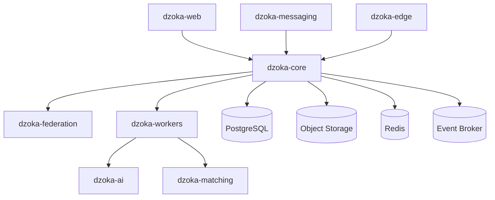

> **Current architecture authority (2026-10-26):** [Accepted baseline](../architecture/baseline.md) and its linked ADRs govern implementation. This supplied document is preserved below as detailed research/design material. Where examples or diagrams conflict with the baseline, use the baseline; no runtime capability is implied.

# Component Architecture

> **Dzoka — The Open Recovery Network**

This document defines the internal component architecture of Dzoka.

It decomposes the major deployable containers into application components, domain modules, internal services, ports, adapters, repositories, providers, workers, and policy boundaries.

This document answers:

- which components exist inside each container;
- which component owns each responsibility;
- which components may call one another;
- where domain boundaries exist;
- where provider abstractions live;
- which components are authoritative;
- which components produce derived evidence;
- where asynchronous boundaries occur;
- how Dzoka avoids turning into a distributed monolith.

This is the C4 **Component** level of the architecture.

---

# 1. Component Architecture Principles

Dzoka follows several component-level rules.

## 1.1 Domain logic lives in domain components

Business rules must not be embedded in:

- controllers;
- HTTP clients;
- message handlers;
- database repositories;
- UI code;
- AI prompts.

---

## 1.2 Components communicate through explicit contracts

Prefer:

```text
Component
   ↓
Application Service
   ↓
Port / Interface
   ↓
Adapter
```

instead of:

```text
Component
   ↓
random repository
   ↓
random database table
```

---

## 1.3 AI produces evidence, not authority

AI components may create:

```text
DerivedEvidence
InferenceResult
Embedding
DetectedFeature
ChallengeSuggestion
ClaimInterpretation
```

They may not independently create:

```text
OwnershipApproval
CustodyTransfer
RewardRelease
RecoveryAuthorization
```

---

## 1.4 Domain modules own their state transitions

Examples:

```text
Claims module
    owns claim lifecycle

Verification module
    owns verification lifecycle

Custody module
    owns custody lifecycle

Recovery module
    owns recovery completion

Reward module
    owns reward lifecycle
```

---

## 1.5 Cross-module calls should use application interfaces

A domain module should not reach directly into another module's internal repository.

---

# 2. Major Component View



The internal component breakdown of each container is described below.

---

# 3. `dzoka-core` Component Architecture

`dzoka-core` is the primary transactional application.

Recommended package structure:

```text
com.dzoka
├── identity
├── tenancy
├── organization
├── location
├── case
├── item
├── report
├── media
├── fingerprint
├── matching
├── claim
├── verification
├── fraud
├── custody
├── recovery
├── messaging
├── notification
├── logistics
├── reward
├── federation
├── traceability
├── policy
├── audit
├── integration
├── mlfeedback
└── shared
```

Each module should internally follow:

```text
domain/
application/
ports/
adapters/
api/
```

where practical.

---

# 4. Core Module Dependency Direction

Preferred dependency direction:

```text
API / Adapter
      ↓
Application
      ↓
Domain
      ↓
Ports
      ↓
Infrastructure Adapter
```

Domain code must not depend on:

- Spring controllers;
- JPA internals;
- Kafka client classes;
- vendor SDKs;
- AI SDKs;
- courier SDKs.

---

# 5. Identity Module

## Components

```text
IdentityController
IdentityApplicationService
UserService
ServiceIdentityService
IdentityRepository
OidcIdentityAdapter
```

Responsibilities:

- local user representation;
- external identity mapping;
- service identity mapping;
- account status;
- identity references;
- authentication context mapping.

Authentication itself is delegated to the OIDC provider.

---

# 6. Tenancy Module

Components:

```text
TenantService
TenantResolver
TenantContext
TenantPolicyService
TenantRepository
TenantIsolationGuard
```

Responsibilities:

- resolve tenant from request;
- enforce tenant boundaries;
- provide tenant configuration;
- prevent cross-tenant access;
- scope background jobs;
- scope vector search;
- scope object-storage paths.

Every tenant-aware request should obtain:

```text
TenantContext
```

early in the request lifecycle.

---

# 7. Organization Module

Components:

```text
OrganizationService
OrganizationUnitService
MembershipService
OrganizationPolicyService
OrganizationRepository
MembershipRepository
```

Responsibilities:

- organizations;
- departments;
- branches;
- staff memberships;
- operational units;
- organization hierarchy.

---

# 8. Location Module

Components:

```text
LocationService
LocationHierarchyService
LocationResolutionService
LocationAliasService
SpatialQueryService
RouteContextService
LocationRepository
```

Responsibilities:

- canonical locations;
- aliases;
- parent/child hierarchy;
- coordinates;
- geofences;
- facilities;
- routes;
- vehicles;
- location confidence.

Example:

```text
"Joina"
"Joina City"
"Joina City Harare"

        ↓

Canonical Location
```

---

# 9. Case Module

The Case module provides the top-level recovery process context.

Components:

```text
CaseApplicationService
CaseLifecycleService
CaseQueryService
CaseRepository
CasePolicy
```

Case aggregates may connect:

```text
reports
items
matches
claims
verification
custody
messages
shipments
recovery
```

The Case module should coordinate, not duplicate, state owned by other modules.

---

# 10. Item Module

Components:

```text
ItemApplicationService
ItemRegistryService
RegisteredItemService
ItemIdentifierService
ItemRepository
ItemIdentifierRepository
```

Responsibilities:

- physical-item records;
- registered possessions;
- persistent item identity;
- item lifecycle;
- protected identifiers;
- external asset IDs.

---

# 11. Report Module

Components:

```text
LostReportService
FoundReportService
ReportDraftService
ReportNormalizationCoordinator
ReportRepository
```

Report entities preserve:

```text
raw description
raw timestamps
raw location expression
raw channel message
```

AI-derived normalized information belongs alongside, not instead of, the raw evidence.

---

# 12. Media Module

Components:

```text
MediaService
MediaUploadService
MediaAccessService
MediaSanitizationCoordinator
MediaVisibilityService
MediaRepository
ObjectStoragePort
```

Responsibilities:

- upload authorization;
- signed URLs;
- media metadata;
- classification;
- privacy level;
- sanitization state;
- media provenance.

The module does not implement computer vision itself.

---

# 13. Fingerprint Module

One of the most important components in Dzoka.

Components:

```text
ItemFingerprintService
FingerprintAssembler
FingerprintVersionService
FingerprintQueryService
FingerprintRepository
EmbeddingReferenceRepository
```

The assembler consumes derived evidence from AI components.

Conceptually:

```text
Item
+
Report
+
Attributes
+
Vision Evidence
+
OCR
+
Embeddings
+
Protected Identity
+
Context

        ↓

ItemFingerprint
```

---

# 14. Fingerprint Component Boundary

`FingerprintAssembler` is responsible for canonical composition.

It does not generate embeddings itself.

Example:

```text
Embedding Worker
      ↓
EmbeddingRecord

OCR Worker
      ↓
OCR Evidence

Vision Worker
      ↓
Visual Evidence

FingerprintAssembler
      ↓
ItemFingerprint
```

---

# 15. Matching Domain Integration Component

The core does not implement the heavy matching algorithm directly.

Core-side components:

```text
MatchingOrchestrationService
MatchCandidateService
MatchEvidenceService
MatchDecisionService
MatchingRunRepository
MatchCandidateRepository
MatchEvidenceRepository
```

Responsibilities:

- request matching;
- persist matching runs;
- store candidates;
- expose match review;
- record human decisions;
- generate events.

---

# 16. Claim Module

Components:

```text
ClaimApplicationService
ClaimLifecycleService
ClaimEvidenceService
ClaimConflictService
ClaimRepository
ClaimEvidenceRepository
```

Possible claim lifecycle:

```text
DRAFT
  ↓
SUBMITTED
  ↓
UNDER_REVIEW
  ↓
VERIFICATION_REQUIRED
  ↓
APPROVED / REJECTED / WITHDRAWN / CONFLICT
```

---

# 17. Verification Module

Components:

```text
VerificationService
OwnershipChallengeService
ChallengeSelectionService
VerificationEvidenceService
VerificationDecisionService
VerificationPolicy
VerificationRepository
ChallengeRepository
```

Responsibilities:

- ownership challenge lifecycle;
- evidence collection;
- evidence interpretation;
- challenge scoring;
- human-review requirements;
- ownership decision state.

---

# 18. Verification Authority Rule

Only:

```text
VerificationDecisionService
```

may produce domain-level verification outcomes.

AI output enters as:

```text
VerificationEvidence
```

not as:

```text
OwnershipApproved
```

---

# 19. Fraud Module

Components:

```text
ClaimRiskService
FraudSignalCollector
FraudRuleEngine
FraudModelPort
FraudReviewService
FraudRepository
```

Inputs may include:

```text
claim history
failed challenges
account behaviour
device signals
network signals
location plausibility
duplicate evidence
```

Outputs:

```text
ClaimRiskAssessment
```

---

# 20. Custody Module

Components:

```text
CustodyService
CustodyTransferService
CustodyPolicy
CustodyEventService
CustodyRepository
```

Custody is modeled append-first.

Example:

```text
Finder
 ↓
Security Desk
 ↓
Lost Property Office
 ↓
Courier
 ↓
Owner
```

Each transition generates a durable event.

---

# 21. Handover Component

Components:

```text
HandoverService
HandoverTokenService
OtpService
QrHandoverService
HandoverPolicy
```

Responsibilities:

- one-time handover tokens;
- OTP generation;
- expiration;
- replay protection;
- confirmation.

---

# 22. Recovery Module

Components:

```text
RecoveryService
RecoveryAuthorizationService
RecoveryCompletionService
RecoveryPolicy
RecoveryRepository
```

The Recovery module answers:

```text
Is this item legally/policy-wise ready for release?
```

It considers:

- ownership verification;
- custody;
- fraud status;
- organization policy;
- courier state;
- handover state.

---

# 23. Recovery Authorization

The authorization component may combine:

```text
VerificationResult
+
FraudResult
+
CustodyState
+
OrganizationPolicy
+
ReviewerApproval
```

to produce:

```text
RecoveryAuthorization
```

This is intentionally separate from AI.

---

# 24. Reward Module

Components:

```text
RewardService
RewardOfferService
RewardLedgerService
RewardReleaseService
PaymentPort
EscrowPort
RewardRepository
```

Reward state example:

```text
OFFERED
  ↓
AUTHORIZED
  ↓
RESERVED
  ↓
RECOVERY_PENDING
  ↓
RELEASED
```

or:

```text
CANCELLED
REFUNDED
FAILED
```

---

# 25. Logistics Module

Components:

```text
LogisticsService
CourierQuoteService
ShipmentService
DeliveryTrackingService
CourierWebhookService
CourierProviderPort
ShipmentRepository
```

Courier provider implementations live in adapters.

Example:

```text
CourierProviderPort
├── MockCourierAdapter
├── ProviderAAdapter
└── ProviderBAdapter
```

---

# 26. Messaging Domain Module

This differs from the external `dzoka-messaging` gateway.

Core components:

```text
ConversationService
RecoveryChatService
MessagePolicyService
ConversationRepository
MessageRepository
```

Responsibilities:

- secure relay;
- conversation authorization;
- moderation state;
- retention;
- domain conversation rules.

---

# 27. Notification Module

Components:

```text
NotificationService
NotificationTemplateService
NotificationPreferenceService
NotificationDispatchPort
NotificationRepository
```

Notification delivery itself is delegated to the messaging gateway.

---

# 28. Federation Domain Module

Core-side components:

```text
FederatedSearchService
FederatedCandidateService
FederationPolicyService
FederationCaseService
PeerDirectoryPort
FederationGatewayPort
```

The Core module decides:

```text
whether federation is allowed
what may be shared
which data classification applies
```

The gateway handles network protocol mechanics.

---

# 29. Traceability Module

Components:

```text
RecoveryEventService
TraceabilityQueryService
EpcisMappingService
RecoveryEventRepository
EpcisPort
```

Internal recovery events remain domain-native.

Example:

```text
ITEM_FOUND
CUSTODY_TRANSFERRED
OWNERSHIP_VERIFIED
ITEM_RETURNED
```

The EPCIS adapter translates where appropriate.

---

# 30. Policy Module

Components:

```text
PolicyDecisionService
AuthorizationPolicyService
RecoveryPolicyService
FederationPolicyService
RetentionPolicyService
PolicyEnginePort
```

Possible adapter:

```text
OpaPolicyAdapter
```

Policies may be evaluated locally if OPA is not deployed.

---

# 31. Audit Module

Components:

```text
AuditService
AuditEventFactory
AuditQueryService
AuditRepository
```

Audit records must capture:

```text
actor
action
entity
timestamp
tenant
request
correlation ID
before/after where appropriate
```

Secret values must not be dumped blindly into audit logs.

---

# 32. ML Feedback Module

Components:

```text
MatchFeedbackService
VerificationFeedbackService
RecoveryOutcomeService
DatasetContributionService
MlFeedbackRepository
```

Outputs form ground truth for later model evaluation.

---

# 33. `dzoka-ai` Component Architecture

Recommended package structure:

```text
dzoka_ai/
├── api/
├── orchestration/
├── providers/
├── vision/
├── ocr/
├── speech/
├── translation/
├── extraction/
├── embeddings/
├── local_features/
├── challenges/
├── claim_interpretation/
├── privacy/
├── models/
└── telemetry/
```

---

# 34. AI Orchestrator

Component:

```text
AIEnrichmentOrchestrator
```

Coordinates independent inference tasks.

Example:

```text
Media
 ├── OCR
 ├── object detection
 ├── image embedding
 ├── local feature extraction
 └── visual attribute extraction
```

These should run in parallel where possible.

---

# 35. Detection Component

Components:

```text
ObjectDetectionService
DetectionProvider
DetectionResultNormalizer
```

Providers:

```text
PaddleDetectionProvider
Detectron2Provider
UltralyticsProvider optional
```

Normalized output:

```text
DetectedObject
├── label
├── confidence
├── bounding_box
├── provider
├── model
└── version
```

---

# 36. Segmentation Component

Components:

```text
SegmentationService
SegmentationProvider
MaskNormalizer
```

Segmentation is used when object isolation improves:

- visual embeddings;
- distinctive-region extraction;
- background removal;
- privacy.

---

# 37. OCR Component

Components:

```text
OCRService
OCRProvider
OCRNormalizer
SensitiveTextDetector
```

Default provider candidate:

```text
PaddleOCRProvider
```

OCR results include:

```text
text
bounding boxes
confidence
language
model/version
```

---

# 38. Speech Component

Components:

```text
SpeechTranscriptionService
SpeechProvider
TranscriptNormalizer
LanguageDetectionService
```

Possible providers:

```text
FasterWhisperProvider
ExternalSpeechProvider
```

---

# 39. Translation Component

Components:

```text
TranslationService
TranslationProvider
CanonicalLanguageService
```

Raw source text remains untouched.

Translation output is derived evidence.

---

# 40. Attribute Extraction Component

Components:

```text
AttributeExtractionService
StructuredExtractionProvider
AttributeSchemaRegistry
AttributeNormalizer
```

Produces attributes such as:

```text
category
brand
model
colour
material
size
distinctive features
serial candidates
```

Attributes must include:

```text
source
confidence
provenance
```

---

# 41. Global Embedding Component

Components:

```text
ImageEmbeddingService
TextEmbeddingService
MultimodalEmbeddingProvider
EmbeddingVersionRegistry
```

Possible provider:

```text
OpenClipProvider
```

Vectors from different model versions must never be mixed implicitly.

---

# 42. Local Feature Component

This is a critical same-instance component.

Components:

```text
LocalFeatureService
PatchExtractor
PatchEmbeddingProvider
DistinctiveRegionSelector
PatchAggregationService
```

Inspired by:

- Patchwise Retrieval;
- ILIAS;
- instance-level retrieval techniques.

Produces:

```text
local patches
patch embeddings
distinctive regions
local confidence
```

---

# 43. Distinctive Feature Component

Components:

```text
DistinctiveFeatureService
DefectDetector
StickerDetector
WearPatternExtractor
VisualFeatureDescriptionService
```

The goal is not merely:

```text
"This is a laptop"
```

but:

```text
"black Lenovo laptop with a yellow underside sticker,
missing right rubber foot and scratch beside USB-C port"
```

---

# 44. Challenge Generation Component

Components:

```text
ChallengeGenerationService
ChallengeCandidateSelector
ChallengeSafetyFilter
ChallengeDisclosureGuard
LLMChallengeProvider
```

It must ensure a challenge:

- does not leak the answer;
- uses non-public evidence;
- is sufficiently discriminative;
- is answerable;
- avoids unnecessarily sensitive information.

---

# 45. Claim Interpretation Component

Components:

```text
ClaimAnswerInterpretationService
SemanticAnswerComparator
LLMClaimInterpretationProvider
```

Its output is:

```text
ClaimInterpretationEvidence
```

not a final ownership decision.

---

# 46. AI Privacy Component

Components:

```text
FaceDetectionService
PlateDetectionService
DocumentSensitiveRegionService
MediaRedactionService
MetadataSanitizationService
```

This component creates public-safe derivatives.

---

# 47. `dzoka-matching` Component Architecture

Recommended structure:

```text
matching/
├── retrieval/
├── fusion/
├── conflicts/
├── features/
├── scoring/
├── reranking/
├── confidence/
├── explainability/
├── calibration/
├── providers/
├── evaluation/
└── api/
```

---

# 48. Candidate Retrieval Component

Components:

```text
CandidateRetrievalService
RetrievalStrategy
RetrievalCoordinator
```

Strategies:

```text
ExactIdentifierRetriever
CategoryRetriever
AttributeRetriever
LexicalRetriever
TrigramRetriever
SemanticVectorRetriever
ImageVectorRetriever
TextToImageRetriever
GeoRetriever
TemporalRetriever
DistinctiveFeatureRetriever
FederatedCandidateRetriever
```

Each strategy returns:

```text
CandidateReference
retrieval_score
retrieval_route
evidence
```

---

# 49. Retrieval Fusion Component

Components:

```text
RankFusionService
ReciprocalRankFusionStrategy
CandidateDeduplicator
```

Purpose:

combine candidate sets from multiple retrieval routes without assuming raw retrieval scores are directly comparable.

---

# 50. Hard Conflict Component

Components:

```text
ConflictEngine
ConflictRuleRegistry
ConflictComparator
ConflictPolicy
```

Rules may include:

```text
IMEI mismatch
serial mismatch
passport mismatch
model tier mismatch
brand mismatch
category incompatibility
chronology violation
```

Produces:

```text
MatchConflict
├── severity
├── field
├── evidence
├── penalty
└── reject
```

---

# 51. Feature Scoring Component

Components:

```text
FeatureScoringService
CategoryFeatureScorer
AttributeFeatureScorer
LocationFeatureScorer
TemporalFeatureScorer
DistinctiveFeatureScorer
SemanticFeatureScorer
LexicalFeatureScorer
ImageFeatureScorer
LocalVisualFeatureScorer
OcrFeatureScorer
ProvenanceFeatureScorer
MovementFeatureScorer
```

Each scorer returns:

```text
FeatureScore
```

---

# 52. FeatureScore Contract

```text
FeatureScore
├── feature
├── score
├── reliability
├── available
├── lost_value
├── found_value
├── relation
├── explanation
├── provenance
└── conflict
```

If unavailable:

```text
available = false
score = null
```

---

# 53. Score Aggregation Component

Components:

```text
ScoreAggregator
WeightProfileRegistry
EvidenceNormalizationService
CategoryWeightResolver
```

Important rule:

```text
available evidence only
```

is included in the denominator.

---

# 54. Evidence Coverage Component

Components:

```text
EvidenceCoverageService
IdentityEvidenceCoverageService
ConfidenceCapService
```

Coverage should measure:

- how many important dimensions are available;
- reliability of those dimensions;
- presence of identity-grade evidence.

---

# 55. Heavy Reranking Component

Components:

```text
CandidateReranker
GlobalVisualReranker
LocalPatchReranker
MultimodalReranker
CrossEncoderReranker
LLMReranker optional
```

Reranking should operate on a bounded shortlist.

---

# 56. Confidence Component

Components:

```text
MatchConfidenceService
ConfidenceCalibrationService
EvidenceQualityService
```

Produces:

```text
MatchConfidence
```

separately from:

```text
MatchScore
```

---

# 57. Explainability Component

Components:

```text
MatchExplanationService
EvidenceSummaryService
HumanReadableReasonBuilder
```

Explanations should be generated primarily from structured evidence.

An LLM may help wording but must not invent evidence.

---

# 58. Federated Candidate Calibration

Components:

```text
FederatedEvidenceNormalizer
RemoteCandidateCalibrator
FederatedRerankingService
```

Remote node raw scores are preserved but not merged directly.

---

# 59. Matching Evaluation Components

```text
MatchingBenchmarkRunner
RetrievalEvaluator
RerankingEvaluator
FalseMatchAnalyzer
DatasetLoader
```

Metrics include:

```text
Recall@K
Precision@K
MRR
NDCG
false-match rate
candidate-recall rate
```

---

# 60. `dzoka-messaging` Component Architecture

Recommended structure:

```text
messaging/
├── inbound/
├── outbound/
├── providers/
├── sessions/
├── media/
├── templates/
├── webhooks/
├── normalization/
└── telemetry/
```

---

# 61. Inbound Messaging Component

Components:

```text
InboundWebhookController
WebhookSignatureValidator
InboundMessageNormalizer
InboundMediaResolver
ConversationRouter
```

Responsibilities:

convert provider-specific inbound messages into canonical:

```text
InboundMessage
```

---

# 62. Conversation Session Component

Components:

```text
ConversationSessionService
ConversationStateMachine
SessionRepository
```

Redis may be used for temporary state.

Example:

```text
NEW
 ↓
REPORT_TYPE
 ↓
COLLECT_DESCRIPTION
 ↓
COLLECT_MEDIA
 ↓
COLLECT_LOCATION
 ↓
CONFIRM
```

---

# 63. Outbound Messaging Component

Components:

```text
OutboundMessageService
ChannelResolver
TemplateRenderer
DeliveryTracker
RetryService
```

---

# 64. Messaging Provider Components

```text
MessagingProvider
├── WhatsAppCloudAdapter
├── TwilioAdapter
├── SmsAdapter
├── EmailAdapter
└── PushAdapter
```

Vendor payloads remain inside adapters.

---

# 65. `dzoka-federation` Component Architecture

Recommended structure:

```text
federation/
├── identity/
├── trust/
├── protocol/
├── search/
├── transport/
├── signatures/
├── capabilities/
├── peers/
├── circuitbreaker/
├── audit/
└── api/
```

---

# 66. Node Identity Component

Components:

```text
NodeIdentityService
NodeKeyService
NodeCertificateService
NodeIdentifier
```

Node identity must be cryptographically verifiable.

---

# 67. Peer Trust Component

Components:

```text
PeerRegistry
PeerTrustService
PeerPolicyService
PeerStatusService
```

Possible trust states:

```text
PENDING
TRUSTED
RESTRICTED
SUSPENDED
REVOKED
```

---

# 68. Federation Signature Component

Components:

```text
MessageSigner
SignatureVerifier
NonceService
ReplayProtectionService
```

Every sensitive federation message should be attributable.

---

# 69. Federation Search Component

Components:

```text
FederatedSearchCoordinator
PeerSelector
SearchFanoutService
FederationTimeoutService
CandidateAggregator
```

Flow:

```text
Search Request
   ↓
Eligible peers
   ↓
parallel fan-out
   ↓
bounded timeout
   ↓
safe candidate responses
```

---

# 70. Circuit Breaker Component

Components:

```text
PeerCircuitBreaker
PeerFailureTracker
PeerHealthService
```

A failing node must not block the entire network.

---

# 71. Capability Negotiation Component

Components:

```text
CapabilityRegistry
ProtocolVersionService
CapabilityNegotiator
```

Example capabilities:

```text
VECTOR_SEARCH
IMAGE_SEARCH
EPCIS
CUSTODY_TRANSFER
REMOTE_VERIFICATION
CCTV_MATCH
```

---

# 72. `dzoka-edge` Component Architecture

Recommended structure:

```text
edge/
├── camera/
├── video/
├── search/
├── detection/
├── tracking/
├── reid/
├── privacy/
├── evidence/
├── connectors/
├── storage/
└── sync/
```

---

# 73. Camera Connector Component

Components:

```text
CameraRegistry
VmsConnector
OnvifConnector
RecordingSource
```

The connector translates camera/VMS-specific APIs.

---

# 74. Video Search Component

Components:

```text
DisappearanceSearchService
TemporalSamplingService
PresenceDetector
TemporalBracketService
```

Implements coarse-to-fine search:

```text
days
 ↓
hours
 ↓
minutes
 ↓
seconds
```

---

# 75. Tracking Component

Components:

```text
TrackingService
ObjectTrackerProvider
AppearanceEncoder
TrackStateManager
```

Potential provider implementations:

```text
ByteTrackProvider
DeepSortProvider
```

---

# 76. ReID Component

Components:

```text
ObjectReIdentificationService
AppearanceEmbeddingProvider
TrackSimilarityService
```

Used only where object re-identification adds value.

---

# 77. Edge Evidence Component

Components:

```text
EdgeEvidenceBuilder
EvidenceClipGenerator
ObjectCropGenerator
TrajectorySummaryBuilder
```

Produces minimized evidence for central Dzoka.

---

# 78. Edge Privacy Component

Components:

```text
FaceRedactor
PlateRedactor
PrivacyZoneMasker
EdgeRetentionService
```

---

# 79. Edge Sync Component

Components:

```text
EdgeSyncService
OfflineQueue
UploadRetryService
CentralNodeClient
```

Supports intermittent connectivity.

---

# 80. `dzoka-workers` Component Architecture

Recommended structure:

```text
workers/
├── enrichment/
├── matching/
├── media/
├── notification/
├── federation/
├── logistics/
├── rewards/
├── retention/
├── analytics/
└── mlfeedback/
```

---

# 81. Worker Base Component

Common components:

```text
EventConsumer
IdempotencyGuard
RetryPolicy
DeadLetterPublisher
CorrelationContext
WorkerTelemetry
```

Every worker must implement the same operational guarantees.

---

# 82. Enrichment Worker

Flow:

```text
item.reported
    ↓
request AI enrichment
    ↓
persist derived evidence
    ↓
check enrichment completion
    ↓
build fingerprint
    ↓
fingerprint.ready
```

---

# 83. Matching Worker

Flow:

```text
fingerprint.ready
    ↓
invoke dzoka-matching
    ↓
persist candidates/evidence
    ↓
matching.completed
```

---

# 84. Notification Worker

Flow:

```text
notification.requested
     ↓
resolve channel
     ↓
render template
     ↓
dzoka-messaging
     ↓
delivery result
```

---

# 85. Federation Worker

Handles asynchronous federation fan-out where immediate synchronous responses are not required.

---

# 86. Logistics Worker

Handles:

```text
courier quote refresh
shipment creation
webhook reconciliation
tracking refresh
delivery confirmation
```

---

# 87. Reward Worker

Handles:

```text
payment authorization
reservation
release
refund
reconciliation
```

Must be idempotent.

---

# 88. Retention Worker

Responsibilities:

```text
expire temporary evidence
purge eligible media
remove federation cache
enforce retention policies
archive old cases
```

Retention policy must be data-class aware.

---

# 89. ML Feedback Worker

Flow:

```text
confirmed/rejected candidate
        ↓
label generation
        ↓
dataset contribution
        ↓
evaluation queue
```

---

# 90. Cross-Component Call Rules

Allowed primary directions:

```text
Controller
    ↓
Application Service
    ↓
Domain Service
    ↓
Port
    ↓
Adapter
```

Module-to-module communication should occur through:

```text
application interfaces
domain events
well-defined query services
```

---

# 91. Prohibited Coupling

Avoid:

```text
ClaimRepository
directly updating Custody tables

AI service
directly approving claims

Messaging gateway
directly writing recovery state

Federation gateway
directly mutating item ownership

Frontend
calculating match confidence

Courier webhook
directly releasing reward
```

---

# 92. Example Correct Ownership Flow

```text
ClaimController
    ↓
ClaimApplicationService
    ↓
ClaimLifecycleService
    ↓
VerificationService
    ↓
FraudRiskService
    ↓
PolicyDecisionService
    ↓
RecoveryAuthorizationService
```

Each component retains its own responsibility.

---

# 93. Domain Event Components

Each module may publish domain events.

Example:

```text
ClaimSubmitted
OwnershipVerified
CustodyTransferred
RecoveryAuthorized
ItemReturned
```

A:

```text
DomainEventPublisher
```

writes through the transactional outbox.

---

# 94. Outbox Components

```text
OutboxService
OutboxRepository
OutboxPublisher
```

Flow:

```text
transaction
  ├── update domain
  └── insert outbox event

commit

outbox publisher
   ↓
Kafka
```

This prevents DB/event inconsistencies.

---

# 95. Inbox Components

For critical external/federated/event consumption:

```text
InboxService
InboxRepository
DuplicateEventGuard
```

This supports idempotent processing.

---

# 96. Provider Registry Pattern

For interchangeable dependencies, use registries/factories.

Example:

```text
LLMProviderRegistry
    ├── OpenAICompatibleProvider
    ├── OllamaProvider
    └── VllmProvider
```

Runtime configuration selects the active provider.

---

# 97. Model Registry Component

Inside AI:

```text
ModelRegistry
ModelManifestLoader
ModelCapabilityRegistry
```

Each model manifest should include:

```text
provider
model
version
task
dimensions
license
hardware requirements
status
```

---

# 98. Feature Flag Component

Components:

```text
FeatureFlagService
TenantFeatureResolver
FeatureFlagRepository
```

Potential flags:

```text
FEDERATION
CCTV
AI_CHALLENGES
REWARDS
COURIER
MOVEMENT_INTELLIGENCE
EXPERIMENTAL_RERANKER
```

---

# 99. Movement Intelligence Components

Likely located initially in `dzoka-matching` or an intelligence package.

Components:

```text
RecoveryGraphService
TransitionFeatureBuilder
RecoveryTransitionModel
NextStatePredictionService
RecoveryPathRankingService
```

Inputs:

```text
item type
organization
route
location
custodian
time
historical events
```

Outputs:

```text
likely next state
likely location
expected transition time
confidence
```

---

# 100. Recovery Graph Component

Components:

```text
RecoveryGraphProjector
RecoveryGraphQueryService
RecoveryRelationshipRepository
```

Initial implementation:

```text
PostgreSQL
```

not a graph database.

---

# 101. Analytics Components

```text
RecoveryMetricsService
OperationalAnalyticsService
HotspotAnalyticsService
FederationAnalyticsService
AnalyticsProjectionWorker
```

Analytics should normally read projections, not overload transactional query paths.

---

# 102. Read Model Components

Where useful, introduce projections:

```text
CaseSummaryProjection
MatchReviewProjection
CustodyDashboardProjection
RecoveryAnalyticsProjection
```

This can improve staff dashboard performance without compromising transactional models.

---

# 103. API Component Layout

Inside `dzoka-core`:

```text
api/
├── public/
├── user/
├── staff/
├── admin/
├── partner/
└── internal/
```

Do not expose internal endpoints through public routing.

---

# 104. Public API Components

Examples:

```text
PublicReportController
PublicSearchController
PublicCaseStatusController
```

Public responses must pass through:

```text
PublicDataProjectionService
```

to prevent secret evidence leakage.

---

# 105. Staff API Components

Examples:

```text
MatchReviewController
ClaimReviewController
CustodyController
RecoveryController
FraudReviewController
CctvInvestigationController
```

---

# 106. Admin API Components

Examples:

```text
TenantAdminController
OrganizationAdminController
FederationAdminController
ModelAdminController
IntegrationAdminController
RetentionAdminController
```

---

# 107. Internal API Components

Used only for trusted service communication.

Examples:

```text
InternalMatchingController
InternalMediaController
InternalFederationController
InternalWorkerController
```

These must not rely solely on obscurity for protection.

---

# 108. Component-Level Authorization

Controllers should not implement business authorization manually.

Preferred:

```text
Request
   ↓
Authentication
   ↓
TenantContext
   ↓
AuthorizationPolicyService
   ↓
Application Service
```

---

# 109. Secret Data Access Component

Introduce:

```text
SensitiveDataAccessService
```

for operations involving:

```text
full serial number
IMEI
identity evidence
receipts
private challenge answers
```

This service should:

- authorize access;
- decrypt when necessary;
- audit access;
- minimize returned fields.

---

# 110. Protected Identifier Component

Components:

```text
ProtectedIdentifierService
IdentifierHashService
IdentifierEncryptionService
IdentifierMatcher
```

Where equality comparison is sufficient:

```text
normalized identifier
      ↓
keyed hash
      ↓
matching
```

Plain identifiers should not be used casually.

---

# 111. Encryption Components

```text
FieldEncryptionService
KeyManagementPort
EnvelopeEncryptionService
```

Keys should be externalized from application data.

---

# 112. Privacy Projection Components

```text
PublicItemProjection
RestrictedItemProjection
SecretEvidenceProjection
```

Different callers receive different projections of the same underlying item.

---

# 113. Search Privacy Component

Components:

```text
PublicSearchPolicy
CandidateDisclosureService
ImageDisclosureService
```

Example:

A public candidate may show:

```text
black Lenovo backpack
found in central Harare
safe photo
```

but hide:

```text
serial
yellow inside sticker
finder identity
exact custody room
```

---

# 114. Integration Components

Recommended structure:

```text
integration/
├── couriers/
├── payments/
├── identity/
├── messaging/
├── storage/
├── mapping/
├── epcis/
├── institutional/
└── assetregistry/
```

Every external integration implements a domain port.

---

# 115. Webhook Component

Components:

```text
WebhookController
WebhookSignatureService
WebhookReplayGuard
WebhookNormalizer
WebhookDispatchService
```

All webhooks must be treated as untrusted input.

---

# 116. Idempotency Component

Central shared components:

```text
IdempotencyService
IdempotencyKeyRepository
IdempotentOperationGuard
```

Required for:

```text
payments
courier booking
custody transfer
claim submission
handover
federation
webhooks
```

---

# 117. Correlation Component

Shared:

```text
CorrelationContext
CorrelationIdFilter
EventCorrelationPropagator
```

Every request/event should preserve traceability across components.

---

# 118. Error Component

Use canonical error types.

Example:

```text
ValidationError
AuthorizationError
ConflictError
NotFoundError
ExternalProviderError
RetryableInfrastructureError
PolicyViolationError
```

Do not expose raw stack traces through external APIs.

---

# 119. Configuration Component

```text
ConfigurationService
TenantConfigurationService
ProviderConfigurationService
FeatureConfigurationService
```

Configuration should be validated on startup where possible.

---

# 120. Component Health

Each major provider component should expose health information.

Examples:

```text
PostgreSQLHealthIndicator
KafkaHealthIndicator
ObjectStorageHealthIndicator
AiProviderHealthIndicator
FederationPeerHealthIndicator
CourierHealthIndicator
```

Optional integrations should not necessarily make the entire core unready.

---

# 121. Observability Component

Shared component:

```text
TelemetryService
MetricsRecorder
TraceContext
StructuredLogger
```

Business-relevant metrics should be explicit.

Example:

```text
dzoka_match_candidates_generated
dzoka_claims_verified
dzoka_cases_recovered
dzoka_federation_query_duration
dzoka_ai_inference_duration
```

---

# 122. Component Testing Strategy

Each component should have:

```text
unit tests
contract tests
integration tests where infrastructure is involved
```

Provider implementations should have shared contract tests.

Example:

```text
VectorSearchProviderContractTest
```

must run against:

```text
PgVectorProvider
QdrantProvider
```

---

# 123. Provider Contract Testing

Similarly:

```text
MessagingProviderContract
CourierProviderContract
PaymentProviderContract
OCRProviderContract
EmbeddingProviderContract
```

This prevents abstraction interfaces from becoming theoretical only.

---

# 124. Matching Golden Tests

The matching engine should maintain deterministic golden datasets.

Examples:

```text
same item, different angle
same category, different item
missing photo
contradictory IMEI
nearby location
far location with valid transport route
weak evidence
strong distinctive mark
```

---

# 125. Verification Golden Tests

Cases should include:

```text
correct hidden detail
partially correct answer
publicly guessable answer
wrong serial
receipt matches
conflicting claims
brute-force answers
```

---

# 126. Component Security Tests

Test:

```text
cross-tenant access
secret projection leaks
unauthorized challenge access
federation privilege escalation
replayed handover token
replayed webhook
cross-case evidence access
```

---

# 127. Source Audit Traceability

Components influenced by external repositories should link back to:

```text
docs/source-audit/
```

Example:

```text
CandidateRetrievalService
    ← globalenglish01/lostfound

LocalFeatureService
    ← Patchwise Retrieval
    ← ILIAS

DisappearanceSearchService
    ← cctv-theft-finder

FederatedSearchCoordinator
    ← Mycel concepts

Traceability module
    ← OpenEPCIS
```

This does not imply code copying.

---

# 128. Component Ownership Matrix

| Component | Container | Authority |
|---|---|---|
| CaseLifecycleService | core | authoritative |
| ItemFingerprintService | core | authoritative composition |
| AIEnrichmentOrchestrator | ai | derived evidence |
| CandidateRetrievalService | matching | derived candidates |
| VerificationDecisionService | core | authoritative |
| ClaimRiskService | core | derived risk + policy input |
| CustodyService | core | authoritative |
| RecoveryAuthorizationService | core | authoritative |
| Messaging Provider | messaging | delivery only |
| Federation Gateway | federation | transport/trust |
| Edge Search | edge | derived CCTV evidence |
| Courier Adapter | core/worker | external integration |
| Reward Ledger | core | authoritative |
| ML Feedback | core/worker | derived learning data |

---

# 129. Internal Call Direction Summary

Preferred:

```text
Web/API
  ↓
Core Application Services
  ↓
Domain Components
  ↓
Ports
  ↓
Adapters
```

For asynchronous AI:

```text
Core
 ↓
Event
 ↓
Worker
 ↓
AI / Matching
 ↓
Derived Evidence
 ↓
Core Persistence
```

For federation:

```text
Core
 ↓
Federation Port
 ↓
Federation Gateway
 ↓
Remote Federation Gateway
 ↓
Remote Core
```

---

# 130. Component Boundary Invariants

Do not violate these without ADR review.

1. AI components cannot authorize release.
2. Matching components cannot approve ownership.
3. Messaging adapters cannot mutate domain state directly.
4. Federation transport cannot bypass federation policy.
5. Edge nodes cannot write arbitrary authoritative records.
6. Courier providers cannot complete recovery without handover policy.
7. Payment providers cannot release rewards without recovery state.
8. UI components cannot calculate authoritative trust decisions.
9. Repositories must remain module-owned.
10. Secret data access must be mediated and audited.
11. Provider SDKs must remain inside adapters.
12. External payload formats must not leak into core domain models.

---

# 131. Component Architecture Summary

```text
                              DZOKA CORE

 Identity ─ Tenancy ─ Organization ─ Location
                    │
                    ▼
              Case Management
                    │
          ┌─────────┼──────────┐
          ▼         ▼          ▼
       Reports     Items      Media
          │         │          │
          └─────────┼──────────┘
                    ▼
             Item Fingerprint
                    │
                    ▼
          Matching Orchestration
                    │
                    ▼
                  Claim
                    │
          ┌─────────┼──────────┐
          ▼         ▼          ▼
      Verification Fraud     Policy
          │         │          │
          └─────────┼──────────┘
                    ▼
          Recovery Authorization
                    │
             ┌──────┴───────┐
             ▼              ▼
          Custody        Logistics
             │              │
             └──────┬───────┘
                    ▼
                 Recovery
                    │
             ┌──────┴──────┐
             ▼             ▼
           Reward       ML Feedback
```

Specialized computation surrounds the core:

```text
dzoka-ai
    → perception and derived evidence

dzoka-matching
    → retrieval/ranking/conflicts

dzoka-messaging
    → channel adapters

dzoka-federation
    → cross-node trust and transport

dzoka-edge
    → local CCTV/edge intelligence

dzoka-workers
    → asynchronous orchestration
```

---

# 132. Final Component Principle

Dzoka's component architecture is designed around one central idea:

> **Authority and intelligence are deliberately separated.**

Intelligence components answer questions such as:

```text
What does this object look like?
What text is visible?
Which records are similar?
What evidence supports this candidate?
What next location is plausible?
What private question could distinguish the owner?
```

Authoritative domain components answer:

```text
Does this claim satisfy policy?
Who currently has custody?
May the item be released?
Has the item actually been returned?
Should a reward be released?
```

That separation is fundamental to making Dzoka explainable, secure, auditable, federated, and safe enough to operate as real-world recovery infrastructure.