> **Current architecture authority (2026-10-26):** [Accepted baseline](../architecture/baseline.md) and its linked ADRs govern implementation. This supplied document is preserved below as detailed research/design material. Where examples or diagrams conflict with the baseline, use the baseline; no runtime capability is implied.

# Container Architecture

> **Dzoka — The Open Recovery Network**

This document defines the **C4 Container Architecture** for Dzoka.

It decomposes the Dzoka system boundary into deployable applications, services, workers, databases, brokers, storage systems, observability components, and edge nodes.

This document answers:

- which deployable containers exist;
- what each container owns;
- how containers communicate;
- which containers may scale independently;
- which data stores are authoritative;
- which workloads are synchronous;
- which workloads are asynchronous;
- which components can be deployed independently;
- how SaaS, institutional and federated deployments differ.

---

# 1. Architectural Style

Dzoka uses a hybrid architecture:

```text
Transactional Core
        +
Specialized AI Services
        +
Asynchronous Workers
        +
Edge Processing
        +
Federation Gateway
```

The transactional core should remain a:

> **modular monolith**

unless a proven operational or scalability need justifies further decomposition.

This prevents premature microservice fragmentation.

Specialized components are separated when they have materially different:

- runtime requirements;
- programming-language requirements;
- scaling patterns;
- trust boundaries;
- hardware requirements;
- deployment locations.

---

# 2. Top-Level Container View

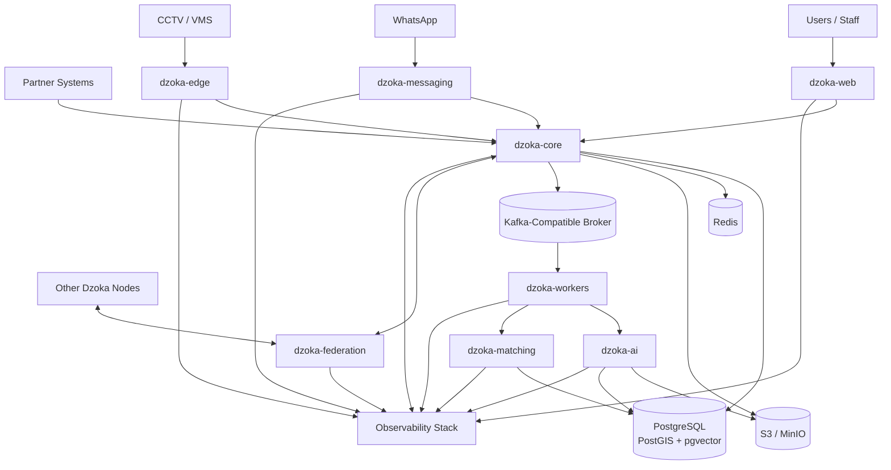

---

# 3. Container Inventory

The principal containers are:

```text
dzoka-web
dzoka-core
dzoka-ai
dzoka-matching
dzoka-messaging
dzoka-federation
dzoka-edge
dzoka-workers

postgresql
redis
object-storage
event-broker

observability-stack
identity-provider
```

Optional supporting containers may include:

```text
mlflow
qdrant
keycloak
prometheus
grafana
loki
tempo
otel-collector
```

---

# 4. `dzoka-web`

## Purpose

`dzoka-web` is the primary browser-based user interface.

Recommended technology:

```text
Next.js
TypeScript
React
PWA
```

It serves:

- individuals;
- finders;
- staff;
- reviewers;
- organization administrators;
- system administrators.

---

## Responsibilities

`dzoka-web` provides:

```text
public reporting
lost-item submission
found-item submission
media upload UX
candidate review
claim submission
ownership challenge UI
secure recovery messaging
pickup arrangements
courier tracking
reward management
case history
staff operations
custody management
match review
fraud review
federation administration
CCTV investigation UI
analytics
system administration
```

---

## Does Not Own

`dzoka-web` does not own:

- authoritative domain state;
- matching algorithms;
- verification policies;
- AI inference;
- custody state;
- authentication credentials.

Those remain server-side.

---

## Communication

Primary:

```text
HTTPS / JSON
```

to:

```text
dzoka-core
```

Optional:

```text
SSE
WebSocket
```

for:

- case updates;
- AI processing progress;
- live courier state;
- federation query progress;
- staff review queues.

---

# 5. `dzoka-core`

## Purpose

`dzoka-core` is the authoritative transactional application.

Recommended technology:

```text
Java 21+
Spring Boot
```

It should begin as a modular monolith.

---

## Domain Modules

```text
identity
tenancy
organizations
users
locations

cases
items
reports
registered-items
media
fingerprints

matching
claims
verification
fraud

custody
handover
recovery

messaging
notifications

logistics
rewards

federation
traceability

audit
policy

integrations
ml-feedback
```

---

# 6. Core Responsibilities

`dzoka-core` owns:

- transactional domain state;
- lifecycle state machines;
- authorization;
- tenant boundaries;
- case management;
- item records;
- claims;
- verification orchestration;
- custody;
- recovery authorization;
- handover;
- courier orchestration;
- rewards;
- recovery-event persistence;
- federation business rules;
- public APIs;
- integration APIs;
- audit.

---

# 7. Core Non-Responsibilities

`dzoka-core` should not perform heavy inference inside request threads.

It does not directly perform:

```text
large image inference
OCR
speech transcription
video analysis
heavy embedding generation
CCTV frame scanning
expensive multimodal reranking
large ML evaluation jobs
```

Those workloads are delegated asynchronously.

---

# 8. Core Persistence

Primary store:

```text
PostgreSQL
```

with:

```text
PostGIS
pgvector
pg_trgm
```

The core owns transactional writes.

AI containers may write derived data only through:

- controlled service APIs;
- event handlers;
- explicit repository ownership rules.

Shared-database access must not become uncontrolled cross-service coupling.

---

# 9. `dzoka-ai`

## Purpose

`dzoka-ai` implements perception and AI enrichment.

Recommended runtime:

```text
Python
FastAPI
```

---

## Responsibilities

```text
object detection
segmentation
OCR
speech transcription
language detection
translation
text normalization
attribute extraction
brand/model extraction
image embeddings
text embeddings
text-to-image embeddings
local patch embeddings
distinctive-region extraction
visual description
ownership challenge generation
claim-response interpretation
```

---

# 10. AI Provider Interfaces

`dzoka-ai` exposes internal provider abstractions such as:

```text
DetectionProvider
SegmentationProvider
OCRProvider
SpeechProvider
TranslationProvider
TextEmbeddingProvider
ImageEmbeddingProvider
LocalFeatureProvider
LLMProvider
```

Possible implementations include:

```text
PaddleDetection
Detectron2
OpenCLIP
PaddleOCR
faster-whisper
local sentence-transformers
ONNX Runtime
vLLM
Ollama
OpenAI-compatible APIs
```

---

# 11. AI Isolation

The AI container should be isolated because:

- dependencies are Python-heavy;
- GPU support may be required;
- AI scaling differs from transactional scaling;
- model updates should not require redeploying the core;
- memory requirements may be much larger;
- AI failures must not take down case creation.

---

# 12. AI API

Example internal endpoints:

```text
POST /internal/v1/vision/analyze
POST /internal/v1/ocr
POST /internal/v1/speech/transcribe
POST /internal/v1/text/embed
POST /internal/v1/image/embed
POST /internal/v1/fingerprint/enrich
POST /internal/v1/challenges/generate
POST /internal/v1/claims/interpret
```

Most calls should originate from workers.

The API is not intended to be public internet infrastructure.

---

# 13. `dzoka-matching`

## Purpose

`dzoka-matching` performs matching-specific computation.

This boundary exists because matching has its own:

- retrieval logic;
- scoring algorithms;
- feature engineering;
- reranking;
- benchmarks;
- model versions;
- scaling characteristics.

It may initially run within the same physical deployment as `dzoka-ai`, but should maintain an independent module/API contract.

---

# 14. Matching Responsibilities

```text
candidate generation
lexical retrieval
semantic retrieval
image retrieval
text-to-image retrieval
attribute retrieval
geo/time filtering
rank fusion
hard conflict detection
feature scoring
coverage calculation
heavy reranking
confidence
explanation generation
match experiment execution
```

---

# 15. Matching Pipeline

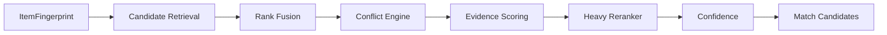

---

# 16. Vector Search Provider

`dzoka-matching` accesses vector search through:

```text
VectorSearchProvider
```

Implementations:

```text
PgVectorProvider
QdrantProvider
```

Default:

```text
PgVectorProvider
```

---

# 17. `dzoka-messaging`

## Purpose

`dzoka-messaging` isolates channel-specific communication.

It acts as the bridge between external communication providers and Dzoka domain workflows.

---

## Supported Channels

```text
WhatsApp
SMS
Email
Push
Webhook
```

---

# 18. Messaging Responsibilities

```text
incoming webhook validation
channel message normalization
media retrieval
conversation session state
outbound message formatting
template rendering
delivery tracking
retry
provider failover where supported
provider webhook processing
```

---

# 19. WhatsApp Container Flow

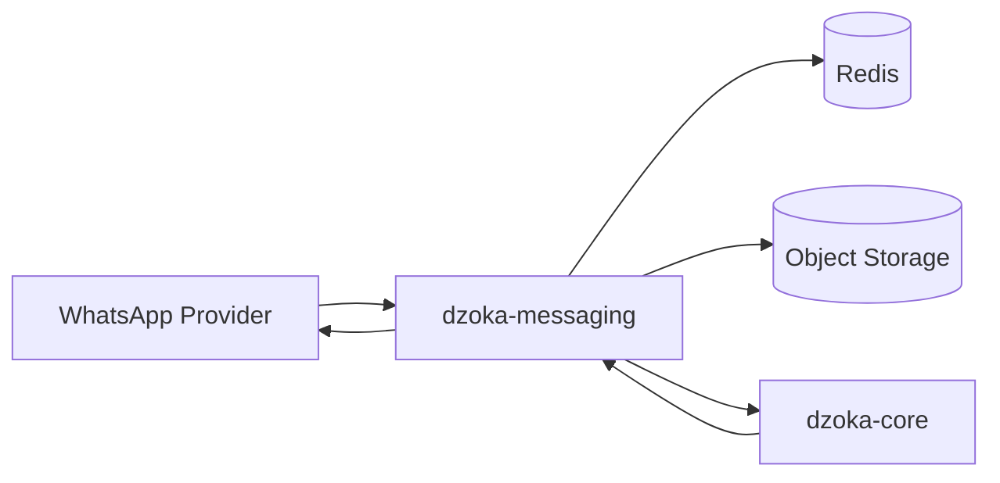

---

# 20. Messaging Domain Boundary

The gateway should normalize:

```text
Meta-specific payload
Twilio-specific payload
other provider payload
```

into a canonical internal message representation:

```text
InboundMessage
├── channel
├── provider
├── provider_message_id
├── sender_reference
├── conversation_reference
├── message_type
├── text
├── media[]
├── location
├── received_at
└── metadata
```

Domain logic should never operate directly on Twilio or Meta payloads.

---

# 21. `dzoka-federation`

## Purpose

`dzoka-federation` exposes the secure cross-node protocol.

It isolates federation-specific:

- cryptography;
- peer management;
- rate limiting;
- trust policy;
- protocol versioning;
- retry;
- circuit breaking.

---

# 22. Federation Responsibilities

```text
node identity
peer registration
peer trust
certificate/signing keys
request signing
signature verification
nonce validation
replay protection
federated search
candidate exchange
safe evidence retrieval
protocol version negotiation
capability negotiation
remote recovery messages
health checks
federation audit
```

---

# 23. Federation Traffic

Conceptual flow:

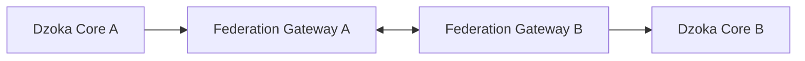

Core services should not communicate directly across organizational boundaries.

Federation gateways form the trust boundary.

---

# 24. Federation APIs

Possible operations:

```text
POST /federation/v1/search
POST /federation/v1/evidence/request
POST /federation/v1/verification/request
POST /federation/v1/custody/request
POST /federation/v1/recovery/confirm
GET  /federation/v1/capabilities
GET  /federation/v1/health
```

All federation operations must be:

- authenticated;
- signed;
- auditable;
- rate-limited;
- replay-safe.

---

# 25. `dzoka-edge`

## Purpose

`dzoka-edge` runs near cameras and local institutional systems.

It is optional.

It should be installable independently from the central Dzoka deployment.

---

# 26. Edge Responsibilities

```text
camera registration
VMS/NVR connectivity
authorized footage retrieval
local video indexing
reference-object selection
ROI definition
coarse-to-fine disappearance search
object detection
object tracking
local ReID
event extraction
privacy redaction
evidence packaging
secure result submission
```

---

# 27. Edge Privacy Principle

The edge should prefer:

```text
derived evidence
short relevant clips
object crops
event metadata
```

over:

```text
bulk raw CCTV uploads
```

Raw footage should normally remain inside the institutional trust boundary.

---

# 28. Edge Flow

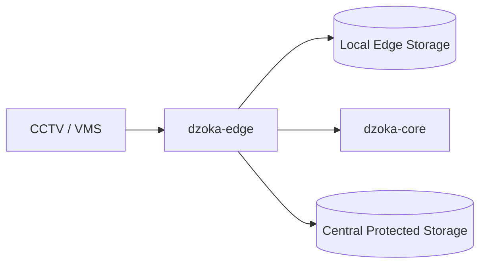

---

# 29. `dzoka-workers`

## Purpose

`dzoka-workers` executes asynchronous workflows.

Workers consume events and execute retriable background operations.

They may eventually be split by workload, but they should begin as a coherent worker deployment.

---

# 30. Worker Domains

Potential worker pools:

```text
enrichment-worker
matching-worker
notification-worker
federation-worker
logistics-worker
reward-worker
ml-feedback-worker
retention-worker
media-worker
```

---

# 31. Worker Event Flow

Example:

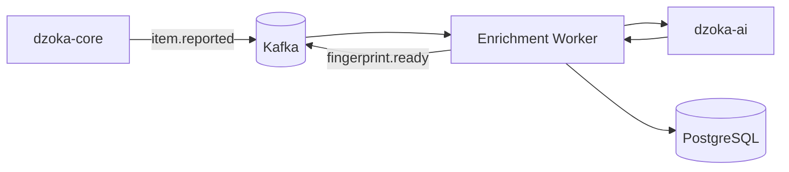

---

# 32. Worker Reliability

Workers must support:

```text
idempotent consumption
retry with backoff
dead-letter queue
failure reason
correlation ID
event versioning
duplicate protection
poison-message handling
```

---

# 33. PostgreSQL Container

## Purpose

PostgreSQL is the authoritative transactional data store.

Extensions:

```text
PostGIS
pgvector
pg_trgm
uuid support
```

---

# 34. PostgreSQL Data Domains

Major groups include:

```text
identity
tenancy
organization

cases
items
reports

locations

attributes
fingerprints
embeddings

matching
claims
verification
fraud

custody
recovery

federation

logistics
rewards

model metadata
feedback

audit
```

---

# 35. PostgreSQL Availability

Small deployments may use:

```text
single PostgreSQL instance
```

Production deployments may use:

```text
primary + replicas
managed HA PostgreSQL
Patroni-style cluster
cloud equivalent
```

The application architecture should not depend on a specific HA implementation.

---

# 36. Object Storage Container

Default:

```text
MinIO
```

Cloud alternative:

```text
S3-compatible object storage
```

---

# 37. Object Storage Namespaces

Example logical buckets:

```text
dzoka-public-media
dzoka-private-media
dzoka-secret-evidence
dzoka-cctv-evidence
dzoka-model-artifacts
dzoka-exports
```

Actual isolation strategy may use:

- separate buckets;
- prefixes;
- separate encryption keys;
- tenant-specific namespaces.

---

# 38. Object Storage Security

Required controls:

```text
private by default
signed URLs
short-lived access
server-side encryption
tenant-aware object keys
MIME validation
malware scanning
EXIF removal
retention rules
audit
```

---

# 39. Redis Container

Redis is optional for very small deployments but recommended for production.

Uses:

```text
rate limiting
OTP
session state
WhatsApp conversation state
short-lived locks
temporary idempotency state
cache
handover token state
```

Redis does not store authoritative recovery records.

---

# 40. Event Broker

Preferred:

```text
Kafka-compatible broker
```

Candidates may include:

```text
Apache Kafka
Redpanda
```

The exact broker should be locked in an ADR after the broker source/operational audit.

The event contract should remain portable enough that business logic is not coupled to broker internals.

---

# 41. Event Topics

Representative topics:

```text
dzoka.case
dzoka.item
dzoka.media
dzoka.ai
dzoka.fingerprint
dzoka.matching
dzoka.claim
dzoka.verification
dzoka.custody
dzoka.recovery
dzoka.notification
dzoka.federation
dzoka.logistics
dzoka.reward
dzoka.ml-feedback
dzoka.audit
```

Topic granularity should avoid:

- one topic per entity instance;
- excessive fragmentation;
- unrelated schemas mixed without versioning.

---

# 42. Event Schema Governance

Shared event contracts live under:

```text
packages/event-schemas/
```

Each event schema includes:

```text
event_type
schema_version
payload schema
compatibility policy
example
owner
```

Breaking schema changes require explicit migration/versioning.

---

# 43. Identity Provider

Recommended default:

```text
Keycloak
```

but Dzoka is OIDC-oriented rather than Keycloak-specific.

Responsibilities:

```text
authentication
MFA
token issuance
identity federation
password policy
account lifecycle
```

Dzoka itself maintains:

```text
tenant membership
organization roles
domain authorization
case permissions
policy
```

---

# 44. Qdrant Container

Qdrant is optional.

It becomes useful for deployments with:

- large vector collections;
- independent vector scaling;
- advanced vector filtering;
- multi-vector workload requirements.

It sits behind:

```text
VectorSearchProvider
```

It must not become an architectural requirement for small deployments.

---

# 45. MLflow Container

Optional ML operations component.

Responsibilities:

```text
experiment tracking
model metadata
evaluation
model registry
promotion
rollback
```

MLflow does not determine production release automatically.

Promotion remains governed by Dzoka model-governance policy.

---

# 46. Observability Containers

Recommended observability stack:

```text
OpenTelemetry Collector
Prometheus
Grafana
Loki
Tempo
```

Equivalent compatible systems may be used.

---

# 47. Observability Flow

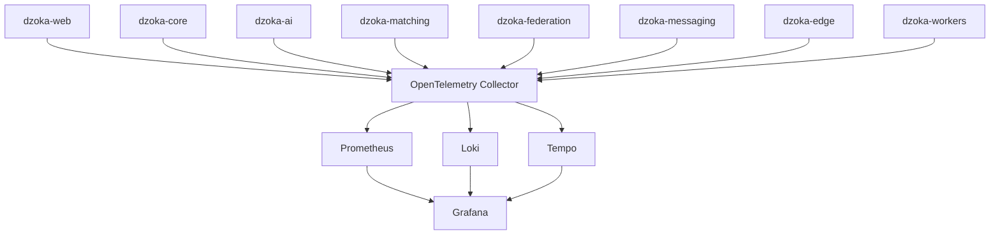

---

# 48. Communication Matrix

| Source | Destination | Protocol | Purpose |
|---|---|---|---|
| Web | Core | HTTPS | application API |
| Messaging | Core | HTTPS/events | normalized conversations |
| Core | PostgreSQL | SQL | transactional data |
| Core | Redis | Redis protocol | ephemeral state |
| Core | Object Storage | S3 API | media |
| Core | Broker | Kafka protocol | event publication |
| Workers | Broker | Kafka protocol | event consumption |
| Workers | AI | HTTP/gRPC | inference |
| Workers | Matching | HTTP/gRPC | candidate processing |
| AI | Object Storage | S3 API | read/write media artifacts |
| Matching | PostgreSQL | SQL | retrieval/evidence |
| Matching | Qdrant | HTTP/gRPC | optional vector search |
| Core | Federation | internal API | remote workflows |
| Federation | Federation Peer | HTTPS/mTLS | federation |
| Edge | Core | HTTPS | case/event submission |
| Edge | Object Storage | S3 API | approved evidence |
| Core | Courier | HTTPS | logistics |
| Core | Payment | HTTPS | reward/payment |
| All | OTel Collector | OTLP | telemetry |

---

# 49. Synchronous vs Asynchronous Communication

## Synchronous

Use synchronous APIs where the caller requires an immediate answer.

Examples:

```text
login/session validation
create report
read case
submit claim
approve ownership
create handover
query basic search results
retrieve case status
```

---

## Asynchronous

Use event-driven processing for:

```text
media sanitization
OCR
speech transcription
vision
embedding generation
fingerprint construction
candidate generation
heavy reranking
notification delivery
federation fan-out
ML feedback
analytics
retention jobs
```

---

# 50. Report Creation Sequence

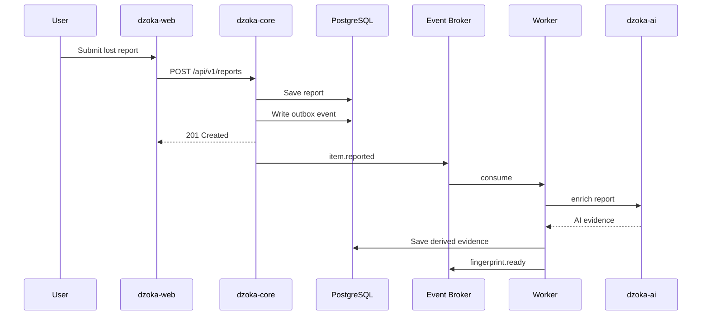

The user's request is acknowledged before heavy AI completes.

---

# 51. Matching Sequence

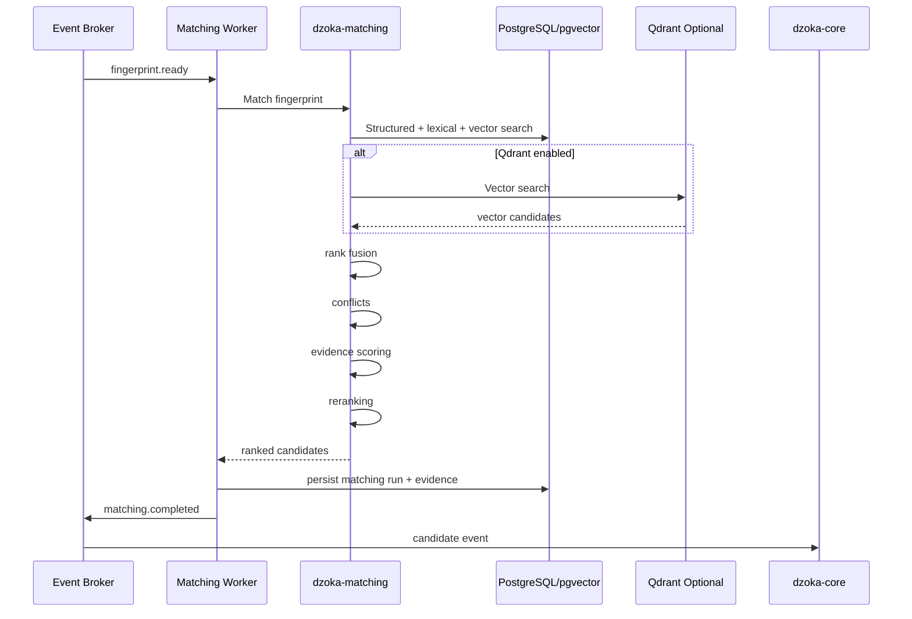

---

# 52. Ownership Verification Sequence

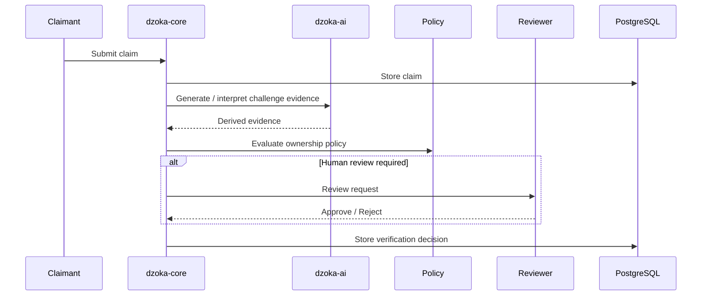

---

# 53. Federation Search Sequence

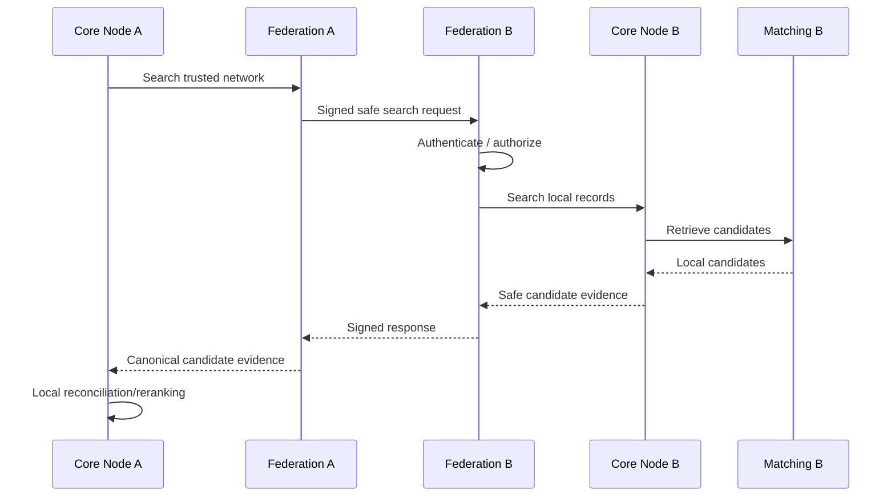

---

# 54. CCTV Sequence

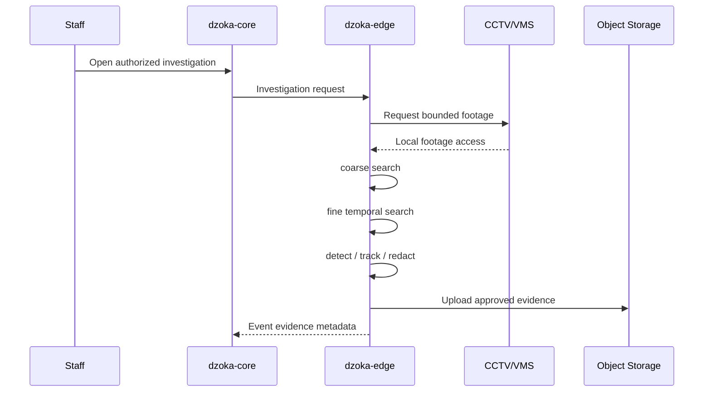

---

# 55. Scaling Model

Each container scales according to workload.

---

## `dzoka-web`

Scale by:

```text
HTTP request volume
active sessions
SSR workload
```

Usually stateless.

---

## `dzoka-core`

Scale by:

```text
API throughput
transaction volume
case operations
```

Instances remain stateless except database-backed state.

---

## `dzoka-ai`

Scale by:

```text
model workload
GPU availability
queue depth
model memory
```

May use separate pools:

```text
CPU inference
GPU inference
speech
vision
LLM
```

---

## `dzoka-matching`

Scale by:

```text
candidate volume
vector search throughput
reranking complexity
```

---

## `dzoka-workers`

Scale based on:

```text
consumer lag
topic-specific queue depth
job latency
```

---

## `dzoka-federation`

Scale according to:

```text
peer count
federated query traffic
network latency
```

---

## `dzoka-edge`

Scales independently per institution.

---

# 56. Resource Classes

Different containers need different resources.

```text
WEB
    CPU + moderate RAM

CORE
    CPU + moderate RAM

MESSAGING
    CPU + network

AI CPU
    high CPU + RAM

AI GPU
    GPU + RAM/VRAM

MATCHING
    CPU + RAM
    optional GPU

FEDERATION
    CPU + network

EDGE
    CPU/GPU depending camera workload

POSTGRESQL
    RAM + fast persistent storage

OBJECT STORAGE
    capacity + throughput

EVENT BROKER
    RAM + persistent storage + network
```

---

# 57. Network Zones

Recommended production network segmentation:

```text
PUBLIC ZONE
    │
    ├── reverse proxy / ingress
    ├── dzoka-web
    └── public API gateway
            │
            ▼
APPLICATION ZONE
    ├── dzoka-core
    ├── dzoka-messaging
    ├── dzoka-federation
    └── workers
            │
            ▼
AI ZONE
    ├── dzoka-ai
    └── dzoka-matching
            │
            ▼
DATA ZONE
    ├── PostgreSQL
    ├── Redis
    ├── object storage
    └── event broker
```

Edge nodes reside in their institution's trust boundary.

---

# 58. Public Exposure

Only necessary endpoints should be internet-accessible.

Typically public:

```text
dzoka-web
public API gateway
messaging provider webhooks
federation gateway
selected integration webhooks
```

Not directly public:

```text
PostgreSQL
Redis
Kafka
MinIO admin
AI internal API
matching internal API
MLflow
Grafana administration
```

---

# 59. API Gateway / Ingress

Production deployment should place public services behind:

```text
reverse proxy
API gateway
Kubernetes ingress
or equivalent
```

Responsibilities may include:

```text
TLS termination
request limits
IP controls
WAF integration
routing
request IDs
basic abuse mitigation
```

Application authorization still remains in the application.

---

# 60. Media Upload Architecture

Large media should avoid unnecessarily passing through application memory.

Preferred flow:

```text
Client
  ↓
Core obtains upload authorization
  ↓
short-lived signed upload URL
  ↓
Object Storage
  ↓
media.uploaded event
  ↓
sanitization worker
```

This reduces application-memory pressure.

---

# 61. Media Processing Containers

The media worker performs:

```text
MIME verification
size validation
malware scanning
EXIF removal
safe derivative generation
face/plate redaction where required
hashing
metadata extraction
```

Only sanitized derivatives become public.

---

# 62. Container-Level Security

All containers should have:

```text
non-root execution
minimal images
read-only filesystem where possible
resource limits
health checks
structured logs
secret injection
network restrictions
dependency scanning
container scanning
```

---

# 63. Service Authentication

Internal container calls should not rely only on network location.

Possible mechanisms include:

```text
service JWT
mTLS
workload identity
signed internal tokens
```

The exact production mechanism should be recorded in an ADR.

---

# 64. Secrets

Secrets include:

```text
database credentials
OIDC secrets
WhatsApp credentials
payment keys
courier credentials
federation signing keys
S3 keys
AI provider tokens
```

They must be delivered through:

```text
secret manager
Kubernetes secrets backed by secure management
Docker secrets
approved environment injection
```

Never store live secrets in source control.

---

# 65. Health Endpoints

Each service should expose:

```text
/livez
/readyz
```

where applicable.

The distinction matters.

Example:

```text
live = process is functioning
ready = dependencies required for traffic are available
```

---

# 66. Graceful Degradation

A service should not declare the entire platform unusable because an optional dependency is unavailable.

Examples:

```text
Qdrant unavailable
→ use pgvector if configured

WhatsApp unavailable
→ web still operational

AI unavailable
→ reports still accepted

Federation unavailable
→ local matching still operational

Courier unavailable
→ pickup remains available

MLflow unavailable
→ production inference continues
```

---

# 67. Deployment Mode — Developer

Recommended local stack:

```text
dzoka-web
dzoka-core
dzoka-ai
dzoka-matching
dzoka-messaging
dzoka-federation
dzoka-workers

PostgreSQL
Redis
MinIO
Kafka-compatible broker
Keycloak
OpenTelemetry Collector
Prometheus
Grafana
Loki
```

Optional local profile:

```text
Qdrant
MLflow
```

---

# 68. Deployment Mode — Small Institution

Possible topology:

```text
Single Server / Small Cluster

├── Reverse Proxy
├── dzoka-web
├── dzoka-core
├── dzoka-ai
├── dzoka-matching
├── dzoka-messaging
├── dzoka-federation
├── workers
├── PostgreSQL
├── Redis
├── MinIO
└── event broker
```

`dzoka-edge` may run separately near the CCTV infrastructure.

---

# 69. Deployment Mode — Large Institution

```text
Kubernetes Cluster

Frontend Pool
Core API Pool
Messaging Pool
Federation Pool
Worker Pools

CPU AI Pool
GPU AI Pool
Matching Pool

PostgreSQL HA
Kafka Cluster
Redis HA
Object Storage
Optional Qdrant Cluster
Observability Stack
```

---

# 70. Deployment Mode — SaaS

```text
Dzoka SaaS

Shared:
    web
    core
    workers
    AI
    matching
    event infrastructure

Logically isolated:
    tenants
    organizations
    media
    vector filtering
    policies
    secrets
    audit
```

Tenant isolation must never rely purely on UI filtering.

---

# 71. Deployment Mode — Federated Institution

```text
Institution A
└── Dzoka Node
     ├── Core
     ├── Database
     ├── Private Media
     ├── Federation Gateway
     └── Optional Edge

Institution B
└── Dzoka Node
     ├── Core
     ├── Database
     ├── Private Media
     └── Federation Gateway
```

The institutions share only permitted federation metadata.

---

# 72. Deployment Mode — Hybrid

Example:

```text
Cloud:
    web
    core
    federation
    matching

Institution:
    edge
    CCTV
    protected media

External:
    AI GPU provider
```

or:

```text
Institution:
    core
    database
    protected data

Cloud:
    optional AI inference
```

The architecture supports both.

---

# 73. Container Failure Domains

Container separation creates intentional failure boundaries.

Examples:

```text
AI crashes
→ core remains available

messaging outage
→ web remains available

federation fails
→ local search works

CCTV edge offline
→ normal recovery continues

ML evaluation crashes
→ production matching continues
```

---

# 74. Data Ownership

Container data ownership must remain explicit.

| Container | Primary Data Ownership |
|---|---|
| dzoka-core | authoritative domain state |
| dzoka-ai | no independent authoritative business state |
| dzoka-matching | matching runs / derived matching evidence |
| dzoka-messaging | channel delivery state / ephemeral session state |
| dzoka-federation | federation transport/audit state |
| dzoka-edge | temporary local footage/index/evidence |
| workers | no standalone authoritative state |
| PostgreSQL | durable relational source of truth |
| Object Storage | durable binary evidence/media |
| Redis | ephemeral state |
| Event Broker | durable asynchronous event stream |

---

# 75. Shared Database Rule

If multiple application containers access the same PostgreSQL cluster, schema ownership must still be explicit.

Do not create a distributed monolith where every container freely updates every table.

Preferred pattern:

```text
Core
    owns domain writes

Matching
    owns matching-derived tables

Workers
    write through explicit repositories/contracts

AI
    produces inference results,
    not arbitrary domain updates
```

Where practical, AI responses should return to the worker/core boundary instead of giving AI services arbitrary database mutation authority.

---

# 76. Deployment Packaging

Target repository structure:

```text
infrastructure/
├── docker/
│   ├── docker-compose.yml
│   ├── docker-compose.ai.yml
│   ├── docker-compose.observability.yml
│   └── docker-compose.full.yml
│
├── helm/
│   └── dzoka/
│
├── kubernetes/
│   └── examples/
│
└── monitoring/
```

---

# 77. Docker Compose Profiles

Suggested profiles:

```text
core
ai
observability
federation
edge
ml
full
```

Example:

```bash
docker compose --profile core up
docker compose --profile ai up
docker compose --profile full up
```

---

# 78. Container Images

Expected images:

```text
ghcr.io/<org>/dzoka-web
ghcr.io/<org>/dzoka-core
ghcr.io/<org>/dzoka-ai
ghcr.io/<org>/dzoka-matching
ghcr.io/<org>/dzoka-messaging
ghcr.io/<org>/dzoka-federation
ghcr.io/<org>/dzoka-edge
ghcr.io/<org>/dzoka-workers
```

Images should be reproducibly built.

---

# 79. Versioning

Each deployable component should expose:

```text
application version
git commit
build timestamp
protocol versions
event schema versions
model bundle version where applicable
```

This information should appear in health/build metadata.

---

# 80. Rolling Compatibility

Production deployments must consider independent rollout order.

Examples:

```text
old worker + new event producer
new core + old federation node
new matching model + old stored embeddings
```

Therefore:

- APIs require compatibility policy;
- event schemas require versioning;
- federation requires protocol negotiation;
- model vectors require version metadata.

---

# 81. Migration Ownership

Database migrations belong to:

```text
dzoka-core / dedicated migration job
```

Do not allow every service to mutate database schemas at startup.

Production migrations should be explicit and versioned.

---

# 82. Backup Boundaries

Backups must cover:

```text
PostgreSQL
Object Storage
federation keys/configuration
identity-provider configuration where self-hosted
critical deployment configuration
```

Redis usually does not require recovery as authoritative data.

Kafka recovery requirements depend on event retention and outbox strategy.

---

# 83. Recovery Priority

Disaster recovery priority should generally be:

```text
1. PostgreSQL
2. protected media / evidence
3. federation identity/signing material
4. configuration
5. object storage derivatives
6. event backlog
7. caches
```

---

# 84. Container-Level Architecture Constraints

The following are prohibited without an ADR:

1. frontend directly connecting to PostgreSQL;
2. public access to AI internal APIs;
3. AI service directly authorizing property release;
4. untrusted edge devices writing arbitrary DB rows;
5. federation peers bypassing the federation gateway;
6. external payment providers updating domain state without verified webhooks;
7. courier systems bypassing recovery policy;
8. exposing PostgreSQL, Redis or Kafka publicly;
9. storing authoritative case state in Redis;
10. synchronous report submission waiting for full AI processing;
11. unbounded worker retries;
12. unrestricted database mutation from all services;
13. direct vendor payloads leaking into domain models.

---

# 85. Container Architecture Summary

```text
                           USERS
                             │
                 ┌───────────┴───────────┐
                 │                       │
            dzoka-web              dzoka-messaging
                 │                       │
                 └───────────┬───────────┘
                             ▼
                        dzoka-core
                             │
        ┌────────────────────┼────────────────────┐
        │                    │                    │
        ▼                    ▼                    ▼
   PostgreSQL           Event Broker         Object Storage
        │                    │
        │                    ▼
        │               dzoka-workers
        │                    │
        │          ┌─────────┴─────────┐
        │          ▼                   ▼
        │      dzoka-ai          dzoka-matching
        │                              │
        │                       pgvector/Qdrant
        │
        ├──────── dzoka-federation ◄────► Other Dzoka Nodes
        │
        └──────── dzoka-edge ◄────────── CCTV/VMS

External:
    Identity Provider
    Payment Providers
    Courier Providers
    SMS/Email/Push Providers
    Optional AI Providers

Observability:
    OpenTelemetry
    Prometheus
    Grafana
    Loki
    Tempo
```

---

# 86. Final Container Principle

Dzoka containers should be split only when the boundary provides clear value through:

```text
different scaling
different runtime
different trust boundary
different hardware
different deployment location
different failure domain
```

The architecture intentionally avoids turning every domain concept into a network service.

The core principle is:

> **Keep transactional recovery logic cohesive, isolate computationally specialized workloads, keep external trust boundaries explicit, and scale only the parts whose workload requires independent scaling.**

This gives Dzoka a production architecture capable of starting on a single self-hosted server while evolving into a geographically distributed federated recovery network without redesigning its fundamental domain model.