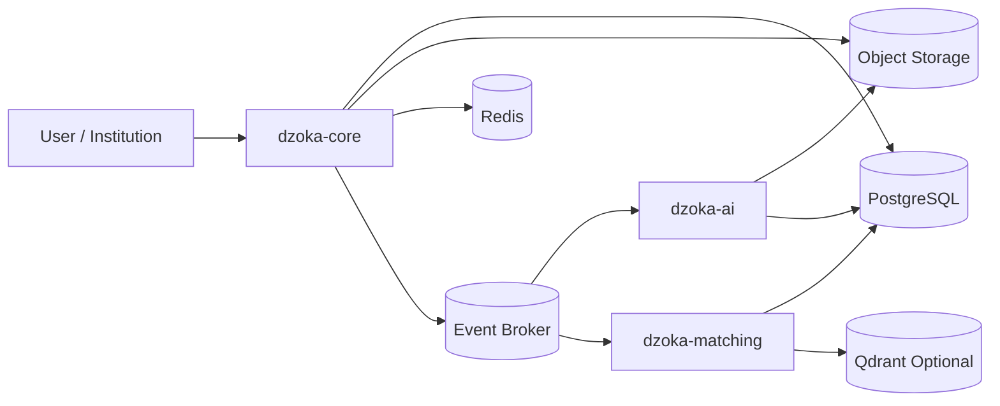

> **Current architecture authority (2026-10-26):** [Accepted baseline](../architecture/baseline.md) and its linked ADRs govern implementation. This supplied document is preserved below as detailed research/design material. Where examples or diagrams conflict with the baseline, use the baseline; no runtime capability is implied.

# Data Architecture

> **Dzoka — The Open Recovery Network**

This document defines the data architecture of Dzoka.

It describes:

- authoritative data stores;
- relational schemas;
- vector storage;
- geospatial storage;
- object/media storage;
- ephemeral state;
- event persistence;
- search indexes;
- ownership boundaries;
- privacy classifications;
- data retention;
- encryption;
- lineage;
- backups;
- archival;
- scalability;
- schema evolution.

Dzoka handles highly heterogeneous data:

```text
transactional business records
images
audio
video
documents
embeddings
location geometry
temporal uncertainty
matching evidence
ownership evidence
custody history
federation metadata
AI provenance
event streams
ML feedback
analytics projections
```

The architecture therefore uses different storage technologies according to workload while maintaining one clear source of truth.

---

# 1. Data Architecture Principles

## 1.1 PostgreSQL is the authoritative system of record

Dzoka uses PostgreSQL as the primary durable transactional store.

Recommended extensions:

```text
PostGIS
pgvector
pg_trgm
```

PostgreSQL stores:

- authoritative domain state;
- relational metadata;
- geospatial entities;
- vector metadata and default vectors;
- matching records;
- claims;
- verification;
- custody;
- recovery;
- federation metadata;
- model provenance;
- audit references;
- ML feedback.

---

## 1.2 Binary objects do not belong in relational tables

Large content belongs in S3-compatible object storage.

Examples:

```text
images
voice notes
videos
receipts
documents
CCTV evidence
redacted derivatives
model artifacts
exports
```

PostgreSQL stores references and metadata.

---

## 1.3 Redis is ephemeral

Redis may contain:

```text
cache
rate-limit state
OTP state
short-lived session state
distributed locks
temporary idempotency data
handover token state
```

Redis MUST NOT contain the only authoritative copy of business data.

---

## 1.4 Events do not replace transactional state

Dzoka is event-driven but is not required to be fully event sourced.

Authoritative domain state remains relational.

Events provide:

- asynchronous communication;
- integration;
- traceability;
- projections;
- replay where supported.

---

## 1.5 AI-derived data must preserve provenance

No derived feature may exist without enough metadata to answer:

```text
which source produced it?
which model produced it?
which model version?
when?
from which source content?
with what confidence?
```

---

## 1.6 Historical decision evidence is immutable

Data used to make historical decisions must remain reproducible.

Examples:

```text
fingerprint version
matching configuration
match evidence
model version
policy version
verification evidence
human decision
```

Do not silently rewrite historical evidence.

---

# 2. Primary Data Stores

Dzoka uses the following primary data stores.

```text
PostgreSQL
├── relational domain state
├── PostGIS
├── pgvector
├── pg_trgm
├── transactional outbox
├── inbox/idempotency
└── audit metadata

S3 / MinIO
├── images
├── audio
├── video
├── documents
├── private evidence
├── redacted derivatives
└── model/evaluation artifacts

Redis
├── short-lived cache
├── rate limits
├── OTP
├── session state
└── locks

Kafka-compatible Broker
├── integration events
├── worker jobs
├── notifications
├── federation work
└── ML feedback events

Optional Qdrant
└── scale-out vector workloads
```

---

# 3. High-Level Data Flow



---

# 4. PostgreSQL Logical Schemas

Prefer logical schemas or clear module ownership.

Possible organization:

```text
identity
tenancy
organization
location
case_management
item_registry
reporting
media
fingerprint
matching
claims
verification
fraud
custody
recovery
messaging
notification
logistics
reward
federation
traceability
policy
audit
ml_feedback
intelligence
integration
platform
```

Whether these become physical PostgreSQL schemas or naming conventions should be decided by implementation ADR.

The important rule is ownership.

---

# 5. Identity Data

Representative tables:

```text
users
external_identities
contact_channels
service_identities
service_scopes
```

Possible `users` fields:

```text
id UUID PK
external_identity_id
display_name
preferred_language
timezone
status
created_at
updated_at
version
```

Do not store external identity-provider passwords.

---

# 6. Tenancy Data

Representative tables:

```text
tenants
tenant_settings
tenant_features
organizations
organization_units
organization_memberships
organization_locations
```

All tenant-owned records should contain an explicit:

```text
tenant_id
```

unless they are intentionally global.

---

# 7. Tenant Isolation

Tenant isolation must be enforced at multiple layers:

```text
application authorization
repository filtering
database constraints
object-storage namespace
cache namespace
event metadata
vector filters
analytics projections
```

Where appropriate, PostgreSQL Row Level Security may provide defense in depth.

It should not replace application authorization.

---

# 8. Organization Tables

Example:

```text
organizations
├── id
├── tenant_id
├── name
├── organization_type
├── status
├── metadata JSONB
├── created_at
└── updated_at
```

Organization units:

```text
organization_units
├── id
├── organization_id
├── parent_unit_id
├── name
├── unit_type
└── status
```

Use hierarchical relationships rather than encoding organizational structure in free-text fields.

---

# 9. Location Data

Primary tables:

```text
locations
location_aliases
location_relationships
routes
route_stops
vehicles
```

Example `locations`:

```text
id UUID PK
tenant_id UUID
organization_id UUID NULL
parent_location_id UUID NULL
canonical_name TEXT
location_type VARCHAR
point GEOGRAPHY(Point, 4326) NULL
geometry GEOGRAPHY NULL
timezone VARCHAR NULL
metadata JSONB
created_at
updated_at
```

---

# 10. PostGIS

PostGIS supports:

```text
distance search
geofencing
point-in-polygon
route geometry
facility boundaries
nearest location
spatial intersections
hierarchical location context
```

Spatial indexes:

```text
GiST
SP-GiST where appropriate
```

must be added to spatial columns used in search.

---

# 11. Location Hierarchy

Do not infer hierarchy only from coordinates.

Represent explicit relationships:

```text
Country
└── City
    └── Airport
        └── Terminal
            └── Gate
```

Example:

```text
locations.parent_location_id
```

Additional relationships may exist in:

```text
location_relationships
```

for relationships that are not strictly parent/child.

---

# 12. Temporal Data

Times must use timezone-aware database types.

Use:

```text
TIMESTAMPTZ
```

for known timestamps.

Approximate user-reported time is stored as:

```text
time_start
time_end
precision
raw_expression
timezone
```

Example:

```text
"around 2pm"

raw_expression = "around 2pm"
time_start      = 13:30
time_end        = 14:30
precision       = APPROXIMATE
```

Do not replace uncertain times with fabricated exact timestamps.

---

# 13. Case Management Tables

Representative tables:

```text
recovery_cases
case_assignments
case_status_history
case_links
```

`recovery_cases`:

```text
id UUID PK
tenant_id UUID
case_number VARCHAR
case_type VARCHAR
opened_by UUID
primary_item_id UUID NULL
owning_organization_id UUID NULL
assigned_unit_id UUID NULL
status VARCHAR
priority VARCHAR
opened_at TIMESTAMPTZ
closed_at TIMESTAMPTZ NULL
closure_reason VARCHAR NULL
version BIGINT
```

Use a stable user-facing case number separate from UUID.

---

# 14. Item Registry Tables

Representative tables:

```text
items
registered_item_profiles
item_identifiers
item_tags
item_ownership_references
```

Example `items`:

```text
id UUID PK
tenant_id UUID
canonical_category_id UUID NULL
canonical_brand TEXT NULL
canonical_model TEXT NULL
status VARCHAR
registration_state VARCHAR
current_fingerprint_id UUID NULL
created_at
updated_at
version
```

---

# 15. Protected Item Identifiers

Sensitive identifiers require special storage.

Table:

```text
item_identifiers
```

Possible fields:

```text
id
item_id
identifier_type
normalized_hash
encrypted_value
last_four
classification
source
verification_state
created_at
```

Do not index raw IMEI or serial values where avoidable.

Prefer:

```text
normalized identifier
        ↓
keyed cryptographic hash
        ↓
equality lookup
```

Store encrypted original only when operationally necessary.

---

# 16. Reporting Tables

Representative tables:

```text
lost_reports
found_reports
report_locations
report_time_windows
report_provenance
report_attributes
```

Raw description must remain unchanged.

Example:

```text
raw_description
normalized_description
canonical_description
```

must be separate columns or records.

---

# 17. Lost Report Data

Representative structure:

```text
lost_reports
├── id
├── case_id
├── item_id
├── reporter_id
├── channel
├── raw_description
├── normalized_description
├── original_language
├── lost_time_start
├── lost_time_end
├── raw_time_expression
├── last_seen_location_id
├── reported_at
├── status
└── provenance_id
```

---

# 18. Found Report Data

Representative structure:

```text
found_reports
├── id
├── case_id
├── item_id
├── finder_reference
├── organization_id
├── channel
├── raw_description
├── normalized_description
├── found_at
├── found_location_id
├── storage_location_id
├── custody_record_id
├── status
└── reported_at
```

---

# 19. Media Metadata

Primary table:

```text
media_assets
```

Fields:

```text
id UUID PK
tenant_id
owner_entity_type
owner_entity_id
storage_bucket
storage_key
content_type
media_type
size_bytes
content_hash
classification
processing_state
safe_derivative_id
retention_policy_id
created_at
deleted_at
```

The object itself resides in object storage.

---

# 20. Object Storage Layout

Logical layout:

```text
dzoka/
├── tenants/
│   └── {tenant-id}/
│       ├── public/
│       ├── restricted/
│       ├── secret/
│       ├── cctv/
│       ├── temporary/
│       └── exports/
│
├── models/
└── evaluation/
```

Actual bucket strategy may differ.

Do not rely on object key obscurity for authorization.

---

# 21. Object Storage Classification

Possible buckets:

```text
dzoka-public-media
dzoka-restricted-media
dzoka-secret-evidence
dzoka-cctv-evidence
dzoka-model-artifacts
dzoka-exports
```

Separate encryption keys may be used for high-sensitivity buckets.

---

# 22. Media Derivatives

A single source upload may produce:

```text
original
sanitized original
thumbnail
public-safe derivative
redacted derivative
object crop
OCR crop
embedding input
```

Represent lineage explicitly.

Table:

```text
media_derivatives
├── source_media_id
├── derivative_media_id
├── derivative_type
├── processor
├── model_version
└── generated_at
```

---

# 23. Evidence Model

A generic evidence table may support shared provenance:

```text
evidence
├── id
├── tenant_id
├── evidence_type
├── source_type
├── source_entity_type
├── source_entity_id
├── classification
├── reliability
├── confidence
├── model_run_id NULL
├── collected_at
├── expires_at
└── metadata JSONB
```

Specialized tables may reference the evidence ID.

---

# 24. AI Model Runs

Table:

```text
model_runs
```

Fields:

```text
id
tenant_id
task
provider
model
model_version
configuration_version
prompt_version
input_hash
output_schema_version
status
started_at
completed_at
latency_ms
token_usage NULL
cost_amount NULL
cost_currency NULL
error_code NULL
metadata JSONB
```

Every material AI-derived record should reference a `model_run_id` where applicable.

---

# 25. Attribute Data

Use normalized structured attributes rather than dumping everything into JSON.

Tables:

```text
attribute_definitions
item_attributes
```

Example:

```text
attribute_definitions
├── id
├── category_id
├── name
├── value_type
├── searchable
├── secret_capable
└── importance
```

`item_attributes`:

```text
id
item_id
fingerprint_id
attribute_definition_id
value_text
value_number
value_boolean
value_json
source_type
source_reference
confidence
reliability
is_secret
created_at
```

JSONB may be used for flexible values but should not replace structured indexing for critical fields.

---

# 26. Item Fingerprint Tables

Recommended decomposition:

```text
item_fingerprints
fingerprint_attributes
fingerprint_embeddings
fingerprint_local_features
fingerprint_ocr_features
fingerprint_distinctive_features
fingerprint_context
fingerprint_protected_features
```

Do not store the entire fingerprint as one opaque JSON document only.

A JSON snapshot may exist for transport/export, but searchable evidence should remain normalized.

---

# 27. Item Fingerprint Versioning

`item_fingerprints`:

```text
id
item_id
version
status
coverage
created_at
supersedes_fingerprint_id NULL
content_hash
```

Constraints:

```text
UNIQUE(item_id, version)
```

Historical fingerprints are immutable.

---

# 28. Embedding Records

Use a generic embedding table:

```text
embeddings
├── id
├── tenant_id
├── entity_type
├── entity_id
├── embedding_type
├── provider
├── model
├── model_version
├── dimensions
├── content_hash
├── vector
├── created_at
└── status
```

Possible `embedding_type`:

```text
TEXT
IMAGE_GLOBAL
IMAGE_PATCH
OCR_TEXT
CANONICAL_DESCRIPTION
CCTV_OBJECT
```

---

# 29. pgvector

The default vector column uses:

```text
vector(N)
```

where dimension is fixed per model-compatible table/index strategy.

Because different embedding models may have different dimensions, do not force every model into a single incompatible column.

Possible strategies:

```text
per-model tables
per-dimension tables
partitioned embeddings
provider-specific indexes
```

The final physical implementation should be benchmark-driven.

---

# 30. Vector Compatibility

Before cosine or inner-product comparison, require compatible:

```text
embedding_type
model
model_version
dimensions
semantic space
```

Never compare arbitrary vectors simply because their dimensions happen to match.

---

# 31. Vector Indexing

Default ANN index:

```text
HNSW
```

where supported and justified.

Alternative:

```text
IVFFlat
```

may be benchmarked.

Indexes may be partitioned by:

```text
tenant
category
embedding type
model version
```

where this improves performance.

---

# 32. Local Patch Embeddings

Patch embeddings may become large.

Do not blindly store thousands of patch vectors per image indefinitely.

Possible table:

```text
local_visual_features
├── id
├── fingerprint_id
├── media_id
├── region
├── scale
├── feature_type
├── embedding_id
├── salience
└── confidence
```

Retention or compression may differ from global embeddings.

---

# 33. Perceptual Hashes

Store perceptual hashes separately:

```text
perceptual_hashes
├── media_id
├── algorithm
├── hash
└── version
```

Useful for:

- duplicate detection;
- near-duplicate images;
- upload deduplication.

Do not treat perceptual hashes as a replacement for instance-level embedding search.

---

# 34. OCR Data

Tables:

```text
ocr_runs
ocr_blocks
ocr_entities
```

`ocr_blocks` may contain:

```text
media_id
text
normalized_text
bounding_box
language
confidence
model_run_id
```

Potential sensitive OCR must inherit classification.

---

# 35. Search Text

PostgreSQL provides:

```text
FTS
pg_trgm
```

Possible indexed fields:

```text
raw description
normalized description
canonical description
OCR text
brand
model
safe attributes
location aliases
```

Use generated `tsvector` columns or maintained search documents.

---

# 36. Search Document

Consider:

```text
item_search_documents
├── item_id
├── fingerprint_id
├── document_text
├── search_vector
├── language_config
└── updated_at
```

Indexes:

```text
GIN(search_vector)
GIN/GiST trigram indexes where appropriate
```

---

# 37. Matching Tables

Core matching persistence:

```text
matching_runs
match_candidates
match_retrieval_evidence
match_feature_evidence
match_conflicts
match_decisions
```

---

# 38. Matching Run

Example:

```text
matching_runs
├── id
├── tenant_id
├── source_fingerprint_id
├── algorithm_version
├── configuration_version
├── trigger
├── status
├── candidate_count
├── duration_ms
├── started_at
└── completed_at
```

This record enables reproducibility.

---

# 39. Match Candidate

```text
match_candidates
├── id
├── run_id
├── lost_item_id
├── found_item_id
├── retrieval_score
├── match_score
├── evidence_coverage
├── confidence
├── match_level
├── recommended_action
├── status
└── created_at
```

Scores must not be used without their algorithm/configuration context.

---

# 40. Match Evidence

`match_feature_evidence`:

```text
id
candidate_id
feature_type
lost_value_snapshot
found_value_snapshot
similarity
reliability
weight
contribution
available
relation
explanation
source_reference
model_run_id
```

Snapshot values are important because source records may later change.

---

# 41. Matching Conflicts

```text
match_conflicts
├── id
├── candidate_id
├── conflict_type
├── field_name
├── severity
├── penalty
├── rejecting
├── lost_value_snapshot
├── found_value_snapshot
└── explanation
```

---

# 42. Human Match Decisions

```text
match_decisions
├── id
├── candidate_id
├── decision
├── decided_by
├── reason
├── score_snapshot
├── algorithm_version
├── decided_at
└── metadata
```

These become valuable labelled ML data.

---

# 43. Claims Data

Tables:

```text
claims
claim_evidence
claim_conflicts
claim_status_history
```

`claims`:

```text
id
tenant_id
item_id
candidate_id NULL
claimant_id
status
verification_id NULL
risk_assessment_id NULL
created_at
resolved_at
resolution_reason
version
```

---

# 44. Verification Data

Tables:

```text
verification_sessions
ownership_challenges
challenge_responses
verification_evidence
verification_decisions
```

---

# 45. Ownership Challenge Security

Expected evidence must never be stored as public plaintext if avoidable.

Possible storage:

```text
protected_expected_hash
encrypted_expected_value
source_evidence_reference
```

Depending on challenge type.

Example:

For exact serial suffix:

```text
keyed hash
```

may be sufficient.

For semantic free-text answers:

encrypted expected evidence may be required.

---

# 46. Verification Decision History

Do not overwrite final verification decisions.

Store append-oriented:

```text
verification_decisions
```

including:

```text
policy_version
model_run references
human reviewer
evidence snapshot
timestamp
```

---

# 47. Fraud / Risk Data

Tables:

```text
risk_assessments
risk_signals
risk_reviews
```

Risk models should reference:

```text
model_version
rule_version
```

so historical decisions remain explainable.

---

# 48. Custody Data

Tables:

```text
custody_records
custody_events
custody_evidence
```

`custody_events` are append-oriented.

Current state may be materialized in:

```text
custody_records
```

for fast operational queries.

---

# 49. Custody Event

Example:

```text
id
item_id
previous_custodian_type
previous_custodian_id
new_custodian_type
new_custodian_id
previous_location_id
new_location_id
reason
actor_id
occurred_at
correlation_id
metadata
```

---

# 50. Recovery Data

Tables:

```text
recovery_orders
recovery_authorizations
handovers
handover_attempts
recovery_confirmations
```

State transitions should use optimistic locking.

---

# 51. Handover Tokens

Never store reusable raw OTP/token values where avoidable.

Store:

```text
token_hash
expires_at
attempt_count
used_at
revoked_at
```

Use cryptographically secure token generation.

---

# 52. Logistics Data

Tables:

```text
shipments
shipment_events
courier_quotes
courier_webhook_events
```

Keep internal shipment ID separate from provider shipment ID.

---

# 53. Reward Data

Tables:

```text
rewards
reward_ledger_entries
payment_transactions
payment_webhook_events
```

Financial data should be append-oriented where possible.

`reward_ledger_entries` should never be casually edited.

---

# 54. Money Storage

Use:

```text
NUMERIC
currency_code
```

Never binary floating point.

Example:

```text
amount NUMERIC(19,4)
currency CHAR(3)
```

---

# 55. Messaging Data

Tables:

```text
conversations
conversation_participants
messages
message_media
message_delivery_attempts
```

Sensitive recovery chat may have independent retention rules.

---

# 56. Channel References

External provider IDs belong in fields such as:

```text
provider
provider_message_id
provider_conversation_id
```

They must never become Dzoka primary keys.

---

# 57. Notifications

Tables:

```text
notifications
notification_deliveries
notification_preferences
notification_templates
```

Separate:

```text
notification intent
```

from:

```text
delivery attempt
```

because one notification may be attempted through multiple channels.

---

# 58. Federation Data

Tables:

```text
federation_nodes
federation_node_keys
federation_trust
federation_capabilities
federated_queries
federated_query_targets
federated_candidates
federation_messages
federation_audit
```

---

# 59. Federation Node Keys

Store:

```text
public keys
key IDs
algorithm
validity
revocation state
rotation metadata
```

Private federation signing keys should preferably live in a secret manager/HSM-equivalent rather than application tables.

---

# 60. Federated Candidates

Store only safe received snapshots.

```text
federated_candidates
├── id
├── query_id
├── source_node_id
├── remote_reference
├── safe_evidence JSONB
├── remote_score
├── evidence_coverage
├── algorithm_version
├── calibration_metadata
├── received_at
└── expires_at
```

Do not import remote secret evidence by default.

---

# 61. Federation Cache Retention

Federation candidate data may be ephemeral.

Retention should be shorter than authoritative local records unless needed for an active case or audit.

---

# 62. Traceability Data

Primary table:

```text
recovery_events
```

Example:

```text
id
item_id
event_type
actor_type
actor_id
organization_id
location_id
occurred_at
reason
source
correlation_id
metadata
```

These records support:

- physical-object history;
- EPCIS mappings;
- recovery graph projection;
- movement intelligence.

---

# 63. Event Ordering

Do not rely solely on timestamps for ordering.

Where required use:

```text
aggregate version
sequence number
event ID
```

especially for custody and recovery history.

---

# 64. Recovery Graph Projection

Initial graph projection remains relational.

Possible tables:

```text
recovery_graph_nodes
recovery_graph_edges
```

or generated views from recovery events.

Example edge:

```text
item X
TRANSFERRED_TO
depot Y
```

A dedicated graph engine is not required initially.

---

# 65. Recovery Transition Data

Tables:

```text
recovery_transition_observations
transition_model_versions
transition_predictions
```

Training records should derive from confirmed events rather than raw speculative data.

---

# 66. ML Feedback Data

Tables:

```text
feedback_records
dataset_memberships
evaluation_runs
evaluation_metrics
model_promotions
```

Example:

```text
feedback_records
├── id
├── type
├── source_entity_type
├── source_entity_id
├── label
├── feature_snapshot_reference
├── algorithm_version
├── created_at
└── dataset_eligible
```

---

# 67. Dataset Isolation

Evaluation/training datasets must be logically separated from production tables.

Possible architecture:

```text
production records
      ↓
approved anonymized/consented export
      ↓
versioned dataset
      ↓
evaluation/training
```

Never allow a training script to indiscriminately query production secret evidence.

---

# 68. Dataset Manifest

Every dataset version should record:

```text
dataset_id
version
description
source policy
created_at
records_count
consent basis
anonymization method
content hash
license
retention
```

---

# 69. Model Registry Metadata

Whether MLflow is enabled or not, Dzoka should persist internal model metadata.

Tables:

```text
model_definitions
model_versions
model_deployments
model_evaluations
```

---

# 70. Policy Data

Tables:

```text
policy_sets
policy_versions
policy_assignments
policy_decisions
```

Historical decisions reference the exact policy version.

---

# 71. Feature Flags

Tables:

```text
feature_flags
tenant_feature_overrides
organization_feature_overrides
```

Feature flags are configuration, not authorization.

---

# 72. Audit Data

Primary tables:

```text
audit_events
sensitive_data_access_log
admin_action_log
```

Audit data should be append-only at the application level.

---

# 73. Sensitive Data Access

Dedicated records should exist for viewing high-risk information.

Example:

```text
sensitive_data_access_log
├── id
├── actor_id
├── tenant_id
├── resource_type
├── resource_id
├── field_category
├── purpose
├── occurred_at
└── correlation_id
```

---

# 74. Audit Immutability

Possible hardening options:

```text
append-only DB permissions
hash chaining
WORM archive
periodic signed audit snapshots
immutable object-storage archive
```

Blockchain is not required.

---

# 75. Transactional Outbox

Table:

```text
outbox_events
```

Fields:

```text
id
aggregate_type
aggregate_id
aggregate_version
event_type
schema_version
tenant_id
payload
correlation_id
causation_id
created_at
published_at
attempt_count
```

Domain transaction:

```text
update aggregate
+
insert outbox event
```

must commit atomically.

---

# 76. Inbox

For critical event consumers:

```text
inbox_events
├── consumer
├── event_id
├── received_at
├── processed_at
├── status
└── result_hash
```

Constraint:

```text
UNIQUE(consumer, event_id)
```

supports duplicate protection.

---

# 77. Event Broker Data

Kafka-compatible infrastructure carries events such as:

```text
item.reported
media.uploaded
media.sanitized
ai.enrichment.requested
fingerprint.ready
matching.requested
matching.completed
claim.submitted
ownership.verified
custody.transferred
recovery.authorized
shipment.updated
item.recovered
ml.feedback.created
```

Kafka is not the primary relational system of record.

---

# 78. Event Retention

Different event streams may have different retention.

Examples:

```text
operational commands/jobs
    shorter

business integration events
    medium/long

audit/traceability exports
    archived separately
```

The authoritative retention requirement must not depend only on Kafka retention.

---

# 79. Redis Data

Permitted Redis data:

```text
rate-limit counters
OTP hashes
temporary conversation state
distributed locks
temporary cache
idempotency windows
handover token attempts
short-lived federation nonce cache
```

---

# 80. Redis Namespacing

Keys should include:

```text
environment
tenant
domain
identifier
```

Example:

```text
prod:tenant-123:otp:handover:abc
```

Avoid cross-tenant key collisions.

---

# 81. Redis Expiration

Every ephemeral key should normally have a TTL.

Do not create indefinite cache entries accidentally.

---

# 82. Search Architecture

Default search stack:

```text
PostgreSQL
├── structured indexes
├── FTS
├── pg_trgm
├── pgvector
└── PostGIS
```

OpenSearch is not mandatory initially.

Introduce dedicated search infrastructure only when evidence shows PostgreSQL is insufficient.

---

# 83. Candidate Retrieval Indexes

Likely indexes include:

```text
category
brand
model
status
tenant
found/lost time
location
safe attributes
identifier hash
FTS
trigram
vector ANN
```

Composite/partial indexes should be driven by real query patterns.

---

# 84. Partitioning Strategy

Partitioning may eventually be appropriate for:

```text
audit_events
recovery_events
messages
model_runs
embeddings
matching_runs
federation messages
```

Possible keys:

```text
time
tenant
organization
```

Do not partition prematurely without volume evidence.

---

# 85. Database Constraints

Important invariants should be reinforced by database constraints.

Examples:

```text
foreign keys
unique constraints
check constraints
not-null constraints
exclusion constraints where useful
```

Do not rely exclusively on application validation.

---

# 86. Soft Delete

Not every domain record should be physically deleted immediately.

Use:

```text
deleted_at
status
```

where historical integrity is required.

However, "soft delete everything forever" is also wrong.

Retention and privacy rules determine eventual physical deletion.

---

# 87. Data Classification

Every sensitive domain should support classification.

```text
PUBLIC
RESTRICTED
SECRET
```

Optionally future:

```text
HIGHLY_RESTRICTED
```

if compliance needs justify it.

---

# 88. PUBLIC Data

Examples:

```text
safe description
general category
broad area
safe public photo
approximate date
```

This information may appear in public search.

---

# 89. RESTRICTED Data

Examples:

```text
exact found location
custody location
finder identity
claim history
internal matching evidence
institutional notes
```

Accessible only to authorized parties.

---

# 90. SECRET Data

Examples:

```text
IMEI
serial
national ID
passport
receipts
ownership answers
private photographs
contact information
authentication secrets
federation private keys
```

Secret data should receive stronger access control and encryption.

---

# 91. Field-Level Encryption

Use application-level encryption for selected high-risk data where justified.

Examples:

```text
identity document number
full IMEI
full serial
private ownership evidence
```

Architecture:

```text
plaintext
   ↓
envelope encryption
   ↓
ciphertext in PostgreSQL
   ↓
key reference in key-management system
```

---

# 92. Searchable Secret Identifiers

Where equality matching is necessary:

```text
normalized secret
   ↓
HMAC / keyed hash
   ↓
search index
```

This enables exact matching without exposing plaintext.

Do not use unsalted general-purpose hashes for low-entropy identifiers.

---

# 93. Encryption Keys

Application data should not contain master keys.

Keys belong in:

```text
secret manager
KMS
HSM
Vault-like system
approved infrastructure secret store
```

Support rotation.

---

# 94. Key Rotation

Encrypted records should contain enough metadata to support:

```text
key_id
encryption_version
```

Rotation must not require downtime where practical.

---

# 95. Media Security

Object storage should support:

```text
encryption at rest
TLS
private-by-default ACL
signed URLs
short-lived access
tenant prefix isolation
bucket policies
retention
```

---

# 96. Public-Safe Media

Do not expose originals directly.

Preferred:

```text
private original
    ↓
sanitization/redaction
    ↓
public-safe derivative
    ↓
public CDN/object URL
```

---

# 97. EXIF and Metadata

Uploads must be inspected for:

```text
GPS
camera metadata
device IDs
author metadata
document metadata
```

Unnecessary metadata should be removed from public derivatives.

---

# 98. Data Lineage

Derived data must preserve lineage.

Example:

```text
Source Photo
   ↓
Sanitized Photo
   ↓
Object Crop
   ↓
Global Embedding
   ↓
Match Evidence
   ↓
Match Decision
```

Each step should be traceable.

---

# 99. Provenance Fields

Common provenance fields:

```text
source_type
source_id
processor
model_run_id
created_at
content_hash
```

---

# 100. Content Hashing

Content hashes support:

```text
deduplication
reprocessing detection
model-run reproducibility
tamper detection
cache validation
```

Use cryptographically secure hash functions.

---

# 101. Re-Embedding

Model upgrades must not overwrite existing embeddings.

Workflow:

```text
Embedding v1
     ↓
model v2 introduced
     ↓
new Embedding v2
     ↓
both coexist
     ↓
matching migration/evaluation
     ↓
old vectors retired later
```

---

# 102. Embedding Lifecycle

Statuses may include:

```text
PENDING
ACTIVE
SUPERSEDED
FAILED
RETIRED
```

---

# 103. Matching Reproducibility

To reproduce a matching run retain:

```text
fingerprint version
candidate filters
retrieval configuration
vector model versions
weight profile
conflict-rule version
reranker version
algorithm version
```

---

# 104. Configuration Versioning

Matching configuration should be versioned separately from code.

Example:

```text
matching_configurations
├── id
├── version
├── category
├── weights
├── thresholds
├── conflict_rules_version
└── effective_at
```

---

# 105. Privacy-Safe Snapshots

Historical match evidence should snapshot the compared values as they were at decision time.

This prevents later edits from rewriting history.

Sensitive snapshots should be:

```text
redacted
hashed
encrypted
```

as appropriate.

---

# 106. Data Retention Architecture

Retention is policy driven.

Represent:

```text
retention_policies
retention_assignments
retention_exceptions
legal_holds
```

---

# 107. Example Retention Classes

Possible classes:

```text
PUBLIC_CASE_DATA
PRIVATE_CASE_DATA
CLAIM_EVIDENCE
IDENTITY_DOCUMENT
CCTV_EVIDENCE
RECOVERY_CHAT
FEDERATION_CACHE
AI_DERIVATIVE
AUDIT
FINANCIAL_LEDGER
```

Each may have different periods.

---

# 108. Retention Worker

The retention worker:

```text
identifies expired data
checks legal hold
checks active case dependencies
removes derived artifacts
removes source objects if allowed
records deletion evidence
```

Deletion must be idempotent.

---

# 109. Legal Hold

Table:

```text
legal_holds
├── id
├── resource_type
├── resource_id
├── reason
├── imposed_by
├── starts_at
├── released_at
└── status
```

Retention jobs MUST respect active holds.

---

# 110. Data Deletion

Deletion may require removing:

```text
database fields
object-storage files
embeddings
cached content
derived media
federation cache
search indexes
```

Deletion workflows should be orchestrated and auditable.

---

# 111. Derived Data Deletion

If source evidence is deleted, dependent derived data may need to be deleted as well.

Example:

```text
private photo deleted
    ↓
associated crop
embedding
OCR
distinctive features
```

unless retention law/policy requires preservation.

---

# 112. Federation Data Ownership

Remote node data remains authoritative at the source node.

Local storage should keep:

```text
remote reference
safe snapshot
source node
received timestamp
expiry
```

rather than full unauthorized replicas.

---

# 113. Federation Message Persistence

Security-relevant federation messages should retain:

```text
message ID
source node
target node
operation
signature key ID
nonce
timestamp
status
correlation ID
```

Payload retention depends on classification.

---

# 114. CCTV Data Architecture

Central Dzoka should generally store:

```text
investigation metadata
camera reference
time window
object crops
short evidence clips
trajectory summary
derived embeddings
event references
```

not indefinite raw footage.

---

# 115. Edge CCTV Storage

`dzoka-edge` may maintain:

```text
temporary footage cache
frame index
object tracks
local embeddings
investigation workspace
```

These should have aggressive retention policies.

---

# 116. CCTV Evidence Reference

Central record:

```text
cctv_evidence
├── id
├── case_id
├── edge_node_id
├── camera_id
├── start_time
├── end_time
├── evidence_media_id
├── object_track_reference
├── classification
├── retention_policy
└── created_at
```

---

# 117. Analytics Architecture

Transactional tables should not be abused for expensive operational analytics.

Use projections/materialized views.

Examples:

```text
daily_recovery_metrics
location_loss_hotspots
category_recovery_metrics
tenant_operational_metrics
federation_contribution_metrics
```

---

# 118. Analytical Projections

Derived using:

```text
event consumers
scheduled jobs
materialized views
```

depending on workload.

These projections are disposable/rebuildable.

---

# 119. Recovery KPIs

Store or derive metrics for:

```text
reports created
candidate recall
claims submitted
verified recoveries
recovery rate
median time to recovery
false-match rate
fraud rejection rate
federation contribution
courier usage
reward usage
```

---

# 120. Data Warehouse

A separate warehouse is not required initially.

If analytical scale later justifies it, introduce:

```text
warehouse/lakehouse
```

through an explicit ADR.

Operational architecture must not depend on it.

---

# 121. ML Evaluation Data

Evaluation outputs:

```text
evaluation_runs
evaluation_metrics
benchmark_results
confusion_cases
```

Example metrics:

```text
Recall@10
Recall@50
MRR
Precision@K
NDCG
false-match rate
recovery conversion
```

---

# 122. Synthetic Test Data

Synthetic data should be marked:

```text
dataset_type = SYNTHETIC
```

Do not mix synthetic benchmark claims with production metrics.

---

# 123. Database Migration Strategy

Use a real migration framework.

For Spring Boot likely candidates:

```text
Flyway
Liquibase
```

Select one via ADR.

Do not depend on JPA auto-DDL for production.

---

# 124. Migration Rules

Every migration should be:

```text
version controlled
reviewable
tested
forward-compatible where practical
```

Avoid destructive migrations in the same release that removes application compatibility.

---

# 125. Expand-and-Contract

For zero/low-downtime migrations use:

```text
1. add new structure
2. deploy compatible code
3. backfill
4. switch reads/writes
5. verify
6. remove old structure later
```

---

# 126. Schema Versioning

APIs, events, federation contracts, fingerprints, and model outputs have independent schema versions.

Do not assume the database schema version is sufficient for all compatibility tracking.

---

# 127. Database Index Governance

Every index carries operational cost.

Indexes should be justified by:

```text
known query
query plan
benchmark
SLO
```

Periodic unused-index review is recommended.

---

# 128. Query Observability

Track:

```text
slow queries
lock waits
connection saturation
index hit rate
vector query latency
spatial query latency
```

Database health is a first-class production concern.

---

# 129. Connection Pooling

Use controlled connection pools.

Potential:

```text
HikariCP
PgBouncer
```

depending on deployment.

Do not let autoscaling application instances exhaust PostgreSQL connections.

---

# 130. Backup Architecture

Required backup coverage:

```text
PostgreSQL
object storage
federation identity configuration
self-hosted identity-provider configuration
critical deployment configuration
```

---

# 131. PostgreSQL Backups

Production should support:

```text
full backups
incremental/WAL archival
point-in-time recovery
```

where deployment tier justifies it.

A backup that has never been restored is not considered verified.

---

# 132. Object Storage Backups

Protected evidence may require:

```text
versioning
replication
immutable retention
secondary storage
```

according to deployment requirements.

---

# 133. Restore Testing

Maintain runbooks for:

```text
restore PostgreSQL
restore object storage
reconcile event backlog
restore federation identity
rebuild search indexes
rebuild analytics projections
```

Run restore tests periodically.

---

# 134. Disaster Recovery

Define deployment-specific targets:

```text
RPO
RTO
```

Small deployments may accept larger recovery windows.

Large institutional deployments may require stronger targets.

Do not hard-code one global RPO/RTO.

---

# 135. Data Sovereignty

Federated institutions may require local storage of:

```text
PII
private evidence
CCTV
custody data
```

Dzoka supports architecture where only privacy-safe derived evidence leaves the jurisdiction or institution.

---

# 136. Cross-Region Replication

Cross-region replication must respect:

```text
tenant policy
data sovereignty
legal restrictions
classification
```

Secret evidence must not automatically replicate globally.

---

# 137. Data Export

Authorized users may need:

```text
case export
audit export
institutional reporting
regulatory export
user data export
```

Exports themselves are sensitive data objects.

Represent them as:

```text
export_jobs
export_artifacts
```

with expiration.

---

# 138. Data Import

Institutional imports should preserve provenance.

Tables:

```text
import_jobs
import_records
import_errors
```

Every imported record should retain:

```text
source system
source ID
import job
imported_at
```

---

# 139. Duplicate Prevention

Potential deduplication signals:

```text
external source ID
content hash
perceptual hash
same reporter/time/item
same serial hash
same provider event ID
```

Do not automatically merge records merely because they appear similar.

---

# 140. Data Merge

If two item records are determined to represent the same physical object, use an explicit merge operation.

Record:

```text
item_merge_records
├── surviving_item_id
├── merged_item_id
├── reason
├── approved_by
└── timestamp
```

Never silently overwrite duplicate IDs.

---

# 141. Referential Integrity

Critical relationships should use foreign keys where practical.

Exceptions for remote/federated references should use explicit external-reference types.

---

# 142. UUID Strategy

Use globally unique IDs suitable for federation.

Preferred:

```text
UUIDv7
```

or another time-sortable globally unique scheme if supported consistently.

The final choice should be recorded in an ADR.

---

# 143. Human-Readable IDs

Users should not need to communicate raw UUIDs.

Examples:

```text
DZK-2026-8X4P9Q
```

Store separately from internal primary keys.

---

# 144. JSONB Usage

JSONB is appropriate for:

```text
provider metadata
non-critical flexible metadata
model outputs requiring archival
safe federation payload snapshots
configuration extensions
```

Do not use JSONB to avoid modeling important searchable domain concepts.

---

# 145. Enumerations

Domain enums that evolve frequently may use lookup tables or strings rather than rigid database enum types.

Choose based on migration flexibility.

---

# 146. Optimistic Locking

Use version fields on aggregates prone to concurrency.

Examples:

```text
claims
custody_records
recovery_orders
rewards
federated_queries
```

---

# 147. Pessimistic Locking

Use sparingly for highly contested operations such as:

```text
one-time reward release
final handover
critical custody transfer
```

Prefer transactional constraints/idempotency before broad pessimistic locking.

---

# 148. Idempotency Records

Table:

```text
idempotency_records
├── key
├── scope
├── request_hash
├── response_reference
├── status
├── created_at
└── expires_at
```

Critical external operations should use durable idempotency where necessary.

---

# 149. Payment Webhook Deduplication

Use:

```text
provider_event_id
```

with uniqueness per provider.

Never process duplicated financial webhooks as new financial events.

---

# 150. Courier Webhook Deduplication

Same principle:

```text
UNIQUE(provider, provider_event_id)
```

---

# 151. Federation Replay Protection

Store short-lived nonce/message IDs in:

```text
Redis
```

and durable federation message IDs where audit requires.

Signed timestamp windows should also be validated.

---

# 152. Data Access Layers

Each bounded context should own repositories for its data.

Example:

```text
ClaimRepository
```

must not expose unrestricted SQL access to unrelated modules.

---

# 153. Shared Database Does Not Mean Shared Ownership

Even in one PostgreSQL cluster:

```text
claims module
```

should not casually modify:

```text
custody tables
```

Cross-domain workflows go through domain services/events.

---

# 154. Database Roles

Production should use separate database roles where practical.

Examples:

```text
migration role
application role
read-only analytics role
matching read role
backup role
```

AI should not receive unrestricted database credentials.

---

# 155. Sensitive Query Logging

Database/application logs must avoid logging:

```text
full serials
IMEI
challenge answers
receipts
identity documents
contact data
```

Use redaction.

---

# 156. Data Quality

Dzoka should track quality of derived/normalized data.

Possible metadata:

```text
confidence
source reliability
normalization status
validation state
```

---

# 157. Unknown Values

Unknown must be different from empty or false.

Examples:

```text
colour = UNKNOWN
```

versus:

```text
colour = black
```

Likewise in matching:

```text
feature unavailable
```

must not equal:

```text
feature mismatch
```

---

# 158. Null Semantics

Database nulls should have domain meaning.

Avoid using:

```text
0
""
"N/A"
```

as substitutes for unknown values.

---

# 159. Matching Missing Evidence

At persistence level:

```text
similarity = NULL
available = FALSE
```

rather than:

```text
similarity = 0
```

This supports correct denominator normalization.

---

# 160. Confidence vs Similarity

Persist separately:

```text
raw_similarity
feature_score
reliability
evidence_coverage
match_score
confidence
```

Do not collapse these into one number.

---

# 161. Model Version Change

When a model changes:

```text
old model vectors remain immutable
new vectors receive new model version
matching config determines which version is active
```

Historical matches continue to reference old vectors.

---

# 162. Federation Score Storage

Remote scores must be labelled explicitly:

```text
remote_local_score
```

They are not equivalent to local canonical `match_score`.

---

# 163. Privacy-Safe Federation Vector Sharing

Where federation shares vectors, metadata must include:

```text
embedding type
provider
model
version
dimensions
content hash/reference
```

and policy must permit sharing.

A vector may itself reveal information and must not automatically be treated as public.

---

# 164. Vector Privacy

Embeddings should normally be classified at least:

```text
RESTRICTED
```

unless explicitly approved otherwise.

They are derived representations of potentially sensitive source content.

---

# 165. Search Result Data Minimization

Search query paths should return only fields required for ranking.

Do not load:

```text
identity documents
claim answers
contact details
```

during normal candidate retrieval.

---

# 166. Database Views

Use views to create safe data surfaces.

Examples:

```text
public_item_view
staff_item_view
matching_candidate_view
federation_safe_item_view
```

Views can provide defense in depth but do not replace authorization.

---

# 167. Materialized Views

Useful for:

```text
recovery statistics
location hotspots
organization dashboards
model performance summaries
```

Refresh strategy depends on freshness requirements.

---

# 168. Search Projections

Search-oriented denormalized projections may be maintained to avoid complex joins during candidate retrieval.

Example:

```text
item_search_projection
├── item_id
├── tenant_id
├── category
├── brand
├── model
├── safe_attributes
├── text_document
├── location
├── time_range
└── status
```

Authoritative data remains normalized.

---

# 169. Rebuildable Data

The following should ideally be rebuildable:

```text
search projections
analytics projections
some caches
some derived embeddings
public thumbnails
recovery graph projection
```

Source evidence and authoritative state are not disposable.

---

# 170. Canonical Data vs Derived Data

Canonical:

```text
reports
items
claims
verification decisions
custody
recovery
payments
audit
```

Derived:

```text
normalized descriptions
embeddings
OCR
candidate indexes
analytics
recovery predictions
```

This distinction drives backup and rebuild priorities.

---

# 171. Recovery Priority After Failure

Recovery order:

```text
1. PostgreSQL authoritative state
2. secret/private object storage
3. federation signing identity
4. payment/reward reconciliation data
5. public media
6. event backlog
7. derived search/vector data
8. caches
```

Derived indexes can be rebuilt if source data remains intact.

---

# 172. Data Architecture for Offline Nodes

Institutional nodes may operate disconnected.

Local node stores:

```text
local PostgreSQL
local object storage
local Redis
local event queue/broker
```

Federation synchronization resumes later.

No central cloud is required for basic recovery.

---

# 173. Conflict Resolution for Offline Sync

Do not implement generic last-write-wins for authoritative physical events.

Use domain-aware reconciliation.

Examples:

```text
custody transfer
recovery completion
claim approval
```

must detect conflicts and require explicit resolution.

---

# 174. Federation Synchronization

Federation does not imply database replication.

It exchanges domain protocol messages.

```text
search request
candidate response
verification request
custody transfer
recovery confirmation
```

This avoids cross-database coupling.

---

# 175. Data Architecture and EPCIS

Selected recovery events may map to EPCIS through an adapter.

Store internal canonical events first.

```text
RecoveryEvent
    ↓
EPCISMapper
    ↓
EPCIS representation
```

Do not store only the EPCIS representation as the Dzoka domain source of truth.

---

# 176. Data Architecture and DID / Digital Passport

Optional digital item identities should map through:

```text
item_external_identities
```

Example fields:

```text
item_id
identity_type
external_identifier
issuer
verification_metadata
status
```

DID/VC support remains optional.

---

# 177. Data Architecture and QR/NFC

Physical tags:

```text
item_tags
├── id
├── item_id
├── tag_type
├── public_token
├── secret_reference
├── status
├── issued_at
└── revoked_at
```

Public scans should not reveal owner PII.

---

# 178. Anonymous Finder Relay

Tag resolution should return:

```text
anonymous recovery endpoint
```

rather than:

```text
owner phone number
owner email
home address
```

---

# 179. Data Architecture and Movement Prediction

The prediction subsystem consumes derived historical data.

Training input should be created from:

```text
recovery_events
custody_events
location hierarchy
routes
organization context
confirmed recovery outcomes
```

Do not train primarily from unverified guesses.

---

# 180. Transition Observation

Example:

```text
recovery_transition_observations
├── item_category
├── from_state
├── to_state
├── from_location
├── to_location
├── organization
├── route
├── occurred_at
├── duration
└── source_recovery_id
```

---

# 181. Model Predictions

Predictions must be stored separately from fact.

```text
transition_predictions
├── model_version
├── case_id
├── predicted_state
├── predicted_location
├── probability
├── expected_delay
└── generated_at
```

Never write a prediction into authoritative custody state.

---

# 182. Data Architecture for Human Review

Queues may use derived tables:

```text
match_review_queue
claim_review_queue
fraud_review_queue
sensitive_evidence_queue
```

These may be projections of authoritative state.

---

# 183. Search Audit

Sensitive searches may require audit.

Examples:

```text
serial search
IMEI lookup
identity-document lookup
cross-tenant administrative search
CCTV evidence query
```

---

# 184. Export Audit

Every sensitive export should record:

```text
who requested
what scope
why
when
artifact
expiration
download access
```

---

# 185. Data Architecture Testing

Required database tests include:

```text
migration tests
constraint tests
tenant-isolation tests
row-level authorization tests
vector retrieval tests
spatial query tests
retention tests
encryption tests
backup/restore tests
index regression tests
```

---

# 186. Production Dataset Tests

Create tests ensuring no fixture or synthetic dataset accidentally contains:

```text
real credentials
real identity documents
real private production data
```

---

# 187. Seed Data

Development seed data should include:

```text
sample tenant
sample organizations
sample locations
sample lost/found reports
synthetic media references
synthetic matching candidates
```

Clearly label seed data as synthetic.

---

# 188. Data Performance SLOs

Define workload-specific targets for:

```text
case query latency
candidate retrieval latency
vector retrieval latency
spatial filtering
claim lookup
custody update
dashboard queries
```

Benchmarks must drive index and partition decisions.

---

# 189. Large-Scale Vector Evolution

If pgvector becomes insufficient:

```text
VectorSearchProvider
      ↓
QdrantProvider
```

can be activated.

Migration should preserve:

```text
embedding IDs
model provenance
content hashes
tenant filters
```

---

# 190. Qdrant Data Model

If used:

```text
collection
├── vector
├── tenant_id
├── item_id
├── fingerprint_id
├── embedding_type
├── model_version
├── category
└── safe filter metadata
```

PostgreSQL remains authoritative for the business entity.

---

# 191. Qdrant Synchronization

Use events/outbox to synchronize derived vector indexes.

Example:

```text
EmbeddingCreated
      ↓
VectorIndexWorker
      ↓
Qdrant upsert
```

Track indexing status in PostgreSQL.

---

# 192. Search Index Consistency

Vector/search indexes may be eventually consistent.

The API should be able to indicate:

```text
indexing pending
```

rather than pretending a newly uploaded item is immediately searchable.

---

# 193. Reindexing

Provide operational jobs for:

```text
rebuild text index
rebuild pgvector index
rebuild Qdrant collection
recalculate embeddings
reproject analytics
```

These operations must be restartable.

---

# 194. Data Architecture Invariants

The following MUST hold unless changed through ADR:

1. PostgreSQL is the authoritative transactional system of record.
2. Binary evidence resides in object storage, not relational BLOB columns.
3. Redis contains no unique authoritative business state.
4. Every tenant-owned record is tenant scoped.
5. Raw user evidence is preserved separately from AI-derived data.
6. Historical fingerprints are immutable.
7. Historical match evidence is reproducible.
8. Every embedding carries model/version provenance.
9. Missing evidence is stored as unavailable, not zero.
10. Secret identifiers are protected.
11. Federated remote data remains remotely authoritative.
12. Remote raw scores are not treated as locally calibrated.
13. AI predictions are never written as factual custody state.
14. Custody history is append-oriented.
15. Audit history is append-oriented.
16. Financial ledger history is append-oriented.
17. Derived indexes must be rebuildable.
18. Retention respects legal hold.
19. Public media is produced through a privacy-sanitization path.
20. Production schema changes use explicit migrations.

---

# 195. Data Ownership Matrix

| Data | Authority | Store |
|---|---|---|
| Users | Dzoka / IdP reference | PostgreSQL |
| Tenants | Dzoka | PostgreSQL |
| Cases | Dzoka Core | PostgreSQL |
| Items | Dzoka Core | PostgreSQL |
| Reports | Dzoka Core | PostgreSQL |
| Media metadata | Dzoka Core | PostgreSQL |
| Media binaries | Dzoka | S3/MinIO |
| Fingerprints | Dzoka | PostgreSQL |
| Embeddings | Dzoka | pgvector / optional Qdrant |
| Locations | Dzoka | PostgreSQL/PostGIS |
| Matches | Matching context | PostgreSQL |
| Claims | Claims context | PostgreSQL |
| Verification | Verification context | PostgreSQL |
| Risk | Fraud context | PostgreSQL |
| Custody | Custody context | PostgreSQL |
| Recovery | Recovery context | PostgreSQL |
| Shipments | Logistics context | PostgreSQL |
| Rewards | Reward context | PostgreSQL |
| Federation metadata | Federation context | PostgreSQL |
| Recovery events | Traceability context | PostgreSQL |
| Events | Integration layer | Kafka + outbox |
| Temporary sessions | Infrastructure | Redis |
| Analytics | Derived | PostgreSQL projections |
| ML feedback | ML feedback context | PostgreSQL |
| Models/artifacts | Model governance | PostgreSQL + object storage |

---

# 196. Data Architecture Summary

```text
                         PostgreSQL
        ┌────────────────────┼────────────────────┐
        │                    │                    │
        ▼                    ▼                    ▼
   RELATIONAL             PostGIS              pgvector
   DOMAIN STATE         GEO CONTEXT         VECTOR SEARCH

        │
        ├── cases
        ├── items
        ├── reports
        ├── fingerprints
        ├── matching
        ├── claims
        ├── verification
        ├── custody
        ├── recovery
        ├── federation
        └── audit

        │
        ├──────────────► S3 / MinIO
        │                 media/evidence
        │
        ├──────────────► Redis
        │                 ephemeral state
        │
        ├──────────────► Kafka
        │                 asynchronous events
        │
        └──────────────► Qdrant optional
                          scale-out vectors
```

---

# 197. Final Data Principle

Dzoka's data architecture must always preserve the distinction between:

```text
FACT
DERIVED EVIDENCE
PREDICTION
DECISION
```

For example:

```text
FACT:
finder uploaded this photograph

DERIVED EVIDENCE:
OCR detected "Lenovo"

PREDICTION:
this item is probably the missing laptop

DECISION:
authorized reviewer confirmed the match

FACT:
custody transferred to courier
```

These categories must never be silently collapsed into one another.

The architecture should always be able to answer:

```text
Where did this data come from?
Who created it?
Was it observed or inferred?
Which model generated it?
Which version?
Who may see it?
How long should it exist?
Which decision depended on it?
Can we reproduce that decision later?
```

If Dzoka can answer those questions reliably, its data layer is suitable for real recovery infrastructure rather than merely storing lost-and-found listings.