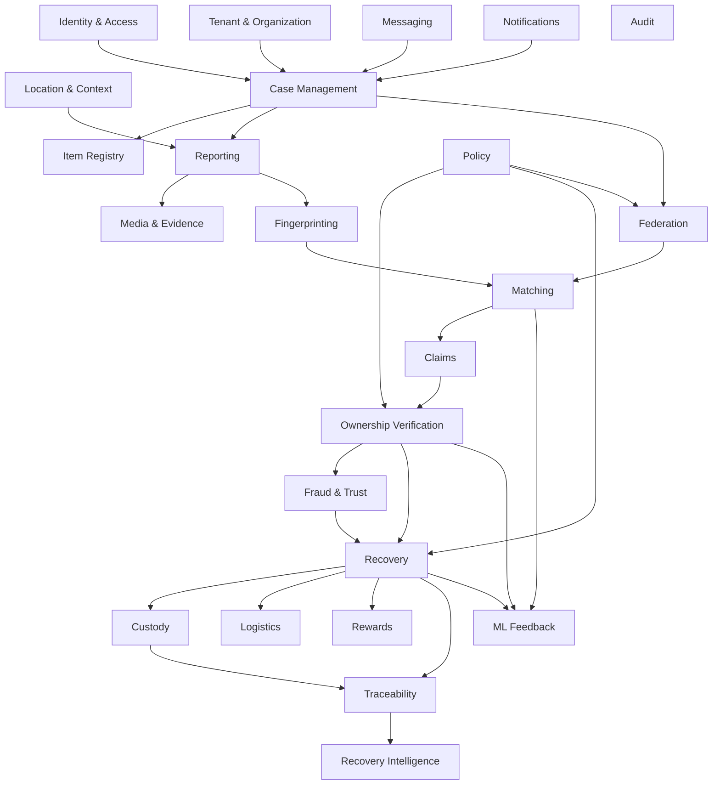

> **Current architecture authority (2026-10-26):** [Accepted baseline](../architecture/baseline.md) and its linked ADRs govern implementation. This supplied document is preserved below as detailed research/design material. Where examples or diagrams conflict with the baseline, use the baseline; no runtime capability is implied.

# Domain Architecture

> **Dzoka — The Open Recovery Network**

This document defines the domain architecture of Dzoka.

It describes:

- bounded contexts;
- aggregates;
- entities;
- value objects;
- domain services;
- state machines;
- domain events;
- invariants;
- ownership boundaries;
- cross-context interactions.

The goal is to prevent Dzoka from becoming a collection of loosely related CRUD tables.

Dzoka models a real-world recovery process involving:

```text
people
physical objects
evidence
institutions
locations
claims
custody
verification
federation
logistics
recovery
learning
```

Each domain concept must have a clear owner and lifecycle.

---

# 1. Domain Architecture Principles

Dzoka follows these domain rules.

## 1.1 Domain concepts come before database tables

The database exists to persist the domain.

The domain must not be designed by starting with:

```text
users table
items table
claims table
```

and inferring behaviour afterwards.

Instead:

```text
business concept
    ↓
domain model
    ↓
aggregate boundaries
    ↓
state machine
    ↓
persistence design
```

---

## 1.2 A physical object is different from a report about the object

A report is:

> somebody's observation or claim about an item.

An item is:

> the physical object Dzoka is attempting to identify and recover.

Therefore:

```text
LostReport ≠ Item
FoundReport ≠ Item
```

Reports contribute evidence about items.

---

## 1.3 Matching is not ownership

A `MatchCandidate` represents:

> evidence that two item observations may refer to the same physical object.

A `Claim` represents:

> a person's assertion that they own or are entitled to recover an item.

These belong to different bounded contexts.

---

## 1.4 Custody is not ownership

An institution may hold an item without owning it.

A finder may possess an item without owning it.

A courier may temporarily control an item without owning it.

Therefore Dzoka separately models:

```text
ownership
custody
possession
authorization
```

---

## 1.5 Derived AI evidence is not source evidence

The system distinguishes:

```text
SOURCE EVIDENCE
```

from:

```text
DERIVED EVIDENCE
```

Example:

```text
Photo uploaded by finder
    = source evidence

"red scratch near charging port"
    = derived vision evidence
```

Both may matter, but their provenance differs.

---

# 2. Bounded Context Overview

Dzoka is divided into the following primary bounded contexts.

```text
Identity & Access
Tenancy & Organization
Location & Context
Case Management
Item Registry
Reporting
Media & Evidence
Fingerprinting
Matching
Claims
Ownership Verification
Fraud & Trust
Custody
Recovery
Messaging
Notifications
Logistics
Rewards
Federation
Traceability
Policy
Audit
ML Feedback
Recovery Intelligence
```

---

# 3. Context Map



---

# 4. Identity & Access Context

## Purpose

Represents people, service identities, and authenticated principals inside Dzoka.

It does not own authentication credentials when an external OIDC provider is used.

---

## Aggregate: `UserAccount`

```text
UserAccount
├── userId
├── externalIdentityId
├── displayName
├── preferredLanguage
├── timezone
├── status
├── contactChannels[]
└── createdAt
```

---

## User Status

```text
ACTIVE
SUSPENDED
DISABLED
DELETED
```

---

## Value Objects

```text
UserId
ExternalIdentityReference
ContactAddress
Locale
Timezone
```

---

# 5. Service Identity

Machines and integrations require separate identities.

Aggregate:

```text
ServiceIdentity
├── serviceId
├── tenantId
├── name
├── type
├── scopes[]
├── status
└── credentialsReference
```

Examples:

```text
courier integration
institution import service
federation node
CCTV edge node
API client
```

---

# 6. Tenancy & Organization Context

## Purpose

Models who operates a Dzoka environment and how institutions are structured.

---

## Aggregate: `Tenant`

```text
Tenant
├── tenantId
├── name
├── status
├── settings
├── dataPolicies
├── featureFlags
└── createdAt
```

---

## Aggregate: `Organization`

```text
Organization
├── organizationId
├── tenantId
├── name
├── type
├── status
├── units[]
├── locations[]
└── policies
```

Organization types may include:

```text
AIRPORT
UNIVERSITY
TRANSPORT_OPERATOR
MALL
HOTEL
HOSPITAL
GOVERNMENT
POLICE_APPROVED
EVENT_VENUE
COURIER
OTHER
```

---

# 7. Organization Unit

```text
OrganizationUnit
├── unitId
├── organizationId
├── parentUnitId
├── name
├── type
└── status
```

Examples:

```text
Terminal 1 Security
Lost Property Office
Bus Depot A
Campus Security
Hotel Front Desk
```

---

# 8. Membership

Aggregate or entity:

```text
OrganizationMembership
├── membershipId
├── userId
├── organizationId
├── organizationUnitId
├── roles[]
├── status
└── effectivePeriod
```

---

# 9. Location & Context Bounded Context

## Purpose

Models where events occur and how locations relate.

Dzoka does not treat every location as a simple latitude/longitude pair.

---

## Aggregate: `Location`

```text
Location
├── locationId
├── tenantId
├── canonicalName
├── type
├── parentLocationId
├── aliases[]
├── coordinates
├── geometry
├── externalReferences[]
├── organizationId
└── metadata
```

---

## Location Types

Possible values:

```text
COUNTRY
PROVINCE
CITY
DISTRICT
FACILITY
BUILDING
FLOOR
ROOM
ZONE
TERMINAL
PLATFORM
STOP
DEPOT
VEHICLE
ROUTE
ENTRANCE
PARKING_AREA
OTHER
```

---

# 10. Location Value Objects

```text
GeoPoint
GeoArea
LocationPath
LocationReference
LocationConfidence
ApproximateLocation
```

Example:

```text
ApproximateLocation
├── canonicalLocation
├── radiusMeters
├── confidence
└── source
```

---

# 11. Temporal Context

Dzoka models uncertain time.

Value object:

```text
TimeWindow
├── start
├── end
├── precision
├── timezone
└── source
```

Examples:

```text
exact:
2026-10-03T14:12

approximate:
14:00 ± 30 minutes

range:
19:00–21:00

natural language:
"yesterday afternoon"
```

Natural-language input is resolved into a time window while preserving the original expression.

---

# 12. Case Management Context

## Purpose

`RecoveryCase` is the umbrella process for a lost-property recovery.

A case is not the item itself.

It coordinates references to the domain entities involved.

---

## Aggregate: `RecoveryCase`

```text
RecoveryCase
├── caseId
├── tenantId
├── caseNumber
├── caseType
├── openedBy
├── primaryItemId
├── status
├── priority
├── owningOrganization
├── assignedUnit
├── createdAt
├── updatedAt
└── closureReason
```

---

# 13. Case Types

```text
LOST_ITEM
FOUND_ITEM
MATCH_INVESTIGATION
CCTV_INVESTIGATION
OWNERSHIP_DISPUTE
FEDERATED_RECOVERY
```

---

# 14. Case Lifecycle

```text
OPEN
 ↓
ENRICHING
 ↓
SEARCHING
 ↓
MATCH_FOUND
 ↓
CLAIM_IN_PROGRESS
 ↓
VERIFICATION
 ↓
RECOVERY_READY
 ↓
RECOVERY_IN_PROGRESS
 ↓
RECOVERED
 ↓
CLOSED
```

Alternative terminal states:

```text
CANCELLED
UNRESOLVED
ARCHIVED
DISPOSED
```

The case state is a projection of multiple domain processes.

It must not replace their individual states.

---

# 15. Item Registry Context

## Purpose

Models physical objects independently from individual observations.

---

## Aggregate: `ItemRecord`

```text
ItemRecord
├── itemId
├── tenantId
├── itemType
├── registrationState
├── canonicalCategory
├── canonicalBrand
├── canonicalModel
├── protectedIdentifiers[]
├── knownOwnerReferences[]
├── registeredTags[]
├── currentFingerprintVersion
└── status
```

---

# 16. Item Status

Possible values:

```text
UNKNOWN
REGISTERED
LOST
FOUND
IN_CUSTODY
MATCHED
CLAIMED
RECOVERED
ARCHIVED
DISPOSED
```

This status should be derived carefully from recovery events rather than mutated casually.

---

# 17. Registered Item

A user may register an item before it is lost.

Entity:

```text
RegisteredItemProfile
├── itemId
├── ownerId
├── photographs[]
├── protectedIdentifiers[]
├── digitalTags[]
├── proofReferences[]
└── registrationDate
```

---

# 18. Item Identifier

Value object:

```text
ItemIdentifier
├── type
├── normalizedValue
├── protectedValue
├── hash
├── source
└── verificationState
```

Identifier types:

```text
SERIAL_NUMBER
IMEI
PASSPORT_NUMBER
ASSET_TAG
QR_IDENTIFIER
NFC_IDENTIFIER
RFID_IDENTIFIER
GS1_IDENTIFIER
ENTERPRISE_ASSET_ID
OTHER
```

Sensitive identifiers should generally be protected rather than exposed directly.

---

# 19. Reporting Context

## Purpose

Captures observations about lost and found objects.

---

## Aggregate: `LostReport`

```text
LostReport
├── reportId
├── caseId
├── reporterId
├── channel
├── rawDescription
├── reportedLocationExpression
├── resolvedLocation
├── lostTimeWindow
├── lastSeenLocation
├── circumstances
├── mediaReferences[]
├── status
├── reportedAt
└── provenance
```

---

# 20. Aggregate: `FoundReport`

```text
FoundReport
├── reportId
├── caseId
├── finderReference
├── reportingOrganization
├── channel
├── rawDescription
├── foundLocation
├── foundTime
├── storageLocation
├── mediaReferences[]
├── custodyReference
├── status
└── reportedAt
```

---

# 21. Report Status

```text
DRAFT
SUBMITTED
PROCESSING
ACTIVE
MATCHED
RESOLVED
REJECTED
ARCHIVED
```

---

# 22. Report Provenance

Value object:

```text
ReportProvenance
├── channel
├── externalSource
├── externalIdentifier
├── submittedBy
├── receivedAt
├── originalLanguage
└── importMetadata
```

---

# 23. Media & Evidence Context

## Purpose

Controls media, ownership evidence, privacy classification, and provenance.

---

## Aggregate: `MediaAsset`

```text
MediaAsset
├── mediaId
├── tenantId
├── ownerEntity
├── objectStorageKey
├── contentType
├── mediaType
├── classification
├── processingState
├── contentHash
├── provenance
├── retentionPolicy
├── safeDerivativeId
└── createdAt
```

---

# 24. Media Classification

```text
PUBLIC
RESTRICTED
SECRET
```

---

# 25. Media Processing State

```text
UPLOADED
VALIDATING
SANITIZING
READY
REDACTED
QUARANTINED
REJECTED
DELETED
```

---

# 26. Evidence

Generic value object/entity:

```text
Evidence
├── evidenceId
├── type
├── source
├── sourceReference
├── classification
├── reliability
├── confidence
├── provenance
├── collectedAt
└── expiresAt
```

---

# 27. Evidence Sources

```text
USER
FINDER
STAFF
SYSTEM
VISION
OCR
SPEECH
AI
FEDERATION
CCTV
ASSET_REGISTRY
COURIER
PAYMENT_PROVIDER
EXTERNAL_SYSTEM
```

---

# 28. Source vs Derived Evidence

```text
SourceEvidence
```

examples:

```text
uploaded photograph
receipt
voice note
serial entered by owner
finder description
CCTV clip
```

DerivedEvidence examples:

```text
OCR result
embedding
detected scratch
predicted category
geolocation inference
LLM-normalized description
```

Derived evidence must always reference its source evidence where applicable.

---

# 29. Fingerprinting Context

## Purpose

Builds a machine-searchable representation of a physical object.

---

## Aggregate: `ItemFingerprint`

```text
ItemFingerprint
├── fingerprintId
├── itemId
├── version
├── category
├── attributes[]
├── globalVisualFeatures[]
├── localVisualFeatures[]
├── textualFeatures[]
├── ocrFeatures[]
├── protectedFeatures[]
├── contextFeatures[]
├── provenance[]
├── coverage
├── createdAt
└── status
```

---

# 30. Fingerprint Versioning

Fingerprint updates create new versions.

Never silently mutate an old fingerprint used in a previous match.

Example:

```text
Fingerprint v1
    ↓
new image uploaded
    ↓
Fingerprint v2
```

Matching runs reference the exact fingerprint version used.

---

# 31. Fingerprint Component Types

Value objects:

```text
FingerprintAttribute
VisualEmbeddingReference
PatchEmbeddingReference
TextEmbeddingReference
OCRFeature
DistinctiveFeature
ProtectedFeature
ContextFeature
ModelProvenance
```

---

# 32. Matching Context

## Purpose

Determines whether lost and found records may refer to the same physical object.

It does not determine ownership.

---

## Aggregate: `MatchingRun`

```text
MatchingRun
├── runId
├── sourceFingerprintId
├── trigger
├── algorithmVersion
├── configurationVersion
├── startedAt
├── completedAt
├── candidateCount
├── status
└── metrics
```

---

# 33. Match Candidate

Entity:

```text
MatchCandidate
├── candidateId
├── runId
├── lostItemId
├── foundItemId
├── retrievalEvidence[]
├── featureEvidence[]
├── conflicts[]
├── retrievalScore
├── matchScore
├── evidenceCoverage
├── confidence
├── level
├── recommendedAction
├── status
└── createdAt
```

---

# 34. Candidate Status

```text
GENERATED
RECOMMENDED
UNDER_REVIEW
CONFIRMED
REJECTED
STALE
SUPERSEDED
```

---

# 35. Match Level

Example:

```text
VERY_HIGH
HIGH
MEDIUM
LOW
IGNORE
REJECTED
```

Exact boundaries are configuration/version controlled.

---

# 36. Match Evidence

Entity/value object:

```text
MatchEvidence
├── evidenceId
├── candidateId
├── featureType
├── lostValue
├── foundValue
├── similarity
├── reliability
├── weight
├── contribution
├── relation
├── explanation
├── provenance
└── modelVersion
```

---

# 37. Match Conflict

```text
MatchConflict
├── type
├── field
├── severity
├── lostValue
├── foundValue
├── penalty
├── rejecting
└── explanation
```

Severity:

```text
CRITICAL
MAJOR
MINOR
```

---

# 38. Match Decision

Entity:

```text
MatchDecision
├── decisionId
├── candidateId
├── decision
├── decidedBy
├── reason
├── scoreAtDecision
├── algorithmVersion
└── decidedAt
```

Possible decisions:

```text
CONFIRMED
REJECTED
DEFERRED
```

These decisions are important ML labels.

---

# 39. Claims Context

## Purpose

Represents a person's assertion that an item belongs to them or that they are entitled to recover it.

---

## Aggregate: `Claim`

```text
Claim
├── claimId
├── itemId
├── candidateId
├── claimantId
├── status
├── submittedEvidence[]
├── verificationId
├── riskAssessmentId
├── createdAt
├── resolvedAt
└── resolutionReason
```

---

# 40. Claim Lifecycle

```text
DRAFT
 ↓
SUBMITTED
 ↓
UNDER_REVIEW
 ↓
VERIFICATION_REQUIRED
 ↓
VERIFYING
 ↓
APPROVED
```

Alternative:

```text
REJECTED
WITHDRAWN
CONFLICT
EXPIRED
```

---

# 41. Claim Conflict

A found item may have multiple active claims.

Entity:

```text
ClaimConflict
├── conflictId
├── itemId
├── claimIds[]
├── status
├── detectedAt
├── resolvedAt
└── resolution
```

---

# 42. Ownership Verification Context

## Purpose

Determines whether a claimant has sufficient evidence to recover an item.

---

## Aggregate: `VerificationSession`

```text
VerificationSession
├── verificationId
├── claimId
├── itemId
├── status
├── challenges[]
├── evidence[]
├── policyVersion
├── confidence
├── decision
├── reviewedBy
├── startedAt
└── completedAt
```

---

# 43. Verification Status

```text
PENDING
CHALLENGE_REQUIRED
EVIDENCE_REQUIRED
IN_PROGRESS
HUMAN_REVIEW
VERIFIED
REJECTED
INCONCLUSIVE
EXPIRED
```

---

# 44. Ownership Challenge

Entity:

```text
OwnershipChallenge
├── challengeId
├── verificationId
├── type
├── question
├── protectedExpectedEvidence
├── sourceEvidenceReference
├── discriminativeScore
├── disclosureRisk
├── status
├── expiresAt
└── generatedBy
```

---

# 45. Challenge Types

```text
PRIVATE_ATTRIBUTE
SERIAL_FRAGMENT
VISUAL_DETAIL
CONTENTS
PURCHASE_DETAIL
PRIOR_PHOTO
DEVICE_DETAIL
INSTITUTIONAL_RECORD
CUSTOM
```

---

# 46. Challenge Response

```text
ChallengeResponse
├── responseId
├── challengeId
├── claimantId
├── rawResponse
├── interpretedResponse
├── score
├── confidence
├── submittedAt
└── interpretationProvenance
```

Raw claimant response must be preserved.

---

# 47. Verification Evidence

```text
VerificationEvidence
├── evidenceId
├── verificationId
├── type
├── source
├── reliability
├── result
├── confidence
└── provenance
```

---

# 48. Verification Decision

```text
VerificationDecision
├── outcome
├── confidence
├── policyResult
├── humanDecision
├── reason
├── evidenceSummary
└── timestamp
```

Outcome:

```text
VERIFIED
REJECTED
INCONCLUSIVE
```

---

# 49. Fraud & Trust Context

## Purpose

Assesses abuse and fraud risk around claims, recovery, and external interactions.

---

## Aggregate: `RiskAssessment`

```text
RiskAssessment
├── assessmentId
├── subjectType
├── subjectId
├── riskScore
├── riskLevel
├── signals[]
├── modelVersion
├── ruleVersion
├── recommendedAction
└── assessedAt
```

---

# 50. Risk Levels

```text
LOW
MEDIUM
HIGH
CRITICAL
```

---

# 51. Risk Signal

```text
RiskSignal
├── signalType
├── severity
├── value
├── confidence
├── source
└── explanation
```

Examples:

```text
REPEATED_FAILED_CLAIMS
HIGH_CLAIM_FREQUENCY
BRUTE_FORCE_CHALLENGES
LOCATION_IMPOSSIBILITY
IDENTITY_CONFLICT
DUPLICATE_EVIDENCE
DEVICE_ABUSE
```

---

# 52. Custody Context

## Purpose

Tracks who physically controls an item.

---

## Aggregate: `CustodyRecord`

```text
CustodyRecord
├── itemId
├── currentCustodian
├── currentLocation
├── status
├── version
└── lastEventId
```

The current state is derived from custody events.

---

# 53. Custody Event

```text
CustodyEvent
├── eventId
├── itemId
├── previousCustodian
├── newCustodian
├── previousLocation
├── newLocation
├── reason
├── actor
├── evidence[]
├── occurredAt
└── correlationId
```

---

# 54. Custodian

Value object/reference:

```text
Custodian
├── type
├── referenceId
└── organizationId
```

Types:

```text
PERSON
FINDER
ORGANIZATION
ORGANIZATION_UNIT
COURIER
LOCKER
SYSTEM
OTHER
```

---

# 55. Custody Status

```text
UNKNOWN
WITH_FINDER
IN_INSTITUTIONAL_CUSTODY
IN_TRANSFER
WITH_COURIER
READY_FOR_HANDOVER
RETURNED
DISPOSED
```

---

# 56. Recovery Context

## Purpose

Owns authorization and completion of the return process.

---

## Aggregate: `RecoveryOrder`

```text
RecoveryOrder
├── recoveryId
├── itemId
├── claimId
├── verificationId
├── status
├── method
├── authorization
├── handoverId
├── shipmentId
├── rewardId
├── createdAt
└── completedAt
```

---

# 57. Recovery Methods

```text
IN_PERSON_PICKUP
COURIER
INSTITUTIONAL_TRANSFER
AUTHORIZED_REPRESENTATIVE
OTHER
```

---

# 58. Recovery Lifecycle

```text
PENDING_AUTHORIZATION
 ↓
AUTHORIZED
 ↓
READY
 ↓
IN_PROGRESS
 ↓
HANDED_OVER
 ↓
CONFIRMED
 ↓
COMPLETED
```

Alternative states:

```text
CANCELLED
FAILED
DISPUTED
EXPIRED
```

---

# 59. Recovery Authorization

Value object/entity:

```text
RecoveryAuthorization
├── verificationOutcome
├── riskOutcome
├── policyOutcome
├── reviewerApproval
├── issuedAt
├── expiresAt
└── restrictions[]
```

Recovery cannot proceed without valid authorization.

---

# 60. Handover

Aggregate/entity:

```text
Handover
├── handoverId
├── recoveryId
├── method
├── tokenReference
├── status
├── recipient
├── completedBy
├── completedAt
└── evidence
```

---

# 61. Handover Status

```text
PENDING
TOKEN_ISSUED
READY
ATTEMPTED
COMPLETED
FAILED
EXPIRED
REVOKED
```

---

# 62. Messaging Context

## Purpose

Provides secure communication without exposing private contact details.

---

## Aggregate: `Conversation`

```text
Conversation
├── conversationId
├── caseId
├── participants[]
├── type
├── status
├── retentionPolicy
└── createdAt
```

---

# 63. Conversation Types

```text
OWNER_FINDER
OWNER_INSTITUTION
STAFF_INTERNAL
CLAIM_REVIEW
COURIER
SYSTEM
```

---

# 64. Message

```text
Message
├── messageId
├── conversationId
├── sender
├── channel
├── content
├── media[]
├── moderationState
├── sentAt
└── deliveryState
```

---

# 65. Notification Context

Aggregate:

```text
Notification
├── notificationId
├── recipient
├── type
├── template
├── channel
├── status
├── relatedEntity
├── createdAt
├── deliveredAt
└── failureReason
```

---

# 66. Notification Status

```text
QUEUED
SENDING
DELIVERED
FAILED
RETRYING
SUPPRESSED
```

---

# 67. Logistics Context

## Purpose

Coordinates physical shipping without owning courier implementation.

---

## Aggregate: `Shipment`

```text
Shipment
├── shipmentId
├── recoveryId
├── provider
├── providerShipmentId
├── pickup
├── delivery
├── status
├── trackingNumber
├── quote
├── proofOfDelivery
└── timestamps
```

---

# 68. Shipment Status

```text
QUOTED
BOOKED
PICKUP_SCHEDULED
PICKED_UP
IN_TRANSIT
OUT_FOR_DELIVERY
DELIVERED
FAILED
CANCELLED
RETURNED
```

---

# 69. Rewards Context

## Purpose

Manages optional compensation to a finder.

---

## Aggregate: `Reward`

```text
Reward
├── rewardId
├── caseId
├── itemId
├── offeredBy
├── beneficiary
├── amount
├── currency
├── status
├── paymentReference
├── conditions
└── timestamps
```

---

# 70. Reward Status

```text
OFFERED
AUTHORIZED
RESERVED
ELIGIBLE
RELEASE_PENDING
RELEASED
CANCELLED
REFUNDED
FAILED
```

Recovery must not depend on a voluntary reward.

---

# 71. Federation Context

## Purpose

Coordinates trusted exchange between independent Dzoka nodes.

---

## Aggregate: `FederationNode`

```text
FederationNode
├── nodeId
├── organizationId
├── endpoint
├── publicKeys[]
├── trustState
├── capabilities[]
├── protocolVersions[]
├── status
└── metadata
```

---

# 72. Federation Trust State

```text
PENDING
TRUSTED
RESTRICTED
SUSPENDED
REVOKED
```

---

# 73. Federated Query

Aggregate:

```text
FederatedQuery
├── queryId
├── initiatingNode
├── fingerprintReference
├── targetNodes[]
├── sharingPolicy
├── status
├── createdAt
├── expiresAt
└── responses[]
```

---

# 74. Federated Candidate

```text
FederatedCandidate
├── candidateId
├── sourceNode
├── remoteReference
├── safeEvidence
├── localScore
├── evidenceCoverage
├── algorithmVersion
├── modelVersions[]
├── calibrationMetadata
└── receivedAt
```

---

# 75. Federation Query Status

```text
CREATED
DISPATCHING
WAITING
PARTIAL
COMPLETED
TIMED_OUT
FAILED
CANCELLED
```

---

# 76. Federation Principle

A `FederatedCandidate` is not imported blindly as a normal local match.

It must pass through:

```text
safe evidence normalization
        ↓
local reconciliation
        ↓
local reranking
        ↓
local policy
```

---

# 77. Traceability Context

## Purpose

Provides append-oriented physical-object event history.

---

## Aggregate: `RecoveryEvent`

```text
RecoveryEvent
├── eventId
├── itemId
├── eventType
├── actor
├── location
├── organization
├── timestamp
├── reason
├── evidence[]
├── source
└── metadata
```

---

# 78. Recovery Event Types

```text
ITEM_REGISTERED
ITEM_REPORTED_LOST
ITEM_REPORTED_FOUND
ITEM_OBSERVED
ITEM_RECEIVED
ITEM_STORED
ITEM_TRANSFERRED
MATCH_IDENTIFIED
CLAIM_SUBMITTED
OWNERSHIP_VERIFIED
RECOVERY_AUTHORIZED
ITEM_DISPATCHED
ITEM_DELIVERED
ITEM_RETURNED
ITEM_ARCHIVED
ITEM_DISPOSED
```

---

# 79. EPCIS Mapping

The domain model remains Dzoka-native.

An adapter may map selected events to concepts such as:

```text
ObjectEvent
AggregationEvent
TransactionEvent
AssociationEvent
```

where semantically appropriate.

EPCIS compatibility must not distort the core domain.

---

# 80. Policy Context

## Purpose

Represents configurable decisions.

---

## Aggregate/Entity: `PolicySet`

```text
PolicySet
├── policySetId
├── tenantId
├── organizationId
├── type
├── version
├── rules
├── status
├── effectiveFrom
└── effectiveTo
```

---

# 81. Policy Types

```text
ACCESS
RECOVERY
VERIFICATION
FEDERATION
RETENTION
CUSTODY
REWARD
CCTV
DATA_DISCLOSURE
```

---

# 82. Policy Decision

```text
PolicyDecision
├── decisionId
├── policySetVersion
├── subject
├── resource
├── action
├── result
├── obligations[]
├── reason
└── decidedAt
```

---

# 83. Audit Context

## Purpose

Tracks security-relevant and business-relevant actions.

---

## Aggregate/Entity: `AuditEvent`

```text
AuditEvent
├── auditId
├── actor
├── action
├── entityType
├── entityId
├── tenantId
├── correlationId
├── requestId
├── beforeSummary
├── afterSummary
├── source
├── timestamp
└── metadata
```

Sensitive payloads should not be copied directly into audit logs.

---

# 84. ML Feedback Context

## Purpose

Converts verified outcomes into model-learning data.

---

## Aggregate: `FeedbackRecord`

```text
FeedbackRecord
├── feedbackId
├── type
├── sourceEntityId
├── label
├── featuresReference
├── algorithmVersion
├── modelVersions[]
├── provenance
├── createdAt
└── datasetEligibility
```

---

# 85. Feedback Types

```text
MATCH_CONFIRMED
MATCH_REJECTED
CLAIM_VERIFIED
CLAIM_REJECTED
RECOVERY_SUCCESS
RECOVERY_FAILED
FRAUD_CONFIRMED
FRAUD_CLEARED
```

---

# 86. Recovery Intelligence Context

## Purpose

Uses historical recovery events to estimate how items move through institutions and networks.

---

## Aggregate/Model: `RecoveryTransitionModel`

Conceptual domain contract:

```text
predictNextStates(context)
```

Input:

```text
item type
current state
organization
location
route
time
custodian
event history
```

Output:

```text
TransitionPrediction
├── nextState
├── destination
├── probability
├── expectedDelay
├── explanation
└── modelVersion
```

---

# 87. Recovery Graph Projection

The Recovery Intelligence context may build a projection:

```text
Item
Person
Organization
Location
Vehicle
Route
Custodian
RecoveryEvent
```

with relationships such as:

```text
LOST_AT
OBSERVED_AT
FOUND_AT
HELD_BY
TRANSFERRED_TO
TRAVELLED_VIA
RETURNED_TO
```

The projection is derived from authoritative domain events.

---

# 88. Aggregate Ownership Summary

| Aggregate | Owning Context |
|---|---|
| UserAccount | Identity |
| Tenant | Tenancy |
| Organization | Organization |
| Location | Location |
| RecoveryCase | Case |
| ItemRecord | Item Registry |
| LostReport | Reporting |
| FoundReport | Reporting |
| MediaAsset | Media |
| ItemFingerprint | Fingerprinting |
| MatchingRun | Matching |
| MatchCandidate | Matching |
| Claim | Claims |
| VerificationSession | Verification |
| RiskAssessment | Fraud |
| CustodyRecord | Custody |
| RecoveryOrder | Recovery |
| Conversation | Messaging |
| Notification | Notification |
| Shipment | Logistics |
| Reward | Rewards |
| FederationNode | Federation |
| FederatedQuery | Federation |
| RecoveryEvent | Traceability |
| PolicySet | Policy |
| FeedbackRecord | ML Feedback |

---

# 89. Aggregate Boundary Rule

A transaction should normally modify only one aggregate.

Example:

Incorrect:

```text
Approve Claim transaction
    updates Claim
    updates Custody
    updates Recovery
    releases Reward
    books Courier
```

Correct:

```text
Claim approved
    ↓
ClaimApproved event

Verification succeeds
    ↓
OwnershipVerified event

Recovery authorized
    ↓
RecoveryAuthorized event

Courier requested
    ↓
ShipmentCreated event
```

This prevents large fragile transactions.

---

# 90. Domain Event Strategy

Domain events express completed business facts.

Examples:

```text
CaseOpened
LostReportSubmitted
FoundReportSubmitted
MediaUploaded
FingerprintCreated
MatchingRequested
MatchCandidateGenerated
MatchConfirmed
ClaimSubmitted
OwnershipChallengeIssued
OwnershipVerified
ClaimRejected
CustodyTransferred
RecoveryAuthorized
ShipmentBooked
ItemReturned
RewardReleased
CaseClosed
```

Use past tense for events.

---

# 91. Domain Event Structure

```text
DomainEvent
├── eventId
├── eventType
├── aggregateType
├── aggregateId
├── aggregateVersion
├── tenantId
├── occurredAt
├── actor
├── correlationId
├── causationId
├── schemaVersion
└── payload
```

---

# 92. Command vs Event

Commands request actions:

```text
SubmitLostReport
GenerateFingerprint
SearchMatches
SubmitClaim
VerifyOwnership
TransferCustody
AuthorizeRecovery
BookCourier
ReleaseReward
```

Events describe facts:

```text
LostReportSubmitted
FingerprintCreated
MatchCandidateGenerated
ClaimSubmitted
OwnershipVerified
CustodyTransferred
RecoveryAuthorized
ShipmentBooked
RewardReleased
```

---

# 93. Important State Machines

Dzoka contains several independent state machines.

They must not be collapsed into one global status.

---

# 94. Match State Machine

```text
GENERATED
   ↓
RECOMMENDED
   ↓
UNDER_REVIEW
   ↓
CONFIRMED
```

or:

```text
REJECTED
STALE
SUPERSEDED
```

---

# 95. Claim State Machine

```text
DRAFT
 ↓
SUBMITTED
 ↓
UNDER_REVIEW
 ↓
VERIFICATION_REQUIRED
 ↓
VERIFYING
 ↓
APPROVED
```

or:

```text
REJECTED
CONFLICT
WITHDRAWN
EXPIRED
```

---

# 96. Verification State Machine

```text
PENDING
 ↓
CHALLENGE_REQUIRED
 ↓
IN_PROGRESS
 ↓
HUMAN_REVIEW
 ↓
VERIFIED
```

Alternative:

```text
REJECTED
INCONCLUSIVE
EXPIRED
```

---

# 97. Custody State Machine

```text
WITH_FINDER
 ↓
IN_INSTITUTIONAL_CUSTODY
 ↓
READY_FOR_HANDOVER
 ↓
WITH_COURIER
 ↓
RETURNED
```

Other paths are possible.

---

# 98. Recovery State Machine

```text
PENDING_AUTHORIZATION
 ↓
AUTHORIZED
 ↓
READY
 ↓
IN_PROGRESS
 ↓
HANDED_OVER
 ↓
CONFIRMED
 ↓
COMPLETED
```

---

# 99. Reward State Machine

```text
OFFERED
 ↓
AUTHORIZED
 ↓
RESERVED
 ↓
ELIGIBLE
 ↓
RELEASED
```

Alternative:

```text
CANCELLED
REFUNDED
FAILED
```

---

# 100. Domain Invariants

These invariants should be enforced in domain code.

---

## INV-DOM-001

A recovery cannot be completed without an item.

---

## INV-DOM-002

An ownership claim must reference a recoverable item.

---

## INV-DOM-003

A verification decision cannot exist without a claim.

---

## INV-DOM-004

A recovery authorization must reference a completed or explicitly overridden verification process.

---

## INV-DOM-005

A custody transfer must identify the previous and new custodian unless the initial custody state is being established.

---

## INV-DOM-006

A reward cannot be released before recovery conditions are satisfied.

---

## INV-DOM-007

A candidate with a rejecting critical conflict cannot become `CONFIRMED` unless an explicit authorized override is recorded.

---

## INV-DOM-008

A public projection must never contain secret evidence.

---

## INV-DOM-009

A federation response may contain only data permitted by the originating node's disclosure policy.

---

## INV-DOM-010

A fingerprint version used by a historical matching run must remain reproducible.

---

# 101. Match vs Ownership Example

Consider:

```text
Lost report:
black Lenovo laptop
serial ending 9247

Found report:
black Lenovo laptop
same location
same photo characteristics
```

The Matching context may conclude:

```text
MatchCandidate
score = 96
confidence = HIGH
```

But this only means:

> likely same physical object.

The Claim context then receives:

```text
Claimant A
Claimant B
```

The Verification context determines:

```text
Claimant A:
knows hidden underside sticker
has receipt
serial matches
prior photo matches

Claimant B:
only knows public description
```

Only Claimant A may be verified.

---

# 102. Eventual Consistency Between Contexts

Cross-context state may be eventually consistent.

Example:

```text
OwnershipVerified
    ↓ event
Recovery context consumes
    ↓
RecoveryOrder becomes AUTHORIZED
```

Do not require direct synchronous database coupling between contexts unless business correctness demands it.

---

# 103. Strong Consistency Boundaries

Use strong transactional consistency for operations such as:

```text
claim lifecycle transition
verification decision
custody transfer
recovery authorization
handover completion
reward ledger update
```

---

# 104. Derived Read Models

Read-heavy UI workflows may use projections.

Examples:

```text
CaseOverview
MatchReviewQueue
ClaimReviewQueue
CustodyDashboard
RecoveryDashboard
FederationSearchSummary
```

These are not authoritative aggregates.

---

# 105. Public Item Projection

Example:

```text
PublicItemView
├── publicReference
├── category
├── safeDescription
├── broadLocation
├── approximateDate
├── safeImage
└── status
```

It must omit:

```text
serial
IMEI
private finder identity
hidden verification attributes
exact storage room
claim evidence
```

---

# 106. Restricted Staff Projection

Example:

```text
StaffItemView
├── public data
├── exact custody location
├── matching evidence
├── claim status
├── internal notes
└── operational history
```

Access remains policy controlled.

---

# 107. Secret Evidence Projection

Only explicitly authorized workflows may expose:

```text
identity documents
full serial
IMEI
private photographs
claim answers
receipts
```

Access must be audited.

---

# 108. Domain Service vs Entity Logic

Rules involving one aggregate should live inside that aggregate where practical.

Example:

```text
claim.submit()
claim.withdraw()
```

Cross-aggregate rules belong in domain/application services.

Example:

```text
RecoveryAuthorizationService
```

must combine:

```text
verification
risk
custody
policy
```

---

# 109. Value Object Guidelines

Use value objects for concepts such as:

```text
Money
TimeWindow
GeoPoint
LocationReference
MatchScore
Confidence
EvidenceReliability
IdentifierHash
TenantId
CaseNumber
ModelVersion
CorrelationId
```

Value objects should validate themselves.

---

# 110. Money

```text
Money
├── amount
└── currency
```

Never represent reward amounts as untyped floating-point numbers.

---

# 111. Confidence

```text
Confidence
├── value
└── calibrationVersion
```

A confidence value should not be confused with a raw similarity score.

---

# 112. Model Provenance

Value object:

```text
ModelProvenance
├── provider
├── model
├── version
├── configurationVersion
├── promptVersion
└── executedAt
```

---

# 113. Evidence Reliability

Value object:

```text
EvidenceReliability
├── score
├── sourceType
└── basis
```

Example conceptual ordering:

```text
verified serial
    >
staff-confirmed observation
    >
OCR
    >
vision inference
    >
generic LLM inference
```

The exact reliability scheme remains configurable.

---

# 114. External Identifier Boundary

External IDs must not become internal primary keys.

Example:

```text
Twilio message ID
Meta message ID
courier shipment ID
payment transaction ID
```

should be represented as:

```text
ExternalReference
```

linked to Dzoka-owned identifiers.

---

# 115. Federation Domain Boundaries

A remote item remains owned by the remote node.

Local Dzoka should not create an authoritative local copy simply because it received a federation candidate.

Instead:

```text
RemoteItemReference
├── nodeId
├── remoteId
└── safeSnapshot
```

---

# 116. Ownership vs Entitlement

Some scenarios may require a person other than the legal owner to collect an item.

Examples:

```text
parent collecting for child
employer collecting company laptop
authorized representative
executor
```

Therefore future-proof the domain for:

```text
RecoveryEntitlement
```

rather than assuming claimant identity always equals owner identity.

---

# 117. Recovery Entitlement

Value object/entity:

```text
RecoveryEntitlement
├── claimantId
├── ownerReference
├── entitlementType
├── supportingEvidence[]
├── validityPeriod
└── status
```

---

# 118. Institutional Custody Policy

Different organizations may have different rules.

Examples:

```text
passport requires supervisor approval
electronics over $500 require ID verification
ordinary clothing may use simplified pickup
```

The domain therefore invokes policy rather than hard-coding all rules into `RecoveryOrder`.

---

# 119. Disposal Domain

Unclaimed property may follow a lifecycle.

Possible aggregate/entity:

```text
DispositionOrder
├── itemId
├── policyReference
├── type
├── authorizedBy
├── status
├── scheduledAt
└── completedAt
```

Types:

```text
DONATION
DISPOSAL
TRANSFER
AUCTION
LEGAL_HOLD
OTHER
```

---

# 120. Registered Asset Domain Extension

Registered items may support proactive recovery.

Future entity:

```text
AssetPresenceRule
├── itemId
├── ruleType
├── geofence
├── separationThreshold
└── notificationPolicy
```

This enables optional BLE/UWB or institutional asset monitoring without changing the core recovery model.

---

# 121. Channel Independence

The domain must not know whether a report came from:

```text
WhatsApp
web
mobile
kiosk
API
voice
```

It only receives:

```text
ReportSubmission
```

with provenance.

Channel-specific behavior remains outside the domain.

---

# 122. AI Independence

The domain should not know whether an embedding came from:

```text
OpenCLIP
SigLIP
remote model
local ONNX
future model
```

It receives:

```text
EmbeddingEvidence
```

with model provenance.

---

# 123. Courier Independence

The Recovery context does not depend on DHL, FedEx, local courier, or another vendor.

It works with:

```text
ShipmentReference
```

through a provider interface.

---

# 124. Payment Independence

The Rewards context works with:

```text
PaymentAuthorization
PaymentReservation
PaymentSettlement
```

through a provider abstraction.

---

# 125. Domain Error Types

Examples:

```text
InvalidStateTransition
PolicyViolation
UnauthorizedDomainAction
ConflictingClaim
CriticalMatchConflict
CustodyConflict
ExpiredVerification
RecoveryNotAuthorized
HandoverTokenExpired
RewardNotEligible
FederationDisclosureDenied
```

These should be domain concepts, not generic HTTP errors.

---

# 126. Concurrency

Aggregates should use optimistic locking where concurrent modification is possible.

Examples:

```text
Claim
CustodyRecord
RecoveryOrder
Reward
FederatedQuery
```

A version field may be used.

---

# 127. Idempotency and Domain Commands

Critical commands should carry:

```text
IdempotencyKey
```

Examples:

```text
SubmitClaim
TransferCustody
ConfirmHandover
BookShipment
ReleaseReward
```

Repeated commands must not create duplicate physical or financial actions.

---

# 128. Event Replay

Domain events may be replayed into projections.

However, Dzoka is not required to be a pure event-sourced system.

Primary authoritative state can remain relational while important events are append-oriented.

---

# 129. Audit vs Domain Events

Do not confuse:

```text
Domain Event
```

with:

```text
Audit Event
```

Domain event:

```text
OwnershipVerified
```

Audit event:

```text
Staff member X viewed claimant passport at 12:04
```

One describes business state.

The other records accountable activity.

---

# 130. Traceability vs Audit

Similarly:

```text
RecoveryEvent
```

tracks what happened to the physical object.

```text
AuditEvent
```

tracks what people and systems did inside Dzoka.

Example:

```text
RecoveryEvent:
ITEM_TRANSFERRED from Airport Security to Courier

AuditEvent:
Staff user 123 approved transfer
```

---

# 131. Domain Event Examples

## Lost report

```text
LostReportSubmitted
```

payload concept:

```text
reportId
caseId
itemReference
reportedBy
locationReference
timeWindow
channel
```

---

## Fingerprint

```text
ItemFingerprintCreated
```

---

## Match

```text
MatchCandidateGenerated
```

---

## Claim

```text
ClaimSubmitted
```

---

## Verification

```text
OwnershipVerified
```

---

## Custody

```text
CustodyTransferred
```

---

## Recovery

```text
ItemReturned
```

---

# 132. Full Domain Flow

```text
USER REPORT
    ↓
Reporting Context
    ↓
Item Registry
    ↓
Media / Evidence
    ↓
Fingerprinting
    ↓
Matching
    ↓
MatchCandidate
    ↓
Claims
    ↓
Ownership Verification
    ↓
Fraud / Policy
    ↓
Recovery Authorization
    ↓
Custody
    ↓
Logistics / Handover
    ↓
Recovery Completed
    ↓
Traceability
    ↓
ML Feedback
    ↓
Recovery Intelligence
```

---

# 133. Example Domain Journey

A commuter reports a lost laptop.

```text
LostReportSubmitted
```

creates or associates:

```text
RecoveryCase
ItemRecord
LostReport
```

The photograph and voice note become:

```text
MediaAsset
SourceEvidence
```

AI produces:

```text
OCR Evidence
Visual Evidence
Embeddings
Structured Attributes
```

Fingerprinting creates:

```text
ItemFingerprint v1
```

Matching creates:

```text
MatchingRun
MatchCandidate
MatchEvidence
```

A likely found laptop exists at a bus depot.

The owner submits:

```text
Claim
```

Verification creates:

```text
OwnershipChallenge
ChallengeResponse
VerificationEvidence
```

The claimant is verified.

The Recovery context creates:

```text
RecoveryAuthorization
RecoveryOrder
```

Custody moves:

```text
Bus Depot
    ↓
Courier
    ↓
Owner
```

Traceability stores:

```text
CustodyTransferred
ItemDispatched
ItemDelivered
ItemReturned
```

The completed recovery produces:

```text
FeedbackRecord
```

which later contributes to:

```text
RecoveryTransitionModel
```

---

# 134. Aggregate Relationship Summary

```text
RecoveryCase
   │
   ├── LostReport / FoundReport
   │       │
   │       └── MediaAsset
   │
   ├── ItemRecord
   │       │
   │       └── ItemFingerprint
   │
   ├── MatchCandidate
   │
   ├── Claim
   │       │
   │       └── VerificationSession
   │
   ├── RecoveryOrder
   │       ├── Handover
   │       ├── Shipment
   │       └── Reward
   │
   └── RecoveryEvents
```

This diagram represents references, not one giant aggregate.

---

# 135. No Giant Case Aggregate

`RecoveryCase` MUST NOT become a massive aggregate containing every object.

That would create:

- huge transactions;
- locking contention;
- difficult concurrency;
- poor modularity.

Instead the case references independently owned aggregates.

---

# 136. Domain Model and Database

The next data-architecture document should map aggregates to persistence.

However, a likely pattern is:

```text
aggregate
    ↓
own tables
    ↓
foreign references
    ↓
domain event outbox
```

Database schemas must respect aggregate ownership.

---

# 137. Domain Model and Federation

Federation should exchange contracts based on domain concepts such as:

```text
FederatedSearchRequest
FederatedCandidate
VerificationRequest
CustodyTransferRequest
RecoveryConfirmation
```

It must not expose raw internal database schemas.

---

# 138. Domain Model and APIs

Public API resources may map to domain concepts but should use explicit DTOs.

Do not expose internal entities directly.

Example:

```text
Claim
```

becomes:

```text
ClaimResponseDTO
```

with fields filtered by authorization.

---

# 139. Domain Model and Events

Domain events should be more stable than internal implementation.

Consumers should not rely on internal JPA entity structures.

---

# 140. Domain Model and AI

AI services should receive explicit inference contracts.

Example:

```text
GenerateFingerprintFeaturesRequest
```

rather than being given direct access to arbitrary domain tables.

---

# 141. Domain Model and Privacy

Every domain object carrying sensitive data should support data classification.

Examples:

```text
Evidence.classification
MediaAsset.classification
ItemIdentifier.classification
Challenge.expectedEvidence.classification
```

---

# 142. Domain Model and Retention

Retention may apply differently to:

```text
report
media
claim evidence
CCTV
audit
chat
federation cache
```

The domain should reference retention policies rather than assuming one global retention period.

---

# 143. Domain Model and Legal Hold

Sensitive evidence may sometimes require a legal hold.

Value object/entity:

```text
LegalHold
├── holdId
├── resourceType
├── resourceId
├── reason
├── imposedBy
├── startsAt
└── releasedAt
```

Retention workers must respect active holds.

---

# 144. Source Audit Influence

The current domain architecture incorporates source-audit lessons including:

```text
globalenglish01/lostfound
    → separate retrieval, evidence, conflict and decision concepts

Lost-and-Found-Tracking-System
    → explicit claim and review lifecycle

La2eet
    → private verification questions

FindBack
    → recovery/handover workflow concepts

OpenEPCIS
    → append-oriented physical-object event history

Mycel
    → remote nodes remain independently authoritative
```

External inspiration does not imply source-code copying.

---

# 145. Domain Architecture Constraints

Do not introduce the following without architectural review:

1. one `status` field attempting to represent all workflows;
2. one giant `Item` aggregate containing reports, claims, custody and recovery;
3. direct AI ownership decisions;
4. direct courier control over recovery state;
5. direct payment control over reward state;
6. federation importing remote authoritative records as local truth;
7. public APIs exposing domain entities directly;
8. destructive AI normalization of user input;
9. mutable historical match evidence;
10. mutable historical model provenance.

---

# 146. Domain Architecture Decision Summary

| Domain Concern | Decision |
|---|---|
| Case | coordination aggregate |
| Physical object | ItemRecord |
| User observation | LostReport / FoundReport |
| AI representation | versioned ItemFingerprint |
| Matching | separate Matching context |
| Ownership assertion | Claim |
| Ownership proof | VerificationSession |
| Fraud | RiskAssessment |
| Physical possession | Custody |
| Physical return | RecoveryOrder |
| Delivery | Shipment |
| Reward | Reward |
| Cross-node search | FederatedQuery |
| Object history | RecoveryEvent |
| Learning feedback | FeedbackRecord |
| Prediction | RecoveryTransitionModel |

---

# 147. Core Semantic Distinctions

These distinctions must remain explicit throughout implementation:

```text
Item
≠ Report

Report
≠ Fingerprint

Fingerprint
≠ Match

Match
≠ Claim

Claim
≠ Verification

Verification
≠ Recovery Authorization

Ownership
≠ Custody

Custody
≠ Delivery

Delivery
≠ Recovery Confirmation

AI Evidence
≠ Ground Truth

Federated Candidate
≠ Local Authoritative Record
```

---

# 148. Final Domain Principle

Dzoka's core domain can be summarized as six connected questions:

```text
WHAT physical object are we talking about?
        ↓
WHERE and WHEN was it lost, seen or found?
        ↓
DO these observations refer to the same object?
        ↓
WHO is entitled to recover it?
        ↓
WHO has custody and how does it get back safely?
        ↓
WHAT should Dzoka learn from the outcome?
```

The domain architecture must preserve those distinctions.

That is what allows Dzoka to evolve from a simple lost-property application into a federated physical-object recovery network without losing correctness, privacy, or auditability.