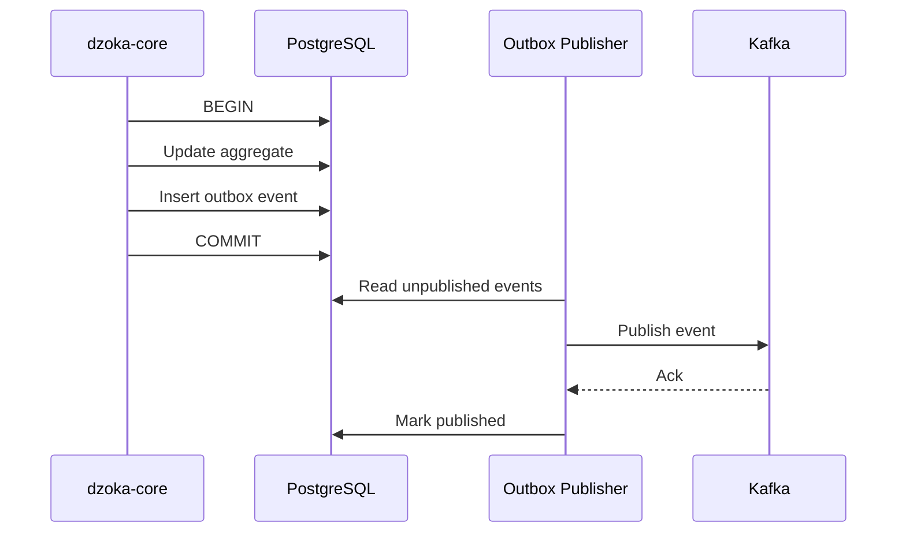
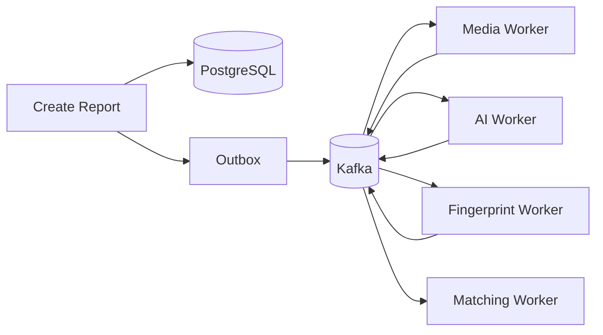
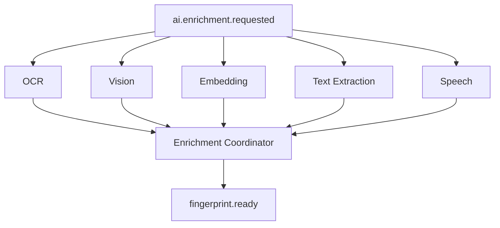
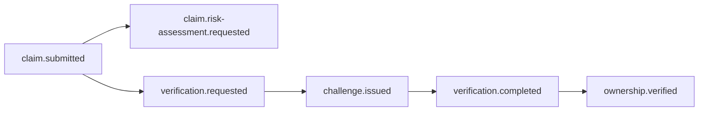
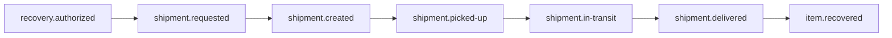
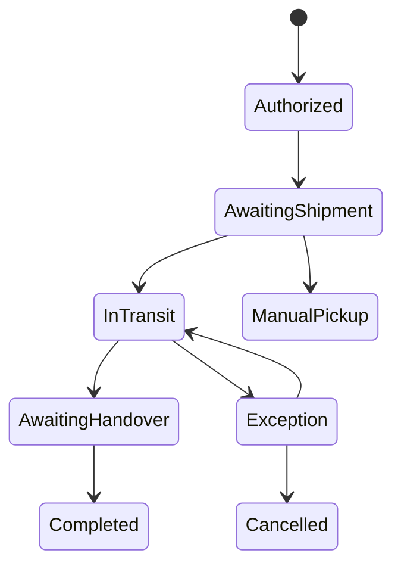

> **Current architecture authority (2026-10-26):** [Accepted baseline](../architecture/baseline.md) and its linked ADRs govern implementation. This supplied document is preserved below as detailed research/design material. Where examples or diagrams conflict with the baseline, use the baseline; no runtime capability is implied.

# Event Architecture

> **Dzoka — The Open Recovery Network**

This document defines the event architecture of Dzoka.

It covers:

- domain events;
- integration events;
- event envelopes;
- Kafka-compatible topics;
- transactional outbox;
- inbox/deduplication;
- idempotency;
- ordering;
- retries;
- dead-letter handling;
- replay;
- schema evolution;
- correlation and causation;
- asynchronous workflows;
- saga/process management;
- observability;
- security;
- federation events.

Dzoka uses events because many important operations are expensive, distributed, failure-prone, or do not need to complete inside the original HTTP request.

Examples include:

```text
media sanitization
OCR
speech transcription
vision analysis
embedding generation
fingerprint construction
matching
notifications
federation fan-out
courier integration
reward processing
analytics
ML feedback
retention
```

The central principle is:

> **Persist the business fact first, publish reliably, process asynchronously, and make every consumer safe to run more than once.**

---

# 1. Event Architecture Goals

The event architecture must provide:

1. reliable business-event publication;
2. loose coupling between bounded contexts;
3. asynchronous processing of expensive work;
4. retryable workflows;
5. idempotent consumption;
6. observable event chains;
7. schema versioning;
8. controlled replay;
9. horizontal worker scaling;
10. explicit failure handling;
11. preservation of business ordering where required;
12. strong separation between events and commands;
13. compatibility with standalone and federated deployments.

---

# 2. Event Architecture Principles

## 2.1 The database commit is authoritative

An event MUST NOT be treated as successfully created until the corresponding authoritative domain transaction has committed.

Incorrect:

```text
publish event
   ↓
write database
   ↓
database fails
```

This could produce an event describing a fact that never happened.

Preferred:

```text
database transaction
├── update aggregate
└── insert outbox event
        ↓
commit
        ↓
outbox publisher
        ↓
event broker
```

---

# 3. Event Types

Dzoka distinguishes several event categories.

```text
DomainEvent
IntegrationEvent
CommandMessage
JobMessage
ExternalEvent
FederationMessage
AuditEvent
TelemetryEvent
```

These concepts MUST NOT be treated as interchangeable.

---

# 4. Domain Events

A domain event represents a business fact that has already occurred.

Examples:

```text
LostReportSubmitted
FoundReportSubmitted
ItemFingerprintCreated
MatchCandidateGenerated
ClaimSubmitted
OwnershipVerified
CustodyTransferred
RecoveryAuthorized
ItemReturned
RewardReleased
```

Domain events use past tense.

They originate from authoritative domain operations.

---

# 5. Integration Events

Integration events are stable messages published for other components.

A domain event may be transformed into an integration event.

Example:

```text
Domain:
ItemFingerprintCreated

Integration:
fingerprint.ready
```

This separation prevents external consumers from depending directly on internal aggregate implementations.

---

# 6. Commands

Commands request that something happen.

Examples:

```text
GenerateFingerprint
RunMatching
SendNotification
BookShipment
ReleaseReward
RunFederatedSearch
```

A command is not proof that the requested operation occurred.

---

# 7. Jobs

Jobs represent asynchronous technical work.

Examples:

```text
sanitize-media
generate-image-embedding
transcribe-audio
refresh-courier-tracking
rebuild-search-projection
```

Jobs are implementation-level messages and should not be confused with domain events.

---

# 8. Event Naming

External/integration event types use lowercase dotted names.

Examples:

```text
case.created
item.reported
media.uploaded
media.sanitized
ai.enrichment.requested
ocr.completed
vision.completed
embedding.completed
fingerprint.ready
matching.requested
matching.completed
candidate.created
claim.submitted
verification.completed
ownership.verified
custody.transferred
recovery.authorized
shipment.created
shipment.updated
item.recovered
reward.released
ml.feedback.created
```

Internal Java/Python domain objects may use:

```text
CaseCreated
OwnershipVerified
CustodyTransferred
```

---

# 9. Canonical Event Envelope

All integration events should use a consistent envelope.

```json
{
  "eventId": "019...",
  "eventType": "fingerprint.ready",
  "schemaVersion": 1,
  "occurredAt": "2026-10-03T14:20:15.145Z",
  "publishedAt": "2026-10-03T14:20:15.431Z",

  "producer": {
    "service": "dzoka-core",
    "instance": "core-7f589d8f9f-x"
  },

  "tenantId": "019...",
  "organizationId": "019...",

  "aggregate": {
    "type": "ItemFingerprint",
    "id": "019...",
    "version": 3
  },

  "correlationId": "019...",
  "causationId": "019...",

  "trace": {
    "traceId": "...",
    "spanId": "..."
  },

  "dataClassification": "RESTRICTED",

  "payload": {}
}
```

---

# 10. Required Envelope Fields

Every durable business integration event should contain:

```text
eventId
eventType
schemaVersion
occurredAt
producer
tenantId where applicable
correlationId
payload
```

Where relevant also include:

```text
organizationId
aggregate identity
aggregate version
causationId
trace context
classification
```

---

# 11. Event ID

Use globally unique IDs.

Preferred project-wide identifier strategy:

```text
UUIDv7
```

if adopted by the identifier ADR.

The event ID is also used for consumer deduplication.

---

# 12. Correlation ID

`correlationId` follows the full logical business operation.

Example:

```text
WhatsApp lost report
       ↓
case creation
       ↓
AI enrichment
       ↓
fingerprint
       ↓
matching
       ↓
notification
```

All events should retain the same correlation ID where they belong to the same workflow.

---

# 13. Causation ID

`causationId` identifies which previous event or command directly caused the current event.

Example:

```text
event A:
item.reported
id = A

event B:
ai.enrichment.requested
causationId = A

event C:
vision.completed
causationId = B
```

This makes event chains reconstructable.

---

# 14. Event Classification

Events inherit data classification.

Possible values:

```text
PUBLIC
RESTRICTED
SECRET
```

SECRET data should generally not be placed in broad event topics.

Instead publish references to protected records.

Incorrect:

```json
{
  "passportNumber": "...",
  "claimAnswer": "..."
}
```

Preferred:

```json
{
  "verificationEvidenceId": "..."
}
```

---

# 15. Event Broker

Dzoka uses a Kafka-compatible event backbone.

Supported candidates include:

```text
Apache Kafka
Redpanda
```

The exact default implementation should be selected by ADR following operational/source audit.

Business contracts must not depend on vendor-specific broker features unless documented.

---

# 16. Topic Strategy

Recommended domain topic families:

```text
dzoka.case
dzoka.item
dzoka.media
dzoka.ai
dzoka.fingerprint
dzoka.matching
dzoka.claim
dzoka.verification
dzoka.custody
dzoka.recovery
dzoka.notification
dzoka.federation
dzoka.logistics
dzoka.reward
dzoka.traceability
dzoka.ml-feedback
dzoka.audit
```

---

# 17. Topic Granularity

Avoid both extremes.

Too broad:

```text
dzoka.everything
```

Too fragmented:

```text
dzoka.claim.created
dzoka.claim.updated
dzoka.claim.reviewed
dzoka.claim.failed
...
```

Preferred:

```text
dzoka.claim
```

with `eventType` inside the event envelope.

---

# 18. Representative Topic Mapping

| Topic | Representative events |
|---|---|
| `dzoka.case` | `case.created`, `case.closed` |
| `dzoka.item` | `item.reported`, `item.registered` |
| `dzoka.media` | `media.uploaded`, `media.sanitized` |
| `dzoka.ai` | `ai.enrichment.requested`, `ocr.completed`, `vision.completed` |
| `dzoka.fingerprint` | `fingerprint.ready`, `fingerprint.superseded` |
| `dzoka.matching` | `matching.requested`, `matching.completed`, `candidate.created` |
| `dzoka.claim` | `claim.submitted`, `claim.withdrawn`, `claim.rejected` |
| `dzoka.verification` | `verification.requested`, `ownership.verified` |
| `dzoka.custody` | `custody.transferred` |
| `dzoka.recovery` | `recovery.authorized`, `item.recovered` |
| `dzoka.notification` | `notification.requested`, `notification.delivered` |
| `dzoka.federation` | federation workflow events |
| `dzoka.logistics` | `shipment.requested`, `shipment.updated` |
| `dzoka.reward` | `reward.authorized`, `reward.released` |
| `dzoka.ml-feedback` | `ml.feedback.created` |

---

# 19. Partitioning

Kafka partition keys should preserve ordering for the smallest business unit that needs it.

Examples:

```text
item events
→ itemId

claim events
→ claimId

recovery events
→ recoveryId

custody events
→ itemId

federated query events
→ queryId
```

Do not use tenant ID as the sole key if per-item ordering is required.

---

# 20. Ordering Guarantees

Dzoka must assume ordering is guaranteed only:

```text
within a partition
```

not globally.

Consumers must not depend on global event order.

---

# 21. Aggregate Version

For state-sensitive event streams include:

```text
aggregateVersion
```

Example:

```text
CustodyTransferred v7
```

A consumer receiving version 9 before version 8 can detect the gap.

---

# 22. Out-of-Order Handling

Possible strategies:

```text
ignore if event is stale
buffer briefly
reload authoritative state
retry later
send to reconciliation
```

The correct strategy depends on the consumer.

---

# 23. Transactional Outbox

Every authoritative service publishing business events must use a transactional outbox.

Example table:

```text
outbox_events
├── id
├── aggregate_type
├── aggregate_id
├── aggregate_version
├── event_type
├── schema_version
├── tenant_id
├── payload
├── correlation_id
├── causation_id
├── created_at
├── published_at
├── attempt_count
└── last_error
```

---

# 24. Outbox Flow



---

# 25. Outbox Publication Semantics

Dzoka assumes:

```text
at-least-once publication
```

rather than pretending exactly-once end-to-end delivery exists automatically.

Consumers MUST therefore be idempotent.

---

# 26. Outbox Polling

Possible implementations:

```text
scheduled DB poller
CDC
Debezium
```

Initial implementation may use a reliable polling publisher.

CDC may be introduced later through ADR if scale warrants it.

---

# 27. Inbox Pattern

Critical consumers should maintain an inbox.

Example:

```text
inbox_events
├── consumer_name
├── event_id
├── status
├── received_at
├── processed_at
├── attempts
└── result_hash
```

Constraint:

```text
UNIQUE(consumer_name, event_id)
```

---

# 28. Consumer Flow

```text
receive event
   ↓
check inbox
   ↓
already processed?
   ├── yes → acknowledge
   └── no
        ↓
process transaction
        ↓
record inbox result
        ↓
commit
        ↓
acknowledge broker
```

---

# 29. Idempotency

Every consumer should assume the same event may arrive more than once.

Examples:

```text
embedding.completed
shipment.updated
payment.authorized
ownership.verified
```

must be safe under duplicates.

---

# 30. Idempotent State Transitions

Example:

Receiving:

```text
ownership.verified
```

twice must not create two RecoveryOrders.

Use:

```text
unique business constraints
inbox
idempotency keys
state checks
```

---

# 31. Commands and Idempotency

Commands to external systems should include idempotency identifiers where supported.

Examples:

```text
courier booking
payment authorization
reward release
shipment cancellation
```

---

# 32. Retry Categories

Failures should be classified.

```text
RETRYABLE
NON_RETRYABLE
UNKNOWN
```

Examples:

RETRYABLE:

```text
timeout
503
temporary connection failure
rate limit
dependency unavailable
```

NON_RETRYABLE:

```text
invalid payload
policy denial
unsupported media
invalid provider credentials
schema incompatibility
```

---

# 33. Retry Policy

Typical retry model:

```text
attempt 1
 ↓
short backoff
 ↓
attempt 2
 ↓
longer backoff
 ↓
attempt 3...
```

Use exponential backoff with jitter.

Do not retry infinitely.

---

# 34. Retry Metadata

Track:

```text
attempt count
first attempt
last attempt
next attempt
error class
provider error code
```

for operational visibility.

---

# 35. Dead-Letter Topics

Each significant topic family may have a corresponding DLQ.

Examples:

```text
dzoka.ai.dlq
dzoka.matching.dlq
dzoka.notification.dlq
dzoka.federation.dlq
dzoka.logistics.dlq
dzoka.reward.dlq
```

---

# 36. DLQ Principle

A DLQ is not a trash bin.

Every DLQ entry should retain:

```text
original event
failure reason
consumer
attempt count
timestamp
stack/error reference
correlation ID
```

Operational tooling must allow review and controlled replay.

---

# 37. Poison Messages

Messages causing deterministic failures should not repeatedly crash the same consumer.

Example:

```text
unsupported schema version
malformed event
invalid required field
```

These should move quickly to DLQ.

---

# 38. Event Schema Registry

Event schemas live in:

```text
packages/event-schemas/
```

Possible structure:

```text
packages/event-schemas/
├── case/
├── item/
├── media/
├── ai/
├── matching/
├── claim/
├── verification/
├── custody/
├── recovery/
├── federation/
├── logistics/
└── reward/
```

---

# 39. Schema Definition

Each event contract should define:

```text
event name
schema version
owner
payload
classification
partition key
producer
known consumers
compatibility policy
example
```

---

# 40. Schema Formats

Possible formats:

```text
JSON Schema
Avro
Protobuf
```

The final choice should be recorded through ADR.

For a polyglot Java/Python/TypeScript environment, explicit generated contracts are strongly preferred over untyped JSON conventions.

---

# 41. Schema Compatibility

Prefer backward-compatible changes.

Safe examples:

```text
add optional field
add enum value where consumers tolerate unknown values
```

Breaking examples:

```text
rename required field
change type
remove field
change semantics
```

Breaking changes require a new schema version.

---

# 42. Consumer Robustness

Consumers should:

```text
ignore unknown optional fields
validate required fields
reject unsupported schema versions
```

Do not deserialize directly into fragile internal domain entities.

---

# 43. Event Contracts vs Domain Entities

Never publish JPA entities directly.

Incorrect:

```text
KafkaTemplate.send(claimEntity)
```

Preferred:

```text
ClaimSubmittedV1
```

with an explicit integration schema.

---

# 44. Event Payload Minimization

Publish only what consumers need.

Example:

```json
{
  "claimId": "...",
  "itemId": "...",
  "verificationRequired": true
}
```

rather than full:

```text
user profile
all evidence
all contact details
entire item
```

---

# 45. Event Security

The broker should enforce:

```text
TLS
authentication
ACLs
service identities
topic permissions
```

Each producer/consumer receives minimum necessary access.

---

# 46. Sensitive Event Payloads

SECRET values should generally be represented by references.

Example:

```json
{
  "claimId": "...",
  "verificationEvidenceIds": ["..."]
}
```

The authorized consumer fetches protected evidence through the proper service.

---

# 47. Event Encryption

Transport encryption is mandatory.

Application-level payload encryption may be used for exceptional sensitive events, but should not become the default because it complicates:

```text
observability
routing
schema validation
replay
```

Prefer references to protected records.

---

# 48. Event Audit

Critical events should be linkable to audit records.

Examples:

```text
ownership.verified
custody.transferred
recovery.authorized
reward.released
```

The event itself is not a substitute for a security audit trail.

---

# 49. Event Observability

Each producer and consumer records metrics such as:

```text
events_published_total
events_consumed_total
event_processing_duration
event_processing_failures
consumer_lag
outbox_pending
dlq_size
retry_count
```

---

# 50. Trace Propagation

OpenTelemetry trace context should propagate through events.

Example:

```text
HTTP request
   ↓
core span
   ↓
Kafka publish
   ↓
worker consumer span
   ↓
AI call
   ↓
model span
```

---

# 51. User Report Event Flow



---

# 52. Lost Report Event Sequence

```text
lost-report.submitted
        ↓
media.sanitization.requested
        ↓
media.sanitized
        ↓
ai.enrichment.requested
        ↓
ocr.completed
vision.completed
speech.completed
embedding.completed
        ↓
fingerprint.ready
        ↓
matching.requested
        ↓
matching.completed
        ↓
candidate.created
```

Not every event is required for every report.

---

# 53. Enrichment Fan-Out

AI enrichment should support parallel execution.



---

# 54. Enrichment Completion

Do not require all possible enrichments in every case.

The coordinator uses required/optional task definitions.

Example:

```text
text report only:
required:
- text extraction
- text embedding

optional:
- translation

photo report:
required:
- image embedding

optional:
- OCR
- object detection
- local patch features
```

---

# 55. Task Tracking

Represent enrichment tasks explicitly.

Example:

```text
enrichment_tasks
├── task_id
├── item_id
├── task_type
├── required
├── status
├── attempt_count
└── result_reference
```

This makes partial progress visible.

---

# 56. Fingerprint Readiness

Fingerprint creation may occur when:

```text
all required enrichment tasks are complete
```

Optional late evidence may produce a new fingerprint version.

Example:

```text
Fingerprint v1
    ↓
late OCR result
    ↓
Fingerprint v2
```

---

# 57. Matching Event Flow

```text
fingerprint.ready
       ↓
matching.requested
       ↓
candidate retrieval
       ↓
reranking
       ↓
matching.completed
       ↓
candidate.created × N
       ↓
candidate notification/policy
```

---

# 58. Candidate Event Volume

Do not publish one event for thousands of low-quality raw retrieval candidates.

Only durable candidates that survive configured thresholds should produce externally relevant candidate events.

Internal matching stages may use in-process data or compact job messages.

---

# 59. Claim Event Flow



---

# 60. Verification Outcome Events

Possible integration events:

```text
verification.completed
ownership.verified
ownership.rejected
verification.inconclusive
verification.expired
```

Only authoritative verification components may publish these.

---

# 61. Recovery Event Flow

```text
ownership.verified
        ↓
recovery.authorization.requested
        ↓
recovery.authorized
        ↓
handover.created
or
shipment.requested
        ↓
custody.transferred
        ↓
item.delivered
        ↓
item.recovered
        ↓
case.closed
```

---

# 62. Courier Workflow



Provider webhooks must be normalized before producing Dzoka domain events.

---

# 63. Reward Workflow

```text
reward.offered
    ↓
payment.authorization.requested
    ↓
reward.reserved
    ↓
item.recovered
    ↓
reward.release.requested
    ↓
reward.released
```

Recovery remains valid even if voluntary reward processing fails.

---

# 64. Federation Workflow Events

Internal federation processing may use events such as:

```text
federation.search.requested
federation.peer-query.requested
federation.peer-response.received
federation.search.partial
federation.search.completed
federation.search.failed
```

These are local operational events.

Cross-node protocol messages are handled separately.

---

# 65. Federation vs Kafka

Kafka is internal infrastructure.

Dzoka nodes MUST NOT assume they share one Kafka cluster.

Cross-node communication occurs through:

```text
Dzoka Federation Protocol
```

not shared Kafka topics.

---

# 66. Cross-Node Event Boundary

Conceptually:

```text
Internal Event
    ↓
Federation Application Service
    ↓
Federation Protocol Message
    ↓
Remote Node
    ↓
Remote Domain Command
    ↓
Remote Domain Event
```

This protects node autonomy.

---

# 67. Saga / Process Manager Architecture

Long-running workflows require process coordination.

Dzoka should prefer explicit process managers over giant distributed transactions.

Potential process managers:

```text
ReportEnrichmentProcess
MatchingProcess
OwnershipVerificationProcess
RecoveryProcess
CourierRecoveryProcess
RewardProcess
FederatedSearchProcess
RetentionDeletionProcess
```

---

# 68. Process Manager Principle

A process manager stores workflow progress.

It does not own underlying domain aggregates.

Example:

```text
CourierRecoveryProcess
├── recoveryId
├── shipmentId
├── currentStep
├── status
├── lastEvent
└── deadlines
```

---

# 69. Recovery Saga

Example:



---

# 70. Compensation

Dzoka should not pretend physical-world operations can always be rolled back.

Examples:

```text
courier already picked up item
payment already settled
custody already transferred
```

Compensating actions may instead be:

```text
return shipment
refund
reverse ledger entry
new custody transfer
manual review
```

Never delete history to simulate rollback.

---

# 71. Timeouts

Long-running workflows need explicit deadlines.

Examples:

```text
ownership challenge expires
federation search expires
courier quote expires
handover token expires
payment authorization expires
```

Represent timeout events explicitly where useful.

```text
verification.expired
handover.expired
federation.search.timed-out
```

---

# 72. Scheduled Events

Scheduled jobs should generally store durable schedule state where business-critical.

Do not rely solely on in-memory timers.

Potential mechanisms:

```text
database scheduled task records
Kafka delayed workflow strategy
worker scheduler
```

---

# 73. Notification Events

Business components should request intent:

```text
notification.requested
```

rather than call WhatsApp directly.

Payload:

```json
{
  "notificationId": "...",
  "recipientId": "...",
  "template": "MATCH_CANDIDATE_FOUND",
  "preferredChannels": ["WHATSAPP", "PUSH"],
  "relatedEntityType": "MatchCandidate",
  "relatedEntityId": "..."
}
```

---

# 74. Delivery Events

The messaging subsystem may emit:

```text
notification.accepted
notification.delivered
notification.failed
notification.suppressed
```

These do not change core business truth unless the business explicitly depends on delivery.

---

# 75. Media Events

Representative flow:

```text
media.uploaded
media.validation.requested
media.validated
media.quarantined
media.sanitization.requested
media.sanitized
media.redacted
media.processing.failed
```

---

# 76. Media Security Failure

An unsafe file should emit something like:

```text
media.quarantined
```

not silently disappear.

The report may remain usable without that media.

---

# 77. CCTV Events

Edge-to-core events may include:

```text
cctv.investigation.started
cctv.object-present
cctv.object-missing
cctv.disappearance-window-found
cctv.track-created
cctv.evidence-ready
cctv.investigation.completed
cctv.investigation.failed
```

Only privacy-safe metadata/evidence references should reach central topics.

---

# 78. Recovery Intelligence Events

Historical outcome events feed intelligence asynchronously.

```text
item.recovered
custody.transferred
recovery.failed
```

may generate:

```text
ml.feedback.created
transition.observation.created
```

---

# 79. Analytics Events

Analytics consumers should use business events where possible.

Do not make authoritative transactional modules wait for analytics.

---

# 80. Event Replay

Replay is required for:

```text
rebuilding projections
re-running analytics
re-indexing search
recovering failed consumers
re-generating derived models
```

Replay must not accidentally repeat external side effects.

---

# 81. Replay Safety

Consumers performing external actions need:

```text
replay guards
```

Example:

A replayed:

```text
shipment.requested
```

must not book a second courier.

---

# 82. Projection Consumers

Projection consumers should be highly replayable.

Examples:

```text
analytics projection
search document projection
recovery graph projection
dashboard projection
```

They should be rebuildable from durable facts where practical.

---

# 83. Side-Effect Consumers

Consumers performing:

```text
payment
courier booking
outbound messages
```

must store external operation state and idempotency references.

---

# 84. Reprocessing AI

Re-running AI inference is not the same as replaying a historic event.

A new model run should produce:

```text
new model_run
new derived evidence
possibly new fingerprint version
```

Historical results remain intact.

---

# 85. Event Retention

Topic retention depends on category.

Possible policy:

```text
technical jobs:
days

business integration events:
weeks/months

replay-critical events:
longer

audit truth:
persisted outside Kafka
```

Kafka retention must not be the only copy of legally/auditably required history.

---

# 86. Event Compaction

Compacted topics may be useful for some configuration/state distribution.

Examples:

```text
model configuration
feature flags
peer capabilities
```

Do not use compaction for workflows where event history matters.

---

# 87. Backpressure

Workers must respond to growing lag.

Strategies:

```text
horizontal scaling
provider rate limiting
queue prioritization
load shedding
bounded concurrency
```

Do not allow millions of AI jobs to overwhelm GPU workers uncontrollably.

---

# 88. Consumer Concurrency

Concurrency must respect ordering.

Example:

```text
matching jobs
→ highly parallel

custody events for same item
→ ordered
```

Partition-key design and consumer concurrency must align.

---

# 89. Priority

Some workloads may need priority.

Example:

```text
active handover verification
>
background analytics rebuild
```

Priority may use:

```text
separate topics
priority fields
dedicated worker pools
```

Avoid overcomplicating initial implementation.

---

# 90. Consumer Groups

Representative groups:

```text
dzoka-enrichment
dzoka-matching
dzoka-notifications
dzoka-logistics
dzoka-federation
dzoka-analytics
dzoka-ml-feedback
dzoka-retention
```

Each group scales independently.

---

# 91. Worker Ownership

Each event has a clearly identified owning consumer.

Do not create multiple unrelated consumers that independently mutate the same aggregate.

---

# 92. Event-Driven Aggregate Updates

When a consumer needs to mutate authoritative state:

```text
event
   ↓
application service
   ↓
domain aggregate
   ↓
repository
```

Do not let event handlers update database tables with ad hoc SQL bypassing domain invariants.

---

# 93. Eventual Consistency

Dzoka explicitly accepts eventual consistency for:

```text
AI enrichment
matching
notifications
analytics
federation cache
search indexes
ML feedback
```

---

# 94. Strong Consistency

Use synchronous transactional logic for:

```text
claim transition
verification decision
custody transfer
recovery authorization
handover completion
reward ledger mutation
```

Events occur after these facts are committed.

---

# 95. Event Failure Example

Suppose:

```text
OwnershipVerified committed
```

but the recovery consumer is down.

Correct result:

```text
ownership remains VERIFIED
event remains available
consumer catches up later
recovery authorization continues
```

Do not roll back verification because an asynchronous consumer was unavailable.

---

# 96. AI Failure Example

```text
item.reported
      ↓
AI job
      ↓
AI provider unavailable
```

The system should:

```text
record failed attempt
retry
keep report active
allow manual processing
```

The case must not disappear.

---

# 97. Matching Failure Example

If vector infrastructure is temporarily unavailable:

```text
matching.requested
      ↓
matching fails
      ↓
retry / fallback
```

If configured:

```text
Qdrant unavailable
→ PgVectorProvider
```

may be used.

---

# 98. Event Deadlines

Some events become stale.

Example:

```text
matching.requested
```

may no longer be relevant if a newer fingerprint superseded the source.

Consumers should verify current state before expensive processing.

---

# 99. Supersession

Example:

```text
Fingerprint v1 ready
Matching requested

Fingerprint v2 created before matching runs
```

The matching worker may:

```text
cancel v1 job
or
run v1 but mark results stale
```

based on policy.

---

# 100. Event Payload References

Large content must never be placed directly in Kafka.

Do not publish:

```text
base64 image
voice audio
video clip
receipt PDF
```

Publish:

```text
mediaId
objectReference
contentHash
```

---

# 101. Event Size Limits

Keep event payloads small and bounded.

Recommended design goal:

```text
KB-scale
```

rather than MB-scale.

---

# 102. External Provider Webhooks

Webhooks are not trusted domain events.

Flow:

```text
provider webhook
    ↓
signature validation
    ↓
deduplication
    ↓
normalization
    ↓
application service
    ↓
domain state update
    ↓
Dzoka domain event
```

---

# 103. Courier Webhook Example

External:

```text
DELIVERED
```

is first interpreted and validated.

Then Dzoka may generate:

```text
ShipmentDelivered
```

only if domain rules accept the state transition.

---

# 104. Payment Webhook Example

Provider event:

```text
payment_succeeded
```

does not automatically equal:

```text
RewardReleased
```

Dzoka reward policy and ledger rules remain authoritative.

---

# 105. Federation Message Handling

Remote federation message:

```text
MATCH_CANDIDATES
```

must go through:

```text
signature validation
replay validation
trust policy
schema validation
disclosure rules
domain mapping
```

before producing local events.

---

# 106. Federation Event Correlation

Cross-node messages should carry:

```text
networkCorrelationId
originNodeId
messageId
requestId
```

Local correlation IDs may additionally exist.

---

# 107. Event Provenance

Every integration event must identify its producer.

Consumers should never accept a business event simply because it appeared on a topic if broker ACLs/provenance are not correct.

---

# 108. Audit-Relevant Events

Certain events should trigger additional audit records.

Examples:

```text
ownership.verified
recovery.authorized
custody.transferred
reward.released
federation.trust.changed
model.promoted
policy.changed
```

---

# 109. Model Lifecycle Events

Possible events:

```text
model.registered
model.evaluated
model.shadow-deployed
model.promoted
model.rolled-back
model.retired
```

These aid governance.

---

# 110. Model Promotion

`model.promoted` does not rewrite old inference history.

It changes which model is selected for future inference.

---

# 111. Configuration Events

Possible events:

```text
matching.configuration.changed
tenant.policy.changed
feature-flag.changed
federation.peer.changed
```

Services may refresh cached configuration asynchronously.

---

# 112. Configuration Consistency

Security-sensitive policy changes may require immediate cache invalidation or synchronous fetch rather than accepting long eventual-consistency windows.

---

# 113. Event Version Example

`fingerprint.ready` version 1:

```json
{
  "fingerprintId": "...",
  "itemId": "..."
}
```

Version 2 might add:

```json
{
  "fingerprintId": "...",
  "itemId": "...",
  "coverage": 0.82
}
```

If additive and optional, this may remain schema version 1 depending on compatibility policy.

Semantically breaking changes require a new version.

---

# 114. Event Deprecation

Event schemas should have:

```text
ACTIVE
DEPRECATED
RETIRED
```

states.

Before retiring:

```text
identify consumers
migrate consumers
monitor usage
remove only after compatibility window
```

---

# 115. Consumer Contract Tests

Every consumer should have tests proving it handles:

```text
current schema
older supported schema
duplicate event
unexpected optional field
retryable failure
poison message
```

---

# 116. Broker-Unavailable Behavior

If Kafka is unavailable but PostgreSQL is operational:

```text
domain transaction
+
outbox row
```

can still commit.

Publishing resumes later.

This is a major reason for the outbox pattern.

---

# 117. Outbox Backlog

Monitor:

```text
oldest unpublished event age
count unpublished
publish error rate
```

A growing outbox is a production incident.

---

# 118. Inbox Backlog

Monitor:

```text
consumer lag
processing duration
retrying events
failed events
```

---

# 119. Event SLOs

Possible SLO categories:

```text
report → enrichment requested
fingerprint → matching started
candidate → notification
ownership verification → recovery authorization
```

Exact values should be deployment-specific.

---

# 120. Event Time vs Processing Time

Distinguish:

```text
occurredAt
publishedAt
receivedAt
processedAt
```

A message processed late should still preserve when the underlying business event occurred.

---

# 121. Clock Skew

Cross-node events may involve clock skew.

Federation protocol should include:

```text
timestamp tolerance
nonce
signed request ID
```

Do not use timestamp alone for replay prevention.

---

# 122. Event Time in Recovery Intelligence

Recovery-transition models should generally use:

```text
event occurred time
```

rather than processing time.

---

# 123. Timezone

All persisted event timestamps use UTC.

Human-facing displays convert to appropriate timezone.

---

# 124. Event Store

Dzoka does not require a separate generic event-store database.

Authoritative event history is captured in:

```text
domain-specific append tables
outbox
Kafka
recovery_events
audit_events
```

A dedicated event store may be introduced only through ADR if future needs justify it.

---

# 125. Domain Events vs Recovery Events

Example:

```text
CustodyTransferred
```

may exist as:

```text
domain/integration event
```

for system coordination.

A corresponding:

```text
RecoveryEvent
```

is persisted as physical-object history.

They serve related but different purposes.

---

# 126. Domain Events vs Audit Events

Similarly:

```text
OwnershipVerified
```

is a business fact.

```text
Reviewer 42 opened secret receipt
```

is an audit fact.

Do not conflate them.

---

# 127. Retention Events

Possible lifecycle:

```text
retention.expiration-detected
retention.deletion-requested
retention.deletion-completed
retention.deletion-failed
```

Deletion must respect active legal holds.

---

# 128. Deletion Saga

Deletion may involve:

```text
PostgreSQL
object storage
vectors
caches
search projections
federation cache
```

Use an orchestrated deletion process rather than one best-effort SQL command.

---

# 129. ML Feedback Event

Example:

```json
{
  "eventType": "ml.feedback.created",
  "payload": {
    "feedbackId": "...",
    "feedbackType": "MATCH_CONFIRMED",
    "sourceCandidateId": "...",
    "datasetEligible": true
  }
}
```

Avoid publishing private raw features unnecessarily.

---

# 130. Reprocessing Historical Feedback

Evaluation/training jobs consume versioned datasets rather than arbitrary live Kafka history when reproducibility matters.

---

# 131. Edge Offline Events

`dzoka-edge` may be disconnected.

It should maintain a local durable queue for events such as:

```text
cctv.evidence-ready
edge.health.changed
```

When connectivity returns:

```text
sync
deduplicate
preserve original occurredAt
```

---

# 132. Edge Event Trust

Central Dzoka treats edge events as authenticated evidence from an authorized edge identity.

They still undergo:

```text
schema validation
authorization
case binding
```

---

# 133. Event Broker Multi-Tenancy

All tenant-aware events carry:

```text
tenantId
```

Topic-level isolation alone is not sufficient.

Consumers must enforce tenant context.

---

# 134. Dedicated Topics for High-Sensitivity Tenants

Some institutional deployments may require separate broker clusters or dedicated topics.

This is a deployment option, not a core domain assumption.

---

# 135. Consumer Tenant Guard

Before processing:

```text
event tenant
        ↓
consumer tenant policy
        ↓
allowed?
```

Cross-tenant leakage through event consumers is a critical security failure.

---

# 136. Event Prioritization for Active Recovery

Time-sensitive event classes may use dedicated topics/pools.

Example:

```text
handover verification
shipment webhook
```

should not sit behind millions of background re-embedding jobs.

---

# 137. Re-Embedding Event Flow

```text
model.promoted
    ↓
reembedding.plan.created
    ↓
embedding.regeneration.requested
    ↓
embedding.completed
    ↓
fingerprint.new-version-ready
```

Do not mutate existing embeddings.

---

# 138. Bulk Operations

Large reindex/reembedding tasks should use bounded batches.

Avoid publishing millions of messages instantaneously without backpressure.

---

# 139. Cancellation

Long-running jobs may support:

```text
job.cancel.requested
```

Examples:

```text
CCTV investigation
bulk reembedding
federated search
```

Workers should periodically check cancellation state.

---

# 140. Process State Persistence

Do not keep long-running saga state only in memory.

Use PostgreSQL tables such as:

```text
process_instances
process_steps
process_deadlines
```

or domain-specific equivalents.

---

# 141. Process Manager Idempotency

Process managers themselves must deduplicate events.

Example:

`item.recovered` arriving twice must not release the reward twice.

---

# 142. Manual Intervention

Certain failed workflows require human action.

Examples:

```text
payment reconciliation
federation conflict
custody discrepancy
courier delivery dispute
poisoned evidence processing
```

Represent these as operational cases/queues rather than infinite retries.

---

# 143. Event Failure Taxonomy

Possible error classes:

```text
VALIDATION
AUTHORIZATION
DEPENDENCY_TIMEOUT
DEPENDENCY_UNAVAILABLE
RATE_LIMIT
CONFLICT
SCHEMA
DATA_CORRUPTION
SECURITY
UNKNOWN
```

This makes operational metrics useful.

---

# 144. Security Incident Events

Potential internal security events:

```text
security.secret-access-denied
security.federation-signature-invalid
security.replay-detected
security.cross-tenant-access-blocked
security.webhook-signature-invalid
```

These should be routed to security monitoring, not normal business workflows.

---

# 145. Audit of Replay

Manual replay should record:

```text
who initiated it
why
which event range
which consumer
when
result
```

Replay is an administrative action.

---

# 146. Replay Scoping

Support replay by:

```text
event ID
time range
aggregate
tenant
consumer
topic partition/offset
```

where operational tooling permits.

---

# 147. No Blind Full Replay

Never replay an entire topic into a side-effecting consumer without understanding consequences.

---

# 148. Exactly-Once Claims

Dzoka should not market or architect around simplistic “exactly-once” guarantees.

The system uses:

```text
at-least-once delivery
+
idempotent consumers
+
transactional domain updates
+
deduplication
```

This is the durable design principle.

---

# 149. Event Contracts Repository

Target repository structure:

```text
packages/
└── event-schemas/
    ├── README.md
    ├── envelope/
    │   └── v1.*
    ├── case/
    ├── item/
    ├── media/
    ├── ai/
    ├── fingerprint/
    ├── matching/
    ├── claim/
    ├── verification/
    ├── custody/
    ├── recovery/
    ├── notification/
    ├── federation/
    ├── logistics/
    ├── reward/
    └── ml-feedback/
```

---

# 150. Event Documentation

Each event should document:

```text
purpose
producer
consumers
topic
partition key
schema
classification
example
idempotency implications
ordering assumptions
retry expectations
```

---

# 151. Example `item.reported`

```json
{
  "eventId": "019...",
  "eventType": "item.reported",
  "schemaVersion": 1,
  "occurredAt": "2026-10-03T13:20:00Z",
  "tenantId": "019...",
  "aggregate": {
    "type": "LostReport",
    "id": "019...",
    "version": 1
  },
  "correlationId": "019...",
  "payload": {
    "caseId": "019...",
    "itemId": "019...",
    "reportId": "019...",
    "reportType": "LOST",
    "hasMedia": true
  }
}
```

---

# 152. Example `fingerprint.ready`

```json
{
  "eventId": "019...",
  "eventType": "fingerprint.ready",
  "schemaVersion": 1,
  "occurredAt": "2026-10-03T13:20:10Z",
  "tenantId": "019...",
  "aggregate": {
    "type": "ItemFingerprint",
    "id": "019...",
    "version": 2
  },
  "correlationId": "019...",
  "payload": {
    "itemId": "019...",
    "fingerprintId": "019...",
    "fingerprintVersion": 2,
    "coverage": 0.81
  }
}
```

---

# 153. Example `ownership.verified`

```json
{
  "eventId": "019...",
  "eventType": "ownership.verified",
  "schemaVersion": 1,
  "occurredAt": "2026-10-03T14:02:13Z",
  "tenantId": "019...",
  "aggregate": {
    "type": "VerificationSession",
    "id": "019...",
    "version": 4
  },
  "correlationId": "019...",
  "payload": {
    "claimId": "019...",
    "itemId": "019...",
    "verificationId": "019...",
    "policyVersion": "verification-policy-4"
  }
}
```

No secret challenge answers are published.

---

# 154. Example `custody.transferred`

```json
{
  "eventId": "019...",
  "eventType": "custody.transferred",
  "schemaVersion": 1,
  "occurredAt": "2026-10-03T15:15:01Z",
  "tenantId": "019...",
  "aggregate": {
    "type": "CustodyRecord",
    "id": "019...",
    "version": 8
  },
  "correlationId": "019...",
  "payload": {
    "itemId": "019...",
    "custodyEventId": "019...",
    "previousCustodianType": "ORGANIZATION_UNIT",
    "newCustodianType": "COURIER",
    "locationId": "019..."
  }
}
```

---

# 155. Event-Driven Search Indexing

Search projection update:

```text
fingerprint.ready
    ↓
SearchProjectionWorker
    ↓
PostgreSQL search document
    ↓
optional Qdrant
```

Indexing status should be recorded.

---

# 156. Qdrant Synchronization Event

Example:

```text
embedding.created
    ↓
VectorIndexWorker
    ↓
Qdrant
    ↓
vector.indexed
```

PostgreSQL remains authoritative.

---

# 157. Event-Driven Analytics

Example:

```text
item.recovered
    ↓
AnalyticsProjectionWorker
    ↓
daily_recovery_metrics
```

Analytics failure never invalidates recovery.

---

# 158. Event-Driven Recovery Graph

```text
recovery event
    ↓
RecoveryGraphProjector
    ↓
graph projection
```

Projection failure can be replayed later.

---

# 159. Deployment Without Kafka

For development or very small deployments, a simplified broker-compatible profile may exist.

However, production architecture assumes an asynchronous durable event mechanism.

Any lightweight alternative must preserve:

```text
durability
retry
ordering assumptions
consumer groups
idempotency
```

---

# 160. Event Broker HA

Large deployments may use:

```text
multi-node Kafka/Redpanda cluster
replication
rack awareness
persistent storage
```

Exact infrastructure belongs in deployment architecture.

---

# 161. Event Backups

Kafka is not treated as the sole durable source of business truth.

Critical authoritative state must be recoverable from PostgreSQL/object storage even if broker history is partially lost.

---

# 162. Rebuilding Events

Where needed, some integration events may be regenerated from authoritative state.

This should be an explicit tool, not normal operation.

---

# 163. Event Privacy Across Federation

Internal Dzoka Kafka events MUST NOT be forwarded directly to remote nodes.

Federation uses a separate privacy-filtered protocol contract.

---

# 164. Event Architecture Constraints

The following are prohibited without ADR:

1. publishing business events before database commit;
2. using Kafka as the only source of transactional truth;
3. assuming exactly-once end-to-end processing;
4. non-idempotent critical consumers;
5. storing large binary media inside event payloads;
6. publishing secret ownership evidence in broad topics;
7. direct provider webhooks becoming domain events without validation;
8. relying on global Kafka ordering;
9. infinite retry loops;
10. silently discarding poison events;
11. letting replay duplicate external side effects;
12. coupling internal domain entities directly to event schemas;
13. using shared Kafka as the federation protocol.

---

# 165. Event Ownership Matrix

| Event Family | Primary Producer | Primary Consumers |
|---|---|---|
| case | Core | analytics, notifications |
| item/report | Core | enrichment, analytics |
| media | Core/media worker | AI workers |
| AI | AI workers | fingerprint coordinator |
| fingerprint | Core/worker | matching |
| matching | Matching worker | core, notifications, ML |
| claim | Core | verification, fraud |
| verification | Core | recovery, notifications, ML |
| custody | Core | traceability, recovery intelligence |
| recovery | Core | logistics, rewards, analytics, ML |
| notification | Core/workers | messaging |
| federation | Federation | core/federation workers |
| logistics | Logistics worker | core/recovery |
| reward | Reward worker | core/audit |
| ml-feedback | Core/worker | evaluation pipelines |

---

# 166. End-to-End Event Example

A WhatsApp report:

```text
WhatsApp message
        ↓
normalized inbound message
        ↓
LostReportSubmitted
        ↓
item.reported
        ↓
media.uploaded
        ↓
media.sanitized
        ↓
ai.enrichment.requested
        ↓
speech.completed
vision.completed
ocr.completed
embedding.completed
        ↓
fingerprint.ready
        ↓
matching.requested
        ↓
matching.completed
        ↓
candidate.created
        ↓
notification.requested
        ↓
notification.delivered
        ↓
claim.submitted
        ↓
verification.requested
        ↓
ownership.verified
        ↓
recovery.authorized
        ↓
shipment.requested
        ↓
shipment.delivered
        ↓
item.recovered
        ↓
reward.released
        ↓
ml.feedback.created
```

Each arrow is independently observable and recoverable.

---

# 167. Event Architecture Summary

```text
                         BUSINESS TRANSACTION
                                  │
                                  ▼
                          PostgreSQL Commit
                            + Outbox Row
                                  │
                                  ▼
                         Outbox Publisher
                                  │
                                  ▼
                       Kafka-Compatible Broker
                                  │
        ┌─────────────────────────┼────────────────────────┐
        │                         │                        │
        ▼                         ▼                        ▼
    AI Workers               Matching Workers       Other Workers
        │                         │                        │
        ▼                         ▼                        ▼
 Derived Evidence          Match Evidence          Notifications /
        │                         │                Logistics / ML
        └─────────────────────────┼────────────────────────┘
                                  ▼
                        Authoritative Services
                                  │
                                  ▼
                          New Domain Events
```

---

# 168. Final Event Principle

Dzoka's event architecture is built around four guarantees:

```text
BUSINESS FACTS
must be committed before publication

DELIVERY
may happen more than once

PROCESSING
must therefore be idempotent

FAILURE
must remain visible and recoverable
```

The system should always be able to answer:

```text
What business fact happened?

Which transaction committed it?

Which event represented it?

Who produced the event?

Which workflow caused it?

Which consumers processed it?

Did any consumer fail?

Can the failed step be retried safely?

Can the event be replayed without repeating physical or financial side effects?
```

If Dzoka can answer those questions reliably, its asynchronous architecture is suitable for real recovery operations rather than only best-effort background jobs.