> **Current architecture authority (2026-10-26):** [Accepted baseline](../architecture/baseline.md) and its linked ADRs govern implementation. This supplied document is preserved below as detailed research/design material. Where examples or diagrams conflict with the baseline, use the baseline; no runtime capability is implied.

# System Context

> **Dzoka — The Open Recovery Network**

This document defines the external context and system boundary for Dzoka.

It answers:

- who interacts with Dzoka;
- which external systems Dzoka integrates with;
- what data crosses the Dzoka boundary;
- which responsibilities belong inside Dzoka;
- which responsibilities remain outside Dzoka.

This document represents the C4 **System Context** level.

---

# 1. System Purpose

Dzoka is a federated multimodal AI platform for recovering lost physical property.

Its responsibilities include:

- accepting lost and found reports;
- understanding unstructured descriptions, images, voice, video and documents;
- constructing structured ItemFingerprints;
- finding likely matches;
- verifying ownership;
- preventing fraudulent claims;
- maintaining chain of custody;
- coordinating pickup and courier return;
- supporting voluntary rewards;
- searching trusted external Dzoka nodes;
- incorporating authorized CCTV evidence;
- maintaining recovery histories;
- learning from previous successful and unsuccessful recoveries.

Dzoka does not merely publish listings.

It coordinates the entire lifecycle:

```text
REPORT
  ↓
UNDERSTAND
  ↓
SEARCH
  ↓
MATCH
  ↓
VERIFY
  ↓
RECOVER
  ↓
LEARN
```

---

# 2. System Boundary

The logical Dzoka system includes:

```text
Dzoka

├── User Experience
│   ├── Web
│   ├── PWA
│   ├── institutional portal
│   ├── administration
│   └── recovery operations
│
├── Core Recovery Platform
│   ├── cases
│   ├── reports
│   ├── items
│   ├── claims
│   ├── verification
│   ├── custody
│   ├── recovery
│   ├── rewards
│   └── logistics
│
├── AI / Perception
│   ├── speech
│   ├── OCR
│   ├── vision
│   ├── embeddings
│   ├── attribute extraction
│   └── ownership challenge generation
│
├── Matching Intelligence
│   ├── retrieval
│   ├── rank fusion
│   ├── conflict detection
│   ├── reranking
│   ├── confidence
│   └── explainability
│
├── Context Intelligence
│   ├── geospatial reasoning
│   ├── temporal reasoning
│   ├── recovery graph
│   └── movement prediction
│
├── Trust
│   ├── identity
│   ├── policy
│   ├── privacy
│   ├── fraud detection
│   └── audit
│
├── Federation
│   ├── node identity
│   ├── node trust
│   ├── federated search
│   ├── candidate exchange
│   └── recovery interoperability
│
└── Edge Integration
    ├── CCTV
    ├── QR/NFC
    ├── IoT
    └── external institutional systems
```

---

# 3. Primary Actors

Dzoka interacts with several categories of people.

---

## 3.1 Person Who Lost an Item

A person who believes they have lost physical property.

Examples:

- passenger;
- student;
- employee;
- shopper;
- tourist;
- patient;
- conference attendee.

They can:

- report a lost item;
- submit text descriptions;
- upload photographs;
- send voice notes;
- share approximate location;
- provide approximate time;
- receive candidate matches;
- submit ownership claims;
- answer private ownership challenges;
- upload proof of ownership;
- arrange collection or delivery;
- offer a voluntary reward;
- confirm recovery.

The person does not need to know which institution currently holds the item.

Dzoka should abstract that complexity.

---

## 3.2 Finder

A person who finds property belonging to someone else.

They can:

- submit a found report;
- upload safe photographs;
- describe where and when the item was found;
- surrender an item to an institution;
- receive anonymous messages through Dzoka where policy allows;
- receive a voluntary reward where enabled;
- confirm handover.

A finder should not need to expose their personal phone number or identity publicly.

---

## 3.3 Institutional Staff Member

A member of staff responsible for handling found property.

Examples:

- airport lost-property officer;
- university security officer;
- bus depot employee;
- hotel receptionist;
- mall security staff;
- hospital administration staff.

They can:

- register found items;
- review candidate matches;
- manage custody;
- review ownership claims;
- conduct verification;
- initiate handover;
- initiate courier return;
- document transfers;
- process unclaimed items.

---

## 3.4 Recovery Reviewer

An authorized staff member responsible for sensitive decisions.

Responsibilities may include:

- reviewing high-value matches;
- validating ownership evidence;
- resolving conflicting claims;
- reviewing fraud alerts;
- approving release of property;
- reviewing sensitive documents;
- overriding automated recommendations where policy permits.

The reviewer remains accountable for human-controlled decisions.

---

## 3.5 Organization Administrator

An administrator for an organization using Dzoka.

Examples:

- university administrator;
- airport IT administrator;
- transport operator administrator.

Responsibilities include:

- locations;
- departments;
- staff access;
- retention policies;
- notification channels;
- organization configuration;
- local AI policy;
- federation policy;
- integration credentials;
- branding;
- claim and recovery workflows.

---

## 3.6 Dzoka Platform Administrator

Responsible for operating a shared Dzoka deployment.

Responsibilities include:

- tenant management;
- platform policies;
- infrastructure health;
- AI provider configuration;
- federation trust configuration;
- model versions;
- vector provider configuration;
- system auditing;
- security incident response;
- integration health;
- global feature flags.

Platform administrators must not automatically gain unrestricted access to tenant secret data unless explicitly required and authorized.

---

## 3.7 Courier Operator

An external or institutional courier responsible for returning verified property.

They interact indirectly through courier APIs or logistics workflows.

They may:

- receive pickup jobs;
- collect an item;
- update shipment state;
- provide tracking;
- submit proof of delivery;
- complete OTP/QR handover.

They should receive only the information necessary for delivery.

---

## 3.8 External Developer / Integration Client

Developers may integrate external systems with Dzoka through its public API.

Use cases include:

- institutional portals;
- asset systems;
- transport systems;
- mobile applications;
- kiosks;
- partner systems;
- public-service applications.

Access is governed by OAuth clients, scoped API keys or equivalent service identities.

---

# 4. Primary External Systems

---

## 4.1 WhatsApp Platform

WhatsApp is a first-class interaction channel.

Users may send:

- text;
- photographs;
- videos;
- voice notes;
- location;
- replies to ownership questions.

Dzoka may send:

- acknowledgements;
- case updates;
- match alerts;
- ownership challenges;
- courier updates;
- handover codes;
- recovery confirmations.

Logical relationship:

```text
Person
  ↓
WhatsApp
  ↓
Dzoka Messaging Gateway
  ↓
Dzoka Core
```

Dzoka must not couple domain logic directly to a specific WhatsApp gateway implementation.

Possible providers may include:

```text
Meta WhatsApp Cloud API
Twilio
other compliant providers
```

---

# 5. SMS Providers

SMS can serve:

- low-bandwidth users;
- OTP delivery;
- recovery notifications;
- basic interaction fallback.

Dzoka communicates through an abstraction:

```text
NotificationProvider
```

SMS providers remain external to Dzoka.

---

# 6. Email Providers

Email is used for:

- notifications;
- institutional reports;
- staff alerts;
- account workflows;
- audit exports;
- integration alerts.

The core platform should not depend directly on a particular email provider.

---

# 7. Push Notification Providers

Web and mobile push may be supported for:

- candidate alerts;
- recovery progress;
- courier tracking;
- staff review queues.

Push delivery infrastructure remains external.

---

# 8. Identity Provider

Dzoka uses an external or integrated OpenID Connect identity provider.

Recommended compatibility:

```text
Keycloak
```

Other OIDC providers should be supportable.

Responsibilities of the Identity Provider include:

- login;
- identity authentication;
- MFA;
- token issuance;
- password management;
- identity federation.

Dzoka remains responsible for:

- authorization;
- organization membership;
- tenant access;
- domain permissions;
- policy evaluation.

Authentication and authorization must remain distinct.

---

# 9. AI Model Providers

Dzoka supports both self-hosted and external AI.

Possible external providers include:

- OpenAI-compatible APIs;
- Anthropic-compatible integrations;
- Gemini;
- externally hosted embedding services;
- externally hosted vision models.

Possible local providers include:

- Ollama;
- vLLM;
- ONNX Runtime;
- local Paddle models;
- local OpenCLIP models.

Dzoka must communicate with AI providers through stable abstractions.

No domain logic should depend on one vendor.

---

# 10. Object Storage

Dzoka stores media using S3-compatible object storage.

Possible implementations:

```text
MinIO
AWS S3
Azure-compatible storage adapter
other S3-compatible services
```

Stored content may include:

- item images;
- evidence;
- receipts;
- video;
- audio;
- CCTV extracts;
- sanitized media;
- private claim evidence.

The database stores metadata and references rather than large binaries.

---

# 11. Courier Providers

External courier systems can integrate with Dzoka.

Interactions may include:

```text
REQUEST_QUOTE
CREATE_PICKUP
CREATE_SHIPMENT
TRACK_SHIPMENT
CANCEL_SHIPMENT
DELIVERY_UPDATE
CONFIRM_DELIVERY
```

Dzoka maintains the recovery workflow.

The courier remains responsible for physical transport.

---

# 12. Payment Providers

Payment systems support optional finder rewards and service fees.

Possible interactions:

```text
authorize payment
reserve funds
capture payment
release reward
refund
reconcile webhook
```

Dzoka must not require blockchain.

Conventional payment infrastructure is the default model.

---

# 13. Institutional Information Systems

Organizations may already operate internal systems.

Examples:

- airport operations systems;
- baggage systems;
- university security systems;
- hotel property systems;
- bus fleet systems;
- asset registers;
- ticketing systems;
- helpdesk systems.

Dzoka integrates through:

```text
ExternalSystemConnector
```

Integration must be permission-aware.

Dzoka does not assume unrestricted access to institutional systems.

---

# 14. CCTV / Video Management Systems

Authorized organizations may connect CCTV systems.

Possible sources:

- ONVIF-compatible cameras;
- NVRs;
- VMS platforms;
- exported recordings;
- institutional video archives.

The primary architectural principle is:

> Raw footage should remain at the edge wherever practical.

Dzoka requests or processes only the footage necessary for an authorized recovery case.

---

# 15. IoT and Physical Identification Systems

Dzoka may integrate with:

```text
QR
NFC
RFID
BLE
UWB
```

Use cases include:

- registered possession tags;
- asset identity;
- finder contact;
- custody scanning;
- handover verification;
- movement detection.

No particular hardware platform is mandatory.

---

# 16. Mapping and Routing Systems

External mapping/routing services may be used to understand:

- transport routes;
- travel time;
- geographic proximity;
- facility movement;
- courier routing.

Possible providers should remain abstracted.

PostGIS remains the internal geospatial source of truth for Dzoka-managed locations.

---

# 17. Federated Dzoka Nodes

Another Dzoka deployment is considered an external system from the perspective of any individual Dzoka node.

Examples:

```text
Airport Dzoka Node
University Dzoka Node
Bus Operator Dzoka Node
Mall Dzoka Node
Government Dzoka Node
```

Nodes may exchange:

- search requests;
- safe fingerprints;
- match candidates;
- safe evidence;
- verification requests;
- custody transfer events;
- recovery confirmations.

Nodes retain authority over their own protected data.

---

# 18. EPCIS-Compatible Traceability Systems

Some institutional environments may use GS1 EPCIS-compatible systems.

Dzoka may exchange traceability events through:

```text
EPCISAdapter
```

Dzoka's internal model remains recovery-domain-oriented.

The EPCIS adapter provides interoperability rather than defining the entire Dzoka domain.

---

# 19. External Asset Registries

Future integrations may include:

- manufacturer asset registries;
- enterprise device inventories;
- GS1-linked product identifiers;
- repair/service registries;
- voluntary possession registries.

These may provide additional ownership or provenance evidence.

They must not automatically be trusted.

Their evidence reliability must be explicit.

---

# 20. External Public Sources

Where legally permitted and useful, Dzoka may ingest authorized public sources.

Examples could include:

- institutional public lost-property feeds;
- approved public bulletin feeds;
- partner APIs.

Every external record must preserve provenance:

```text
source
external_identifier
retrieved_at
license_or_terms
confidence
```

Public-source information is evidence, not verified truth.

---

# 21. System Context Diagram

```mermaid
flowchart TB

    %% Human actors
    LOST[Person Who Lost Item]
    FINDER[Finder]
    STAFF[Institution Staff]
    REVIEWER[Recovery Reviewer]
    ORGADMIN[Organization Admin]
    SYSADMIN[Dzoka Platform Admin]
    DEV[External Developer]

    %% Dzoka
    DZOKA["DZOKA
    The Open Recovery Network"]

    %% Communication
    WA[WhatsApp]
    SMS[SMS Provider]
    EMAIL[Email Provider]
    PUSH[Push Provider]

    %% Identity
    IDP[OIDC Identity Provider]

    %% Infrastructure / AI
    AI[AI / Model Providers]
    STORAGE[S3 / MinIO Object Storage]

    %% Recovery services
    COURIER[Courier Providers]
    PAYMENT[Payment Providers]

    %% Institutional external systems
    INST[Institutional Systems]
    CCTV[CCTV / VMS]
    IOT[QR / NFC / RFID / BLE / UWB]

    %% Interop
    PEER[Other Dzoka Nodes]
    EPCIS[EPCIS-Compatible Systems]
    REGISTRY[External Asset Registries]
    GEO[Mapping / Routing Services]

    LOST --> WA
    FINDER --> WA

    LOST --> DZOKA
    FINDER --> DZOKA
    STAFF --> DZOKA
    REVIEWER --> DZOKA
    ORGADMIN --> DZOKA
    SYSADMIN --> DZOKA
    DEV --> DZOKA

    WA <--> DZOKA
    SMS <--> DZOKA
    EMAIL <--> DZOKA
    PUSH <--> DZOKA

    DZOKA <--> IDP
    DZOKA <--> AI
    DZOKA <--> STORAGE

    DZOKA <--> COURIER
    DZOKA <--> PAYMENT

    INST <--> DZOKA
    CCTV <--> DZOKA
    IOT <--> DZOKA

    PEER <--> DZOKA
    EPCIS <--> DZOKA
    REGISTRY <--> DZOKA
    GEO <--> DZOKA
```



---

# 22. Human Interaction Boundaries

Dzoka must clearly distinguish public interaction from privileged institutional actions.

---

## 22.1 Public User Boundary

Public users may:

```text
report
search
submit claims
provide evidence
answer verification challenges
manage their cases
arrange recovery
```

Public users may not:

```text
view private finder data
view secret ownership attributes
view other users' claim evidence
approve property release
access internal custody logs
inspect unrestricted CCTV
```

---

## 22.2 Institutional Boundary

Authorized institution staff may access only information necessary for their duties.

Access may depend on:

```text
organization
department
location
role
case assignment
item custody
policy
```

A staff member from one organization must not automatically see another organization's sensitive data.

---

# 23. Federation Trust Boundary

Federation creates a major trust boundary.

A remote node must be treated as:

```text
authenticated but not inherently fully trusted
```

Trust decisions may depend on:

```text
node identity
organization
network membership
certificate/signing key
policy
requested capability
requested data class
```

Every federation request must be attributable.

---

# 24. AI Trust Boundary

AI is not an authoritative actor.

AI output is always treated as:

```text
derived evidence
```

not as:

```text
ground truth
```

Examples:

```text
AI category = inferred evidence
OCR serial = inferred evidence
vision scratch detection = inferred evidence
LLM answer comparison = inferred evidence
```

Whenever practical, confidence and provenance accompany AI-derived evidence.

---

# 25. CCTV Trust Boundary

CCTV access is sensitive.

Dzoka must never assume general surveillance authority.

CCTV workflows require:

```text
authorized institution
authorized case
authorized camera or archive
bounded time window
audited access
```

Edge processing is preferred.

Only relevant evidence should leave the institution where possible.

---

# 26. Payment Trust Boundary

Dzoka does not become the payment processor.

It stores:

- payment intent references;
- ledger state;
- reconciliation state;
- reward state.

Sensitive payment credentials and financial processing remain with the payment provider.

---

# 27. Courier Trust Boundary

A courier receives only information needed to perform the delivery.

Courier access must not automatically expose:

- ownership evidence;
- finder evidence;
- match algorithms;
- claim history;
- hidden item attributes.

The courier needs:

```text
pickup information
delivery information
shipment token
handover requirements
```

and nothing more.

---

# 28. Core System Responsibilities

Dzoka owns the following responsibilities.

---

## 28.1 Reporting

Dzoka manages:

- lost reports;
- found reports;
- registered possessions;
- incomplete drafts;
- institutional imports.

---

## 28.2 Case Management

Dzoka provides a durable recovery case.

The case connects:

```text
reports
items
fingerprints
matches
claims
verification
custody
communications
logistics
recovery
```

---

## 28.3 Item Understanding

Dzoka derives structured information from:

```text
text
images
audio
video
documents
location
```

---

## 28.4 Matching

Dzoka performs:

```text
candidate retrieval
evidence scoring
conflict handling
reranking
confidence calculation
explainability
```

---

## 28.5 Ownership Verification

Dzoka coordinates:

```text
ownership challenges
proof collection
fraud assessment
policy evaluation
human review
```

---

## 28.6 Custody

Dzoka records:

```text
where an item is
who has it
who transferred it
why it moved
when it moved
```

---

## 28.7 Recovery

Dzoka coordinates:

```text
pickup
secure handover
courier
delivery
reward
case closure
```

---

## 28.8 Federation

Dzoka searches trusted external nodes without requiring those nodes to surrender their protected source records.

---

## 28.9 Learning

Dzoka uses verified outcomes to improve:

- retrieval;
- ranking;
- verification;
- recovery-path prediction.

---

# 29. Responsibilities Outside Dzoka

Dzoka does not own:

```text
physical courier transport
payment network settlement
telecommunication infrastructure
WhatsApp infrastructure
SMS carrier infrastructure
email infrastructure
CCTV camera hardware
institutional source-system operation
identity-provider authentication internals
mapping-provider infrastructure
```

Dzoka integrates with these systems.

---

# 30. Context-Level Data Flows

---

## 30.1 Lost Report Flow

```text
Person
  ↓
Web / WhatsApp / API
  ↓
Dzoka
  ↓
AI providers
  ↓
ItemFingerprint
  ↓
local search
  ↓
optional federated search
```

---

## 30.2 Found Report Flow

```text
Finder / Staff
  ↓
Dzoka
  ↓
media sanitization
  ↓
AI extraction
  ↓
ItemFingerprint
  ↓
matching
```

---

## 30.3 Claim Flow

```text
Claimant
  ↓
Dzoka
  ↓
Ownership Verification
  ↓
Fraud / Policy
  ↓
Authorized Reviewer
```

---

## 30.4 Federation Flow

```text
Dzoka Node A
    ↓
safe search request
    ↓
Dzoka Node B
    ↓
local retrieval
    ↓
safe candidate evidence
    ↓
Dzoka Node A
```

PII does not need to cross this boundary.

---

## 30.5 Courier Flow

```text
Verified Recovery
    ↓
Dzoka
    ↓
Courier Provider
    ↓
pickup
    ↓
tracking
    ↓
delivery
    ↓
proof
    ↓
Dzoka
```

---

## 30.6 Reward Flow

```text
Owner
  ↓
Reward Offer
  ↓
Dzoka
  ↓
Payment Provider
  ↓
Funds Authorized / Reserved
  ↓
Recovery Confirmed
  ↓
Reward Released
```

---

# 31. Example Cross-Institution Recovery

Consider a laptop lost at an airport but later found by a transport operator.

```text
Traveller
   ↓
Airport Dzoka Node
   ↓
No local result
   ↓
Federation Search
   ↓
Transport Dzoka Node
   ↓
Candidate Found
   ↓
Privacy-safe evidence returned
   ↓
Airport Node reranks candidate
   ↓
Traveller submits ownership evidence
   ↓
Verification succeeds
   ↓
Transport staff approve release
   ↓
Courier transports laptop
   ↓
Traveller completes OTP handover
   ↓
Recovery confirmed
```

Neither institution needed to expose unrestricted internal data to the other.

---

# 32. Data Classification Across System Boundaries

All integrations must respect Dzoka data classification.

---

## PUBLIC

May cross public interfaces.

Examples:

```text
general category
safe public description
broad location
public-safe photo
```

---

## RESTRICTED

Only authorized integrations may receive these.

Examples:

```text
exact recovery location
internal candidate score
custodian details
case workflow data
```

---

## SECRET

Must not leave protected trust boundaries without explicit authorization.

Examples:

```text
identity documents
receipts
claim answers
IMEI
full serials
private photographs
personal contact information
```

---

# 33. Context-Level Security Principles

At system boundaries:

1. all external communications use encrypted transport;
2. external identities are authenticated;
3. external calls are authorized independently of authentication;
4. webhooks require signature validation;
5. federation messages require cryptographic provenance;
6. secret data is never included in logs;
7. uploads are untrusted;
8. AI responses are untrusted input;
9. external API responses are validated;
10. integrations use least privilege;
11. requests are traceable;
12. public endpoints are rate-limited.

---

# 34. System Context Failure Scenarios

Dzoka must remain useful when dependencies fail.

---

## AI provider unavailable

```text
report accepted
case stored
AI enrichment marked pending
retry later
```

---

## WhatsApp unavailable

Users can still use:

```text
web
PWA
API
institution portal
```

---

## Federation unavailable

Local operations remain available.

Federated queries can retry later.

---

## Courier unavailable

The user may select local pickup or another configured courier.

---

## Payment unavailable

Recovery itself must not be blocked unless payment is genuinely required by organizational policy.

Voluntary finder rewards must never prevent property return.

---

## CCTV unavailable

Normal report/search/verification workflows continue.

---

# 35. Deployment Contexts

The same logical system can be deployed in several ways.

---

## 35.1 Shared SaaS

```text
Dzoka Cloud
├── Organization A
├── Organization B
├── Organization C
└── Public Users
```

Strong tenant isolation is required.

---

## 35.2 Institutional Node

```text
Airport
└── Dzoka Node
```

The institution controls:

- storage;
- PII;
- custody;
- staff;
- federation policies.

---

## 35.3 Federated Network

```text
Airport Node ───────┐
University Node ────┤
Transport Node ─────┼── Dzoka Federation
Mall Node ──────────┤
Hotel Node ─────────┘
```

No single node necessarily owns the entire network.

---

## 35.4 Hybrid Deployment

An organization may keep sensitive recovery data locally while using externally hosted AI or SaaS capabilities.

Example:

```text
Institution
├── Dzoka Core
├── PostgreSQL
├── private media
│
└── approved external AI provider
```

The reverse is also possible:

```text
SaaS Dzoka Core
   ↓
Institutional Edge Node
   ↓
private CCTV
```

---

# 36. System Context Constraints

Dzoka should not assume:

- every user has a smartphone app;
- every institution has Kubernetes;
- every organization trusts a central cloud;
- every report contains photographs;
- every location has precise GPS;
- every timestamp is exact;
- every institution uses the same AI model;
- every recovery requires a courier;
- every finder wants a reward;
- every object has a serial number;
- every item has been registered beforehand;
- every node is continuously online.

The architecture must work under partial information.

---

# 37. Architectural Consequences

The system context creates several downstream requirements.

Because Dzoka integrates many channels:

> channel-specific behavior must be isolated behind gateways/providers.

Because institutions retain sensitive information:

> federation must work with privacy-safe derived metadata.

Because external nodes use different models:

> remote similarity scores cannot be treated as globally calibrated.

Because AI providers are external or replaceable:

> AI outputs require provenance and schema validation.

Because recovery involves physical custody:

> transactional recovery state must be authoritative and auditable.

Because external providers may fail:

> integrations must be asynchronous or retryable where possible.

---

# 38. Context-Level Trust Model

The major trust zones are:

```text
UNTRUSTED PUBLIC
    │
    ▼
DZOKA PUBLIC EDGE
    │
    ▼
DZOKA TRUSTED APPLICATION
    │
    ├── AI TRUST BOUNDARY
    ├── STORAGE TRUST BOUNDARY
    ├── PAYMENT TRUST BOUNDARY
    ├── COURIER TRUST BOUNDARY
    ├── CCTV TRUST BOUNDARY
    └── FEDERATION TRUST BOUNDARY
```

No external system receives implicit trust merely because it is integrated.

---

# 39. System Context Decision Summary

| Area | Context Decision |
|---|---|
| Primary users | individuals + institutions |
| Main user channels | Web/PWA + WhatsApp |
| AI | local or external through provider interfaces |
| Identity | OIDC-compatible external identity provider |
| Storage | PostgreSQL + S3-compatible object storage |
| Federation | independent trusted Dzoka nodes |
| CCTV | optional authorized edge integration |
| Payments | external provider abstraction |
| Couriers | external provider abstraction |
| Messaging | provider abstraction |
| EPCIS | optional interoperability adapter |
| IoT | optional provider-based integration |
| Privacy | data-minimized boundaries |
| Ownership | verified inside Dzoka; not inferred from match alone |
| Recovery authorization | policy and/or human controlled |

---

# 40. Context Architecture Principle

At the system-context level, Dzoka can be summarized as:

```text
                    PEOPLE
                      │
        ┌─────────────┼─────────────┐
        │             │             │
       WEB        WHATSAPP       PARTNERS
        │             │             │
        └─────────────┼─────────────┘
                      ▼
                 ┌─────────┐
                 │  DZOKA  │
                 └────┬────┘
                      │
     ┌────────────────┼───────────────────┐
     │                │                   │
     ▼                ▼                   ▼
 AI PROVIDERS   RECOVERY SERVICES     DZOKA NODES
                      │
                ┌─────┴─────┐
                ▼           ▼
             COURIER      PAYMENT

                      │
                      ▼
               PHYSICAL RECOVERY
```

Dzoka sits between:

> **a human report about a missing physical object**

and:

> **a verified, auditable, secure physical recovery.**

Everything inside the Dzoka system boundary exists to bridge those two states safely.