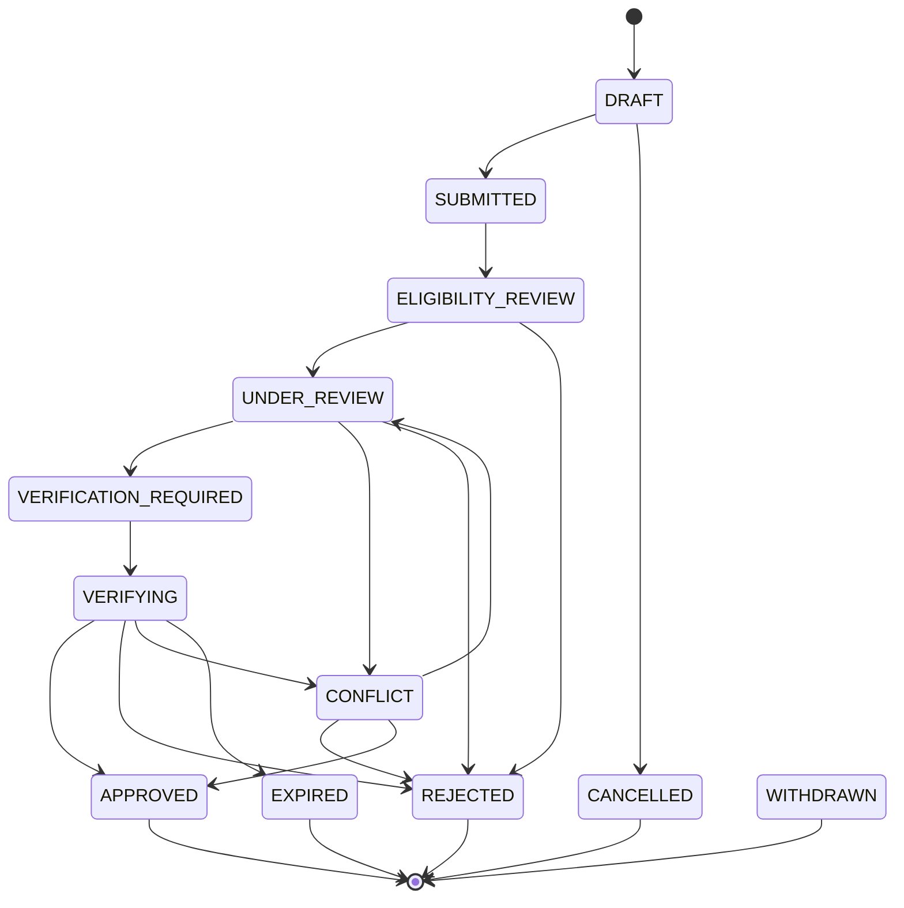
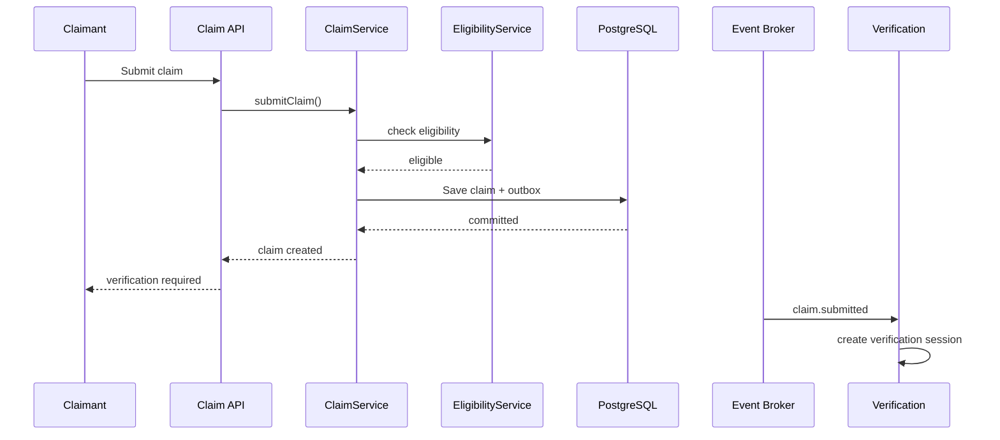
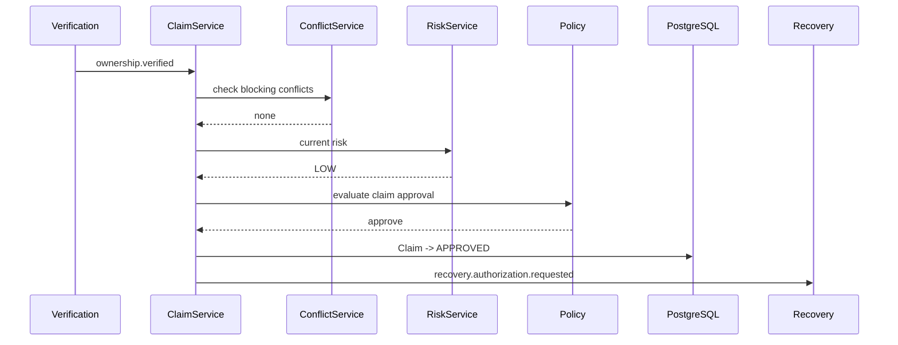

> **Current architecture authority (2026-10-26):** [Accepted baseline](../architecture/baseline.md) and its linked ADRs govern implementation. This supplied document is preserved below as detailed research/design material. Where examples or diagrams conflict with the baseline, use the baseline; no runtime capability is implied.

# Claim Workflow Design

> **Dzoka — The Open Recovery Network**

This document defines the end-to-end workflow for ownership claims in Dzoka.

A claim is:

> **a person's assertion that they are the owner of, or otherwise entitled to recover, a specific item.**

A claim is not proof of ownership.

The claim workflow connects:

```text id="2p6lfs"
MatchCandidate
    ↓
Claim
    ↓
Ownership Verification
    ↓
Fraud / Risk
    ↓
Competing Claim Resolution
    ↓
Recovery Entitlement
    ↓
Recovery Authorization
```

This document defines:

- how claims are created;
- which claims are eligible;
- claim states;
- evidence submission;
- verification orchestration;
- risk handling;
- competing claims;
- staff review;
- entitlement;
- withdrawal;
- expiration;
- rejection;
- approval;
- recovery handoff;
- federation behaviour;
- privacy;
- events;
- persistence;
- API behaviour;
- auditing;
- failure handling.

---

# 1. Core Principle

Dzoka separates:

```text id="u29tno"
"I think this is my item."
```

from:

```text id="f83a1u"
"I have demonstrated sufficient evidence."
```

from:

```text id="kqxj3j"
"This item may now be physically released."
```

Therefore:

```text id="5ho6dc"
Claim
≠
Verification
≠
Recovery Authorization
```

---

# 2. Claim Workflow Goals

The claim workflow must:

1. allow legitimate owners to recover property efficiently;
2. prevent public match results from becoming automatic claims;
3. handle multiple competing claimants safely;
4. preserve claimant evidence;
5. integrate ownership verification;
6. integrate fraud/risk assessment;
7. support human review;
8. support authorized representatives;
9. support institutional policies;
10. support federated claims;
11. prevent duplicate claim side effects;
12. remain fully auditable.

---

# 3. Non-Goals

The claim subsystem does not:

- perform multimodal matching;
- calculate final item similarity;
- release custody;
- create courier jobs directly;
- release rewards;
- let AI independently approve ownership;
- expose hidden item evidence;
- treat user identity verification as item ownership proof.

---

# 4. Claim Aggregate

Canonical structure:

```text id="vglp63"
Claim
├── claimId
├── tenantId
├── caseId
├── itemId
├── candidateId
├── claimantId
├── entitlementType
├── status
├── verificationId
├── riskAssessmentId
├── conflictState
├── submittedEvidence[]
├── createdAt
├── submittedAt
├── resolvedAt
├── expiresAt
├── resolutionReason
└── version
```

---

# 5. Claim Status

Recommended lifecycle:

```text id="uz4x3e"
DRAFT
    ↓
SUBMITTED
    ↓
ELIGIBILITY_REVIEW
    ↓
UNDER_REVIEW
    ↓
VERIFICATION_REQUIRED
    ↓
VERIFYING
    ↓
APPROVED
```

Alternative terminal states:

```text id="hva2ls"
REJECTED
WITHDRAWN
EXPIRED
CANCELLED
CONFLICT
```

---

# 6. State Machine



---

# 7. Claim Creation Entry Points

A claim may originate from:

```text id="d0tmtv"
public match suggestion
staff-created case
registered item workflow
federated match
manual item lookup
secure QR/NFC recovery
institutional transfer
```

---

# 8. Claim Creation Preconditions

Before creating a claim, validate:

```text id="95z5k5"
claimant authenticated or session-verified where required
item is claimable
case is active
candidate is eligible where candidate-based
claimant not blocked by policy
claim not duplicate
tenant/organization scope valid
```

---

# 9. Claim Eligibility Service

Implement:

```text id="8kkmg5"
ClaimEligibilityService
```

Responsibilities:

```text id="gm2qs6"
can claimant claim this item?
is candidate still active?
is item already recovered?
is there a legal hold?
is claimant blocked?
is this a duplicate claim?
is federation policy satisfied?
```

---

# 10. Claim Eligibility Result

Canonical:

```text id="1pown5"
ClaimEligibilityResult
├── eligible
├── reasonCodes[]
├── verificationRequired
├── humanReviewRequired
├── conflictDetected
└── policyVersion
```

---

# 11. Eligibility Rejection Reasons

Examples:

```text id="1fk5vw"
ITEM_ALREADY_RECOVERED
ITEM_NOT_CLAIMABLE
CLAIMANT_BLOCKED
DUPLICATE_ACTIVE_CLAIM
CANDIDATE_STALE
CANDIDATE_REJECTED
LEGAL_HOLD
FEDERATION_POLICY_DENIED
CLAIM_WINDOW_EXPIRED
```

---

# 12. Claim Idempotency

Claim submission should support:

```text id="lsgsld"
Idempotency-Key
```

Repeated submission must not create multiple claims.

---

# 13. Duplicate Claim Detection

Possible duplicate conditions:

```text id="y3f5lz"
same claimant
same item
same active candidate
same case
```

The system should return the existing claim where appropriate.

---

# 14. Claim Draft

A draft may contain:

```text id="77lg6h"
claimant notes
evidence uploads
entitlement type
representative information
```

Drafts are not yet active claims.

---

# 15. Submission

On submission:

```text id="doit4l"
validate eligibility
freeze submitted evidence snapshot
record claimant intent
create ClaimSubmitted event
start verification orchestration
```

---

# 16. Claim Submission Event

```text id="140au7"
claim.submitted
```

Payload should include:

```text id="ub8f4h"
claimId
itemId
candidateId
claimantId
entitlementType
```

Do not publish raw claim evidence.

---

# 17. Claim Evidence

Claim evidence may include:

```text id="ahuxka"
text description
private details
receipt
prior photograph
serial/IMEI
authorization letter
institutional record
registered-item reference
```

---

# 18. Claim Evidence Contract

```text id="s6jazj"
ClaimEvidence
├── evidenceId
├── claimId
├── type
├── source
├── mediaReference
├── protectedValueReference
├── classification
├── submittedAt
├── provenance
└── status
```

---

# 19. Evidence Classification

Possible:

```text id="af6yqm"
PUBLIC
RESTRICTED
SECRET
```

Most ownership proof should be:

```text id="m5rt58"
RESTRICTED
or
SECRET
```

---

# 20. Evidence Submission Rules

Evidence must:

```text id="1zgg1s"
belong to claim
pass upload validation
respect file size/type rules
preserve provenance
not overwrite older evidence
```

---

# 21. Claim Evidence Processing

Flow:

```text id="jgcwux"
evidence submitted
    ↓
sanitization
    ↓
type-specific processing
    ↓
VerificationEvidence
```

The claim subsystem stores the submission; verification interprets it.

---

# 22. Claimant Statement

Allow free-text claimant statement:

```text id="1jc71m"
"I left this laptop on the 8am bus and there is a yellow sticker underneath."
```

Store raw text.

Derived interpretation belongs to verification.

---

# 23. Entitlement Type

Claimant declares:

```text id="t31d8g"
OWNER
AUTHORIZED_REPRESENTATIVE
PARENT_OR_GUARDIAN
EMPLOYEE_OR_AGENT
EXECUTOR
OTHER
```

This affects verification requirements.

---

# 24. Owner Claim

Simple case:

```text id="bqktdh"
claimantId
=
asserted owner
```

Still requires ownership evidence according to policy.

---

# 25. Representative Claim

Example:

```text id="bdc3nr"
employee collecting organization laptop
```

Claim must include:

```text id="5ggbr0"
principal/owner reference
authorization evidence
claimant identity
```

---

# 26. Entitlement Verification

Implement:

```text id="3quq8v"
EntitlementService
```

which determines:

```text id="nfcp62"
is this claimant allowed to act for the owner?
```

This is separate from proving that the item belongs to the underlying owner.

---

# 27. Claim Orchestration

Implement:

```text id="12bjj7"
ClaimWorkflowService
```

Responsibilities:

```text id="d2b8uw"
coordinate eligibility
start verification
request risk assessment
detect claim conflicts
route human review
resolve claim
emit claim events
```

It does not implement the internals of verification or fraud models.

---

# 28. Claim Workflow Flow

```text id="3zsa9z"
SubmitClaim
    ↓
ClaimEligibilityService
    ↓
Claim created
    ↓
ClaimConflictService
    ↓
VerificationSessionService
    ↓
ClaimRiskService
    ↓
VerificationDecision
    ↓
ClaimResolutionService
```

---

# 29. Verification Integration

Claim state maps to verification lifecycle.

Example:

```text id="bocdgm"
claim = VERIFYING

verification = IN_PROGRESS
```

When:

```text id="w7wool"
ownership.verified
```

claim may transition toward:

```text id="3tnhj1"
APPROVED
```

subject to conflict state and policy.

---

# 30. Verification Failure

If verification produces:

```text id="ber3rj"
REJECTED
```

the claim normally becomes:

```text id="436yop"
REJECTED
```

unless appeal/manual escalation policy permits otherwise.

---

# 31. Inconclusive Verification

If:

```text id="04fo83"
INCONCLUSIVE
```

claim may transition to:

```text id="v1r4ei"
UNDER_REVIEW
```

or remain:

```text id="oxmmbd"
VERIFICATION_REQUIRED
```

with additional evidence requested.

---

# 32. Request More Evidence

Possible system action:

```text id="ac497h"
REQUEST_MORE_EVIDENCE
```

Examples:

```text id="uqflmj"
serial fragment
old photograph
receipt
authorization proof
additional hidden detail
```

---

# 33. More Evidence Event

```text id="ivpf5o"
claim.additional-evidence-requested
```

Do not reveal expected evidence values.

---

# 34. Claim Conflict Detection

Implement:

```text id="g2k2qb"
ClaimConflictService
```

Triggers when:

```text id="6qo0v1"
multiple active serious claims
contradictory owner records
duplicate representatives
fraud linkage
```

---

# 35. Claim Conflict Aggregate

```text id="2la5yd"
ClaimConflict
├── conflictId
├── itemId
├── claimIds[]
├── conflictType
├── severity
├── status
├── detectedAt
├── assignedReviewer
├── resolvedAt
└── resolution
```

---

# 36. Conflict Types

Possible:

```text id="81e1u5"
MULTIPLE_OWNERSHIP_CLAIMS
OWNERSHIP_RECORD_CONFLICT
REPRESENTATIVE_CONFLICT
FRAUD_LINKAGE
INSTITUTIONAL_CONFLICT
OTHER
```

---

# 37. Conflict Severity

```text id="o6zlzh"
LOW
MEDIUM
HIGH
CRITICAL
```

---

# 38. Conflict Behaviour

For high/critical conflicts:

```text id="w9ozmx"
block recovery authorization
```

until resolution.

---

# 39. Competing Claims

Example:

```text id="spp2on"
Claim A
Claim B
```

Both may enter verification independently.

The item must not be released merely because:

```text id="9kk6d3"
Claim A verified first
```

if Claim B is also serious and unresolved.

---

# 40. Competing Claim Evaluation

Review evidence such as:

```text id="mqu18b"
protected identifiers
private attributes
pre-loss photos
documents
entitlement
fraud risk
```

Do not compare claimants using public-description knowledge alone.

---

# 41. Claim Priority

The system should not automatically use:

```text id="plbh3k"
first claimant wins
```

or:

```text id="90a3rv"
highest payment/reward wins
```

Evidence and policy determine entitlement.

---

# 42. Conflict Resolution Outcomes

Possible:

```text id="f9eq1t"
CLAIM_A_PREVAILS
CLAIM_B_PREVAILS
NO_CLAIM_VERIFIED
ADDITIONAL_EVIDENCE_REQUIRED
EXTERNAL_AUTHORITY_REQUIRED
```

---

# 43. Claim Risk Integration

Each submitted claim triggers or updates:

```text id="psxxhm"
RiskAssessment
```

Risk remains separate from verification evidence.

---

# 44. Risk Inputs

Possible:

```text id="ymndzm"
claim history
failed verification attempts
account age
device/account linkage
claim frequency
geographic plausibility
reused documents
reused images
multiple unrelated claims
```

---

# 45. Risk Actions

```text id="340d9h"
ALLOW_STANDARD_FLOW
REQUIRE_MORE_EVIDENCE
REQUIRE_HUMAN_REVIEW
BLOCK
```

---

# 46. High Risk Claim

A high risk assessment may transition claim to:

```text id="xufr27"
UNDER_REVIEW
```

even if verification evidence looks strong.

---

# 47. Critical Risk

Critical risk may produce:

```text id="8cd0r3"
REJECTED
```

or:

```text id="e64ypw"
SECURITY_REVIEW
```

depending on policy.

---

# 48. Claim Review Queue

Authorized staff see:

```text id="tvah5v"
claim summary
item summary
match summary
verification status
risk level
conflict state
entitlement type
review reason
```

---

# 49. Reviewer Data Minimization

Reviewer sees only data necessary for the review task.

A general staff reviewer should not automatically see:

```text id="bbmbzs"
full identity document
complete contact data
unrelated claim history
```

---

# 50. Review Actions

Possible:

```text id="y5de2s"
REQUEST_MORE_EVIDENCE
APPROVE
REJECT
ESCALATE
DEFER
```

---

# 51. Review Record

```text id="pc8rs9"
ClaimReview
├── reviewId
├── claimId
├── reviewerId
├── action
├── reasonCodes[]
├── notes
├── policyVersion
└── reviewedAt
```

---

# 52. Approval Rule

A claim can transition to `APPROVED` only when:

```text id="8ns691"
verification outcome permits
AND risk policy permits
AND entitlement is valid
AND no blocking conflict exists
AND required human approvals exist
```

---

# 53. Claim Approval

`APPROVED` means:

> the claim has been accepted as the valid recovery claim.

It does not itself mean:

> property has been released.

Next:

```text id="2i3pt2"
RecoveryAuthorizationService
```

---

# 54. Approval Event

```text id="tbvqzr"
claim.approved
```

This may trigger:

```text id="wc3yox"
recovery.authorization.requested
```

---

# 55. Rejection

A claim may be rejected because of:

```text id="bcsjni"
failed verification
critical identifier conflict
fraud
invalid entitlement
competing claim resolution
policy violation
false claim
```

---

# 56. Rejection Reason Codes

Examples:

```text id="vtbguh"
INSUFFICIENT_EVIDENCE
IDENTIFIER_CONFLICT
PRIVATE_CHALLENGE_FAILED
ENTITLEMENT_INVALID
FRAUD_RISK
COMPETING_CLAIM_PREVAILED
ITEM_NOT_CLAIMABLE
POLICY_REJECTED
```

---

# 57. Rejection Privacy

Claimant-facing explanation should not expose:

```text id="jms5ry"
hidden item attributes
correct challenge answers
fraud detection rules
other claimant secret evidence
```

---

# 58. Withdrawal

Claimant may withdraw an unresolved claim.

Transition:

```text id="lfwzms"
DRAFT / SUBMITTED / UNDER_REVIEW / VERIFYING
    ↓
WITHDRAWN
```

Policy may restrict withdrawal after certain legal/security escalation.

---

# 59. Withdrawal Event

```text id="nz3nt8"
claim.withdrawn
```

Withdrawal does not erase historical evidence.

Retention policy still applies.

---

# 60. Expiration

Claims may expire when:

```text id="7o6es1"
verification not completed
claimant inactive
challenge expired
claim window elapsed
```

---

# 61. Expiration Policy

Expiration duration may depend on:

```text id="05ick0"
organization
item category
claim type
federation
risk
```

---

# 62. Expiration Event

```text id="pqseak"
claim.expired
```

---

# 63. Reopening

Do not silently revive an expired claim.

Create:

```text id="9ow5x3"
new claim
```

or use explicit:

```text id="tjcdlm"
ClaimReopened
```

if policy supports it.

Historical state must remain clear.

---

# 64. Cancellation

System/staff cancellation may occur for:

```text id="bdo2da"
duplicate claim
invalid case
administrative correction
item incorrectly listed
```

Requires auditable reason.

---

# 65. Claim and Matching Relationship

Claim may reference:

```text id="yofnha"
candidateId
```

where claim originated from a match.

But some claims may be created through:

```text id="vb9sxr"
registered item ID
QR/NFC
staff lookup
institutional reference
```

and may have no normal `MatchCandidate`.

---

# 66. Candidate Staleness

If a referenced match becomes:

```text id="usefam"
STALE
SUPERSEDED
REJECTED
```

the claim workflow must reassess.

Do not silently continue based on obsolete match evidence.

---

# 67. Candidate Reassessment

Possible:

```text id="rysnql"
new fingerprint version
    ↓
matching rerun
    ↓
claim candidate updated/revalidated
```

Historical candidate remains referenced for audit.

---

# 68. Claim and Item Recovery State

A new claim should normally be blocked if:

```text id="l5o44e"
item already recovered
disposed
legal hold excludes claim
```

unless special dispute workflow exists.

---

# 69. Claim and Custody

Claim approval does not imply the item is physically available.

Possible custody states:

```text id="nx46lz"
in institution
with courier
in transfer
temporarily unavailable
```

Recovery authorization checks custody separately.

---

# 70. Claim and Rewards

Claim status must not depend on voluntary finder reward.

A claimant cannot be denied rightful property because:

```text id="c60eev"
reward payment failed
```

---

# 71. Claim and Courier

Courier selection occurs after recovery authorization.

The claim subsystem does not book couriers.

---

# 72. Claim and Secure Messaging

A claimant may communicate with:

```text id="ov8hh7"
institution
finder where permitted
reviewer/system
```

through secure relay.

Do not expose direct finder contact by default.

---

# 73. Claim Conversation

Possible:

```text id="dur8bm"
ClaimConversation
```

linked to:

```text id="phyaen"
claimId
caseId
```

with controlled participants.

---

# 74. Claim Notifications

Typical:

```text id="hbop6t"
claim received
additional evidence needed
verification challenge available
claim under review
claim approved
claim rejected
claim expired
```

---

# 75. Notification Privacy

Do not put secret verification details into:

```text id="3cuy1v"
SMS lock-screen notification
email subject
push preview
```

---

# 76. Claim API

Possible endpoints:

```text id="u8k5pi"
POST /api/v1/claims
GET  /api/v1/claims/{claimId}
POST /api/v1/claims/{claimId}/submit
POST /api/v1/claims/{claimId}/withdraw
POST /api/v1/claims/{claimId}/evidence
GET  /api/v1/claims/{claimId}/verification
```

---

# 77. Staff Claim API

```text id="fsdv3p"
GET  /api/v1/staff/claims
GET  /api/v1/staff/claims/{claimId}
POST /api/v1/staff/claims/{claimId}/review
POST /api/v1/staff/claims/{claimId}/request-evidence
POST /api/v1/staff/claims/{claimId}/escalate
```

---

# 78. Claim Submission Request

Example:

```json id="44n2h7"
{
  "itemReference": "DZK-ITEM-...",
  "candidateId": "019...",
  "entitlementType": "OWNER",
  "statement": "This is my laptop.",
  "evidence": []
}
```

---

# 79. Claim Response

Example:

```json id="rcpqxl"
{
  "claimId": "019...",
  "status": "VERIFICATION_REQUIRED",
  "verificationId": "019...",
  "nextAction": "COMPLETE_VERIFICATION"
}
```

Do not return internal risk score to claimant.

---

# 80. Claim Public Projection

Claimant may see:

```text id="il9d9l"
claimId
item public reference
status
required next action
submitted time
high-level messages
```

---

# 81. Staff Projection

Authorized staff may additionally see:

```text id="rz7i0h"
verification state
risk class
conflict state
evidence types
review history
```

---

# 82. Secret Projection

Only narrowly authorized reviewers may access:

```text id="d84prx"
identity documents
full protected identifiers
raw challenge answers
private photographs
```

---

# 83. Claim Events

Representative:

```text id="s9qbyu"
claim.created
claim.submitted
claim.eligibility-checked
claim.verification-requested
claim.additional-evidence-requested
claim.conflict-detected
claim.review-requested
claim.approved
claim.rejected
claim.withdrawn
claim.expired
```

---

# 84. Domain vs Integration Events

Internal domain:

```text id="5xlv00"
ClaimApproved
```

Integration:

```text id="3rfg05"
claim.approved
```

Do not publish ORM/domain entities directly.

---

# 85. Claim Submitted Sequence



---

# 86. Claim Approval Sequence



---

# 87. Claim Conflict Sequence

```text id="c3x5so"
Claim A submitted
    ↓
active claim detected
    ↓
ClaimConflict created
    ↓
Claim A/B marked conflict-aware
    ↓
independent verification continues
    ↓
staff review
    ↓
conflict resolved
```

---

# 88. Federated Claims

A claimant may exist on Node A while item is held by Node B.

Possible model:

```text id="qnhgts"
Node A
    claimant-facing claim

Node B
    custody + authoritative release policy
```

---

# 89. Federated Claim Request

Canonical message:

```text id="xoxc05"
FederatedClaimRequest
├── requestId
├── sourceNode
├── claimantReference
├── remoteItemReference
├── candidateReference
├── entitlementType
├── safeClaimSummary
└── signature
```

---

# 90. Federated Claim Authority

The node holding the item normally remains authoritative for:

```text id="ccvgmh"
verification acceptance
release policy
custody
```

unless federation agreement defines otherwise.

---

# 91. Remote Claim Reference

Local node should store:

```text id="6srlz9"
RemoteClaimReference
├── nodeId
├── remoteClaimId
├── localClaimId
└── statusSnapshot
```

Do not duplicate remote authoritative claim state as local truth.

---

# 92. Federated Claim Privacy

Avoid transmitting:

```text id="a18ikz"
full identity profile
unnecessary contact data
raw secret evidence
```

Only send what the remote verification workflow requires.

---

# 93. Claim Security

Claims are a high-abuse surface.

Required controls:

```text id="rp3mko"
rate limiting
authentication where policy requires
bot/abuse protection
attempt limits
risk assessment
tenant isolation
secret evidence protection
audit
```

---

# 94. Claim Enumeration

An attacker must not be able to discover:

```text id="u5m9fp"
whether another person claimed item
claimant identity
claim evidence
```

through predictable IDs or error messages.

---

# 95. Claim ID

Use globally unique internal ID.

Human-facing claim reference may be:

```text id="srssrx"
DZK-CLM-2026-7Q9K2A
```

---

# 96. Authorization

Claimant may access only:

```text id="5tl4dd"
their claim
authorized representative claim
```

Staff access depends on:

```text id="26iyj8"
tenant
organization
unit
role
case assignment
policy
```

---

# 97. Sensitive Claim Access

Use:

```text id="hxtaa2"
SensitiveDataAccessService
```

for secret claim evidence.

---

# 98. Audit Events

Record:

```text id="dfsece"
claim viewed
secret evidence viewed
claim reviewed
claim approved
claim rejected
claim conflict resolved
```

as required.

---

# 99. Claim Persistence

Representative tables:

```text id="kr6x4m"
claims
claim_evidence
claim_status_history
claim_conflicts
claim_conflict_members
claim_reviews
claim_entitlements
```

---

# 100. `claims`

Possible fields:

```text id="zz79iz"
id
tenant_id
case_id
item_id
candidate_id
claimant_id
entitlement_type
status
verification_id
risk_assessment_id
conflict_state
created_at
submitted_at
resolved_at
expires_at
resolution_reason
version
```

---

# 101. Claim Status History

Append:

```text id="f8aezf"
claim_status_history
├── claim_id
├── from_status
├── to_status
├── actor
├── reason
├── occurred_at
└── correlation_id
```

---

# 102. Claim Evidence Table

```text id="m2bpmr"
claim_evidence
├── id
├── claim_id
├── evidence_type
├── media_id
├── protected_value_reference
├── classification
├── provenance
├── status
└── submitted_at
```

---

# 103. Claim Review Table

```text id="tmlao0"
claim_reviews
├── id
├── claim_id
├── reviewer_id
├── action
├── reason_codes
├── notes
├── policy_version
└── reviewed_at
```

---

# 104. Claim Conflict Table

```text id="4nh8fl"
claim_conflicts
├── id
├── item_id
├── conflict_type
├── severity
├── status
├── detected_at
├── resolved_at
└── resolution
```

---

# 105. Optimistic Locking

Claims should carry:

```text id="1spwcy"
version
```

to protect concurrent updates.

---

# 106. Strong Consistency

Use strong transactional consistency for:

```text id="e7hfcm"
claim submission
claim status transition
claim resolution
conflict resolution
```

---

# 107. Eventual Consistency

Accept eventual consistency for:

```text id="897oen"
notifications
analytics
risk model refresh
review dashboard projection
```

---

# 108. Claim Expiry Worker

A scheduled worker identifies:

```text id="cq1s3b"
expired unresolved claims
```

and transitions safely.

Must be idempotent.

---

# 109. Claim Cleanup

Claim evidence deletion follows retention policy.

Do not delete immediately merely because:

```text id="14mmtv"
claim rejected
```

Audit/legal requirements may require retention.

---

# 110. Claim Legal Hold

If evidence is under:

```text id="hucy5g"
LegalHold
```

normal retention deletion must stop.

---

# 111. Claim Appeals

Optional workflow:

```text id="bk34ew"
REJECTED
    ↓
APPEAL_REQUESTED
    ↓
REVIEW
    ↓
UPHELD
or
OVERTURNED
```

If implemented, original rejection remains immutable.

---

# 112. Appeal Record

```text id="246zdo"
ClaimAppeal
├── appealId
├── claimId
├── reason
├── newEvidence[]
├── status
├── reviewer
└── resolution
```

---

# 113. Manual Claim Creation

Staff may create a claim on behalf of a person.

Audit must record:

```text id="puc4qv"
createdByStaff
claimantReference
reason
```

This must not bypass verification.

---

# 114. Assisted Claim Workflow

Useful for:

```text id="11fxrw"
kiosk
call centre
elderly user
accessibility assistance
```

Staff acts as facilitator, not automatic approver.

---

# 115. Anonymous Claim

Certain low-risk deployments may allow temporary anonymous claim sessions.

Before recovery, policy may require:

```text id="t6854n"
identity/session upgrade
```

depending on item class.

---

# 116. Claimant Authentication

Possible levels:

```text id="bgqbxi"
ANONYMOUS_SESSION
CONTACT_VERIFIED
AUTHENTICATED_ACCOUNT
MFA_VERIFIED
INSTITUTIONALLY_VERIFIED
```

Authentication level may influence policy.

---

# 117. Authentication Does Not Prove Ownership

Even:

```text id="uzjyvy"
MFA_VERIFIED
```

means:

> we know which account is acting.

It does not mean:

> this account owns the item.

---

# 118. Claim Workflow and Policy

Policy may vary by:

```text id="ie527n"
tenant
organization
item category
item value
document sensitivity
claimant type
risk
federation status
```

---

# 119. Example Low-Risk Policy

For inexpensive common item:

```text id="xljpgn"
valid match
+
two private details
+
low risk
+
no conflict
```

may approve claim.

---

# 120. Example High-Risk Policy

For high-value electronics:

```text id="0cwgx6"
high/medium match
+
identity-grade evidence
+
private challenge
+
staff review
```

---

# 121. Example Passport Policy

May require:

```text id="l9g90j"
strict claimant identity validation
+
private document evidence
+
authorized staff
+
organization-specific procedure
```

---

# 122. Claim Resolution Service

Implement:

```text id="9juvyu"
ClaimResolutionService
```

Only this component transitions a verified claim to:

```text id="1g36qu"
APPROVED
REJECTED
```

after checking all required subsystems.

---

# 123. Approval Pseudocode

```text id="rr2z0r"
function resolveClaim(claimId):

    claim = loadClaim(claimId)

    verification = loadVerification(claim.verificationId)

    risk = loadRisk(claim.riskAssessmentId)

    conflicts = loadBlockingConflicts(claim.itemId)

    entitlement = loadEntitlement(claim)

    policy = resolveClaimPolicy(claim)

    if conflicts.blocking:
        return CONFLICT

    if verification.outcome == REJECTED:
        return REJECTED

    if risk.action == BLOCK:
        return REJECTED

    if entitlement.invalid:
        return REJECTED

    if policy.requiresHumanReview
       and !reviewApproved:
        return UNDER_REVIEW

    if verification.outcome == VERIFIED
       and policy.satisfied:
        transition(APPROVED)
        publish claim.approved

    else:
        requestMoreEvidenceOrReview()
```

---

# 124. Claim Approval Must Be Idempotent

If:

```text id="rf2srq"
ownership.verified
```

arrives twice, claim should not produce two approval effects.

Use:

```text id="umqtxs"
state guards
inbox
unique constraints
```

---

# 125. Recovery Transition

After `claim.approved`:

```text id="qcmzu2"
RecoveryAuthorizationService
```

evaluates:

```text id="7pje8r"
claim approval
verification
custody
legal holds
organization policy
active conflicts
```

---

# 126. Claim Completion

Claim does not become a separate `RECOVERED` state.

Recovery is owned by Recovery context.

Claim remains:

```text id="rrrj7k"
APPROVED
```

while recovery state progresses independently.

---

# 127. Why Separate States

Avoid:

```text id="n4e302"
ClaimStatus = COURIER_IN_TRANSIT
```

because courier state belongs to logistics/recovery, not claims.

---

# 128. Claim Read Model

Create:

```text id="cgtlvi"
ClaimSummaryProjection
```

for UI.

May combine:

```text id="cyrwdm"
claim status
verification status
risk class
conflict state
recovery status
next action
```

without making one giant aggregate.

---

# 129. Claim Next Action

Useful UI field:

```text id="zqu1qs"
nextAction
```

Possible:

```text id="m73o6e"
SUBMIT_EVIDENCE
ANSWER_CHALLENGE
WAIT_FOR_REVIEW
RESOLVE_CONFLICT
CLAIM_APPROVED
CLAIM_REJECTED
CLAIM_EXPIRED
```

Derived from authoritative subsystem states.

---

# 130. Claim Explainability

Internal explanation may show:

```text id="4d0wun"
claim approved because:
- ownership verified
- risk LOW
- no competing claims
- entitlement OWNER
- required staff approval completed
```

---

# 131. Claimant-Facing Explanation

Prefer:

```text id="541yx0"
"Your claim has been approved. The item is now moving to the recovery stage."
```

Do not reveal:

```text id="8zp4zh"
fraud scores
other claim evidence
hidden challenge details
```

---

# 132. Metrics

Track:

```text id="3g3tua"
claims created
claims submitted
claims approved
claims rejected
claims withdrawn
claims expired
claims in conflict
average claim resolution time
human review rate
```

---

# 133. Conversion Metrics

Useful:

```text id="7p1rdv"
match → claim
claim → verification
verification → approved claim
approved claim → successful recovery
```

---

# 134. Safety Metrics

Track:

```text id="st2qkn"
approved fraudulent claims
competing claims after approval
claim conflict override rate
claims approved without identity-grade evidence by risk tier
```

---

# 135. Observability

Spans:

```text id="wuvwqw"
claim.create
claim.submit
claim.eligibility
claim.conflict-check
claim.verification-start
claim.risk-check
claim.review
claim.resolve
```

---

# 136. Logs

Safe fields:

```text id="xdj6gs"
claimId
itemId
status
entitlementType
riskLevel
conflictState
duration
```

Never log:

```text id="2mwjbb"
raw secret evidence
challenge answers
identity document numbers
full identifiers
```

---

# 137. Failure Types

Canonical:

```text id="19t2vh"
CLAIM_NOT_ELIGIBLE
DUPLICATE_CLAIM
ITEM_NOT_CLAIMABLE
CLAIM_STATE_CONFLICT
VERIFICATION_UNAVAILABLE
RISK_ASSESSMENT_FAILED
CLAIM_CONFLICT_DETECTED
POLICY_UNAVAILABLE
CLAIM_EXPIRED
```

---

# 138. Graceful Degradation

If risk ML is unavailable:

```text id="d4surr"
rule-based risk
or
human review
```

If notification fails:

```text id="gt0r18"
claim remains valid
```

If verification AI fails:

```text id="zwfkj7"
manual/deterministic verification
```

Never auto-approve because a dependency failed.

---

# 139. Claim Security Invariants

### CLAIM-SEC-001

One claimant cannot access another claimant's evidence.

### CLAIM-SEC-002

Public candidate data must not expose private claim data.

### CLAIM-SEC-003

Competing claimant identities remain protected.

### CLAIM-SEC-004

Claim submission is rate-limited.

### CLAIM-SEC-005

Secret evidence is never included in broad events.

### CLAIM-SEC-006

Claim approval cannot bypass verification policy.

### CLAIM-SEC-007

Staff-created claims remain auditable.

### CLAIM-SEC-008

Cross-tenant claims require explicit federation.

---

# 140. Domain Invariants

### CLAIM-001

Every claim references one recoverable item.

### CLAIM-002

Every submitted claim references one claimant.

### CLAIM-003

A claim cannot be approved while a blocking claim conflict exists.

### CLAIM-004

A rejected claim cannot be silently returned to active state.

### CLAIM-005

An approved claim does not itself transfer custody.

### CLAIM-006

Claim approval requires valid entitlement.

### CLAIM-007

Historical claim transitions are preserved.

### CLAIM-008

Claims based on stale candidates require reassessment.

### CLAIM-009

Fraud risk and ownership verification remain separate inputs.

### CLAIM-010

Claim resolution records the policy version used.

---

# 141. Example — Normal Claim

```text id="1laayg"
Candidate found
    ↓
Owner taps "This is mine"
    ↓
Claim created
    ↓
eligibility passes
    ↓
verification started
    ↓
private challenge answered
    ↓
serial fragment matches
    ↓
risk LOW
    ↓
no competing claims
    ↓
Claim APPROVED
    ↓
Recovery authorization
```

---

# 142. Example — Competing Claims

```text id="qjo2de"
Claim A submitted
Claim B submitted
    ↓
ClaimConflict detected
    ↓
recovery frozen
    ↓
both independently verified
    ↓
Claim A:
weak public evidence

Claim B:
private mark + old photo + serial
    ↓
staff resolves conflict
    ↓
Claim B APPROVED
Claim A REJECTED
```

---

# 143. Example — Representative

Company laptop:

```text id="y27nqp"
Employee claims item
    ↓
entitlement = EMPLOYEE_OR_AGENT
    ↓
company asset record matches
    ↓
manager authorization confirmed
    ↓
ownership belongs to organization
    ↓
employee entitlement verified
    ↓
Claim APPROVED
```

---

# 144. Example — High Risk

User submits claims on:

```text id="iedp8e"
12 unrelated phones
```

Risk detects abnormal behaviour.

Even if one challenge response appears plausible:

```text id="d9g7mh"
REQUIRE_HUMAN_REVIEW
```

or:

```text id="myl2ls"
BLOCK
```

may apply.

---

# 145. Example — Expired Claim

```text id="dn182p"
Claim submitted
    ↓
challenge issued
    ↓
no response
    ↓
session expires
    ↓
Claim EXPIRED
```

A future attempt creates a new claim/session according to policy.

---

# 146. Example — Federated Claim

```text id="qd502n"
User on Node A
    ↓
candidate held on Node B
    ↓
Claim created on A
    ↓
FederatedClaimRequest to B
    ↓
B validates candidate/custody
    ↓
B runs local private verification
    ↓
signed outcome returned
    ↓
claim resolution
    ↓
recovery coordination
```

---

# 147. Source Audit Influence

This workflow incorporates lessons from audited sources:

```text id="ul4ssx"
Lost-and-Found-Tracking-System
    → explicit claim lifecycle
    → claim conflict concepts

La2eet
    → claimant/finder verification questions

FindBack
    → claim approval before handover codes

Smart Asset Finder
    → claim workflow and fraud concepts

globalenglish01/lostfound
    → human decisions as ground truth
    → evidence separation
```

Dzoka extends these into a production claim architecture with:

```text id="zk4ygf"
claim eligibility
entitlement
risk
competing claims
federation
verification orchestration
policy
separate recovery authorization
```

---

# 148. Anti-Patterns

Do not implement:

```text id="fj9r4s"
user clicks "claim"
→ mark item claimed permanently
```

Do not implement:

```text id="eph5qk"
first claimant wins
```

Do not implement:

```text id="w9uqkd"
match confidence HIGH
→ Claim APPROVED
```

Do not implement:

```text id="wtbf0x"
government ID uploaded
→ Claim APPROVED
```

Do not implement:

```text id="75uykk"
reward offered
→ claimant gets priority
```

Do not implement:

```text id="3luquf"
verification dependency failed
→ approve anyway
```

---

# 149. Implementation Components

Recommended:

```text id="67rvli"
ClaimApplicationService
ClaimWorkflowService
ClaimEligibilityService
ClaimEvidenceService
ClaimConflictService
ClaimReviewService
ClaimResolutionService
EntitlementService
ClaimQueryService
ClaimRepository
```

Integrations:

```text id="ou1cnj"
VerificationPort
RiskAssessmentPort
PolicyPort
RecoveryAuthorizationPort
NotificationPort
FederationClaimPort
```

---

# 150. Implementation Sequence

Recommended:

```text id="mcehgm"
1. Claim aggregate
2. claim state machine
3. claim eligibility
4. evidence submission
5. verification integration
6. approval/rejection
7. human review
8. entitlement
9. competing claims
10. risk integration
11. expiration/withdrawal
12. federated claims
13. appeals
14. advanced projections/analytics
```

This is implementation order, not scope reduction.

---

# 151. Test Requirements

Unit tests:

```text id="6xldgh"
valid state transitions
invalid transitions
duplicate claim
eligibility rejection
claim expiry
withdrawal
approval rules
entitlement
blocking conflict
```

Integration tests:

```text id="h87rru"
claim → verification → approved
claim → failed verification → rejected
competing claims
staff review
federated claim
risk block
```

---

# 152. Security Tests

Mandatory:

```text id="jhdy5u"
claimant A cannot view claimant B evidence
cross-tenant claim access denied
duplicate idempotency works
hidden evidence absent from API
review permission enforced
federated unauthorized claim rejected
rate limits enforced
```

---

# 153. Golden Claim Scenarios

Maintain test cases for:

```text id="snx4cl"
normal owner claim
wrong claimant
multiple claims
representative claim
organization asset
minor/guardian
low-value item
high-value electronics
passport/document
stale match
recovered item
federated item
expired verification
high fraud risk
```

---

# 154. Production Readiness

The claim subsystem is production-ready only when it supports:

```text id="lss3kt"
eligibility
idempotency
evidence
verification orchestration
risk
conflicts
entitlement
human review
auditing
privacy
federation
recovery handoff
failure handling
```

A `claims` table plus an `approved` boolean is not sufficient.

---

# 155. Relationship to Matching

Matching supplies:

```text id="fmm2yu"
candidate evidence
```

Claiming supplies:

```text id="fq1v4e"
human assertion
```

The claim workflow never turns similarity directly into entitlement.

---

# 156. Relationship to Verification

Verification answers:

```text id="7ivkv5"
"Has this claimant demonstrated sufficient private evidence?"
```

The claim workflow orchestrates that result.

---

# 157. Relationship to Fraud

Fraud answers:

```text id="r2emr5"
"Is there suspicious behaviour around this claim?"
```

It does not itself determine item ownership.

---

# 158. Relationship to Recovery

Claim approval creates eligibility to request recovery authorization.

It does not:

```text id="nat7s5"
change custody
book courier
complete handover
release reward
```

---

# 159. Final Design Principle

The Dzoka claim workflow is a controlled transition from:

```text id="eol5of"
"I believe this item is mine."
```

to:

```text id="fxofx7"
"This claimant has demonstrated sufficient entitlement for Dzoka to consider releasing the item."
```

The full chain is:

```text id="hjonjt"
MATCH CANDIDATE
      ↓
CLAIM ASSERTION
      ↓
ELIGIBILITY
      ↓
PRIVATE EVIDENCE
      ↓
OWNERSHIP VERIFICATION
      ↓
FRAUD / RISK
      ↓
COMPETING CLAIM CHECK
      ↓
ENTITLEMENT
      ↓
HUMAN / POLICY REVIEW
      ↓
CLAIM APPROVED
      ↓
SEPARATE RECOVERY AUTHORIZATION
```

The subsystem must always be able to answer:

```text id="par96l"
Who made the claim?

What item were they claiming?

Why were they eligible to claim it?

What evidence did they provide?

How was ownership verified?

Were there competing claimants?

What fraud signals existed?

Was the claimant the owner or a representative?

Which policy approved or rejected the claim?

Who reviewed it?

Why was the final decision made?
```

That makes the claim workflow suitable for real physical recovery rather than a simple “claim item” button.