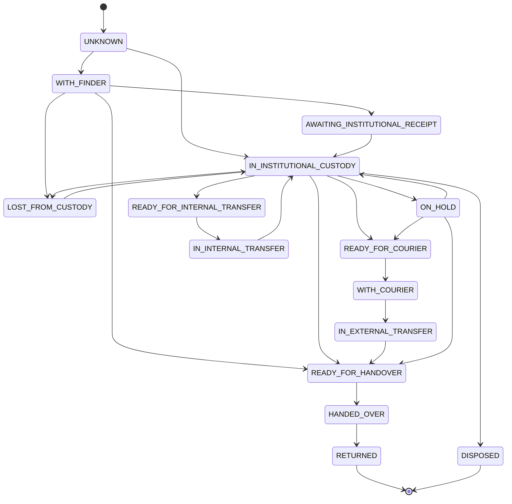
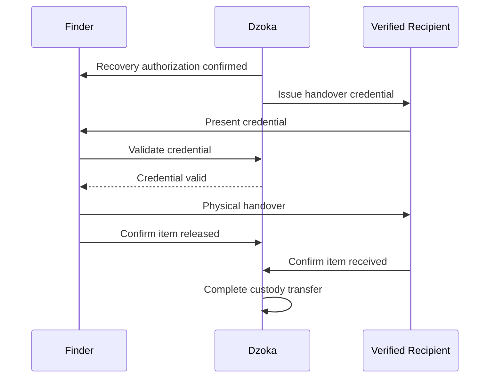

> **Current architecture authority (2026-10-26):** [Accepted baseline](../architecture/baseline.md) and its linked ADRs govern implementation. This supplied document is preserved below as detailed research/design material. Where examples or diagrams conflict with the baseline, use the baseline; no runtime capability is implied.

# Custody State Machine Design

> **Dzoka — The Open Recovery Network**

This document defines the chain-of-custody model and custody state machine for physical items managed by Dzoka.

Custody answers:

> **Who physically controls the item right now, where is it, and how did it get there?**

Custody is separate from:

```text
ownership
claim
verification
recovery authorization
shipment tracking
```

A person or organization may possess an item without owning it.

Examples:

```text
Finder
    possesses item
    does not own it

Airport Security
    holds item
    does not own it

Courier
    transports item
    does not own it

Verified Owner
    eventually receives item
```

Dzoka therefore models custody as its own authoritative, append-oriented domain.

---

# 1. Core Principle

Custody is represented as a sequence of explicit physical-control transitions.

```text
Finder
   ↓
Security Desk
   ↓
Lost Property Office
   ↓
Courier
   ↓
Verified Recipient
```

Every transition should answer:

```text
what item moved?
from whom?
to whom?
from where?
to where?
who authorized it?
who performed it?
when?
why?
what evidence proves the handoff?
```

---

# 2. Custody Goals

The custody subsystem must:

1. maintain current physical-control state;
2. preserve complete custody history;
3. prevent unauthorized handoffs;
4. support institutional storage;
5. support finders;
6. support lockers;
7. support couriers;
8. support federated institutional transfers;
9. work offline where required;
10. detect conflicting custody updates;
11. generate traceability events;
12. support secure handover;
13. support recovery disputes;
14. remain auditable;
15. provide training data for recovery-transition intelligence.

---

# 3. Non-Goals

Custody does not:

- prove ownership;
- verify a claimant;
- determine match similarity;
- book courier services;
- release rewards;
- replace shipment tracking;
- determine legal title;
- infer physical possession purely from AI prediction.

---

# 4. Core Domain Objects

Primary objects:

```text
CustodyRecord
CustodyEvent
Custodian
CustodyLocation
CustodyTransfer
CustodyAuthorization
CustodyEvidence
HandoverReference
ShipmentReference
```

---

# 5. `CustodyRecord`

`CustodyRecord` represents the authoritative current custody projection for an item.

```text
CustodyRecord
├── custodyRecordId
├── itemId
├── tenantId
├── currentCustodian
├── currentLocation
├── state
├── lastEventId
├── lastTransferId
├── version
├── updatedAt
└── integrityState
```

The current record is mutable.

Its history is not.

---

# 6. Custody History

Historical custody is represented by append-only:

```text
CustodyEvent[]
```

The current `CustodyRecord` is derived from those accepted transitions.

Conceptually:

```text
CustodyEvent 1
CustodyEvent 2
CustodyEvent 3
       ↓
Current CustodyRecord
```

---

# 7. Custody State Machine

Recommended top-level states:

```text
UNKNOWN

WITH_FINDER

AWAITING_INSTITUTIONAL_RECEIPT

IN_INSTITUTIONAL_CUSTODY

READY_FOR_INTERNAL_TRANSFER

IN_INTERNAL_TRANSFER

READY_FOR_HANDOVER

READY_FOR_COURIER

WITH_COURIER

IN_EXTERNAL_TRANSFER

HANDED_OVER

RETURNED

ON_HOLD

LOST_FROM_CUSTODY

DISPOSED
```

Not every deployment needs every transition, but the canonical state model should support them.

---

# 8. State Diagram



---

# 9. `UNKNOWN`

Meaning:

> Dzoka knows about the item but does not know who physically possesses it.

Typical cases:

```text
lost report only
historic imported record
unconfirmed sighting
CCTV observation
```

`UNKNOWN` must not be treated as:

```text
no custodian exists
```

It means custody is unknown.

---

# 10. `WITH_FINDER`

Meaning:

> the person who found the item still physically possesses it.

Possible custodian:

```text
FINDER
```

The item may later move to:

```text
institution
verified owner
courier
```

depending on policy.

---

# 11. `AWAITING_INSTITUTIONAL_RECEIPT`

Meaning:

> the finder has initiated transfer to an institution, but institutional receipt has not yet been confirmed.

Useful when:

```text
finder leaves item at security desk
drop box used
handoff awaiting staff acceptance
```

This is intentionally distinct from completed custody transfer.

---

# 12. `IN_INSTITUTIONAL_CUSTODY`

Meaning:

> an authorized institution or organizational unit has acknowledged physical control.

Examples:

```text
airport lost-property office
university security
bus depot
hotel reception
mall security
police-approved facility
```

---

# 13. `READY_FOR_INTERNAL_TRANSFER`

Meaning:

> an authorized movement within an organization has been approved but not yet completed.

Example:

```text
Terminal Security
    ↓
Airport Lost Property Office
```

---

# 14. `IN_INTERNAL_TRANSFER`

Meaning:

> physical transfer between organizational units is currently taking place.

Useful for larger institutions where custody continuity matters.

---

# 15. `READY_FOR_HANDOVER`

Meaning:

> custody holder is permitted and operationally ready to transfer the item directly to the authorized recipient.

Prerequisites normally include:

```text
approved claim
recovery authorization
no blocking hold
valid handover method
```

---

# 16. `READY_FOR_COURIER`

Meaning:

> the item is authorized for courier collection.

It does not mean:

```text
courier currently possesses item
```

That transition occurs only after pickup confirmation.

---

# 17. `WITH_COURIER`

Meaning:

> custody has transferred from the previous holder to the courier.

This requires explicit pickup evidence.

---

# 18. `IN_EXTERNAL_TRANSFER`

Meaning:

> the item is moving through an external logistics network.

The specific shipment state belongs to the Logistics context.

Custody only needs to know:

```text
external courier controls item
```

---

# 19. `HANDED_OVER`

Meaning:

> the physical handoff to the intended recipient has occurred.

This state is intentionally separate from:

```text
RETURNED
```

because final confirmation may require:

```text
recipient confirmation
staff reconciliation
courier proof
post-handover validation
```

---

# 20. `RETURNED`

Meaning:

> the recovery workflow accepts that the physical item has reached the authorized recipient.

This is normally terminal for custody purposes.

---

# 21. `ON_HOLD`

Meaning:

> physical item remains under current control but no transfer may occur.

Possible reasons:

```text
legal hold
claim dispute
police request
fraud review
institutional restriction
custody discrepancy
security investigation
```

---

# 22. `LOST_FROM_CUSTODY`

Meaning:

> an item that was previously believed to be controlled can no longer be physically located by the custodian.

This is a critical operational state.

It must trigger:

```text
incident
audit
recovery investigation
```

and must never be silently reset.

---

# 23. `DISPOSED`

Meaning:

> the item left active custody under an authorized disposition workflow.

Examples:

```text
donation
destruction
auction
legal transfer
```

The relevant disposition order must exist.

---

# 24. Custodian Model

Canonical value object:

```text
Custodian
├── type
├── referenceId
├── organizationId
├── organizationUnitId
└── displayReference
```

---

# 25. Custodian Types

Possible:

```text
FINDER
PERSON
USER
ORGANIZATION
ORGANIZATION_UNIT
COURIER
LOCKER
WAREHOUSE
VEHICLE
AUTHORIZED_REPRESENTATIVE
EXTERNAL_AUTHORITY
SYSTEM_PLACEHOLDER
OTHER
```

---

# 26. Custodian Identity

A custodian reference must identify the actual controlling party where known.

Avoid:

```text
custodian = "staff"
```

Prefer:

```text
organization = Airport A
unit = Lost Property Office
staff actor = Employee 123
```

The actor performing a transfer is not necessarily the custodian.

---

# 27. Actor vs Custodian

Example:

```text
Airport employee Sarah
```

performs a transfer.

But the custodian may be:

```text
Airport Lost Property Office
```

Therefore store separately:

```text
actor
custodian
```

---

# 28. Custody Location

Canonical:

```text
CustodyLocation
├── locationId
├── zone
├── storageReference
├── shelfOrLocker
└── classification
```

Exact storage locations are normally:

```text
RESTRICTED
```

or:

```text
SECRET
```

depending on environment.

---

# 29. Storage Location Example

```text
Harare Central Bus Depot
    ↓
Lost Property Office
    ↓
Secure Locker 12
```

Public user might only see:

```text
Held by transport operator
```

---

# 30. Custody Event

Every accepted change creates:

```text
CustodyEvent
├── eventId
├── itemId
├── sequence
├── eventType
├── previousState
├── newState
├── previousCustodian
├── newCustodian
├── previousLocation
├── newLocation
├── actor
├── authorizationReference
├── reason
├── evidence[]
├── occurredAt
├── recordedAt
├── correlationId
└── source
```

---

# 31. Custody Event Types

Possible:

```text
CUSTODY_ESTABLISHED
TRANSFER_REQUESTED
TRANSFER_AUTHORIZED
TRANSFER_STARTED
TRANSFER_COMPLETED
TRANSFER_REJECTED
HANDOVER_READY
COURIER_PICKUP_CONFIRMED
RECIPIENT_HANDOVER_CONFIRMED
RETURN_CONFIRMED
CUSTODY_HOLD_PLACED
CUSTODY_HOLD_RELEASED
CUSTODY_LOCATION_CORRECTED
CUSTODY_LOSS_REPORTED
CUSTODY_RESTORED
DISPOSITION_COMPLETED
```

---

# 32. Custody Event Immutability

Once accepted:

```text
CustodyEvent
```

must not be edited in place.

Corrections use a new event.

Example:

```text
incorrect storage location recorded
    ↓
CustodyLocationCorrected
```

not:

```text
UPDATE custody_events SET location = ...
```

---

# 33. Custody Sequence Number

Each item should maintain a monotonic custody sequence.

Example:

```text
Item A
event sequence 1
event sequence 2
event sequence 3
```

This protects ordering.

---

# 34. Concurrency

Transfers must use optimistic concurrency.

Command includes:

```text
expectedCustodyVersion
```

Example:

```text
TransferCustody(
    itemId,
    expectedVersion = 7
)
```

If current version is 8:

```text
CUSTODY_VERSION_CONFLICT
```

The caller must reload/reconcile.

---

# 35. Why Versioning Matters

Without it:

```text
Staff A transfers item to Courier
```

while:

```text
Staff B transfers same item to Owner
```

could both succeed.

This is unacceptable for physical custody.

---

# 36. `CustodyTransfer`

Canonical request:

```text
CustodyTransfer
├── transferId
├── itemId
├── fromCustodian
├── toCustodian
├── fromLocation
├── toLocation
├── method
├── status
├── authorization
├── evidenceRequirements[]
├── requestedBy
├── requestedAt
├── acceptedAt
└── completedAt
```

---

# 37. Transfer Status

```text
REQUESTED
AUTHORIZED
READY
IN_PROGRESS
COMPLETED
REJECTED
CANCELLED
EXPIRED
DISPUTED
```

---

# 38. Transfer Methods

Possible:

```text
DIRECT_HANDOVER
INTERNAL_STAFF_TRANSFER
COURIER_PICKUP
LOCKER_DROP
LOCKER_COLLECTION
INSTITUTIONAL_TRANSFER
AUTHORIZED_AGENT
OTHER
```

---

# 39. Transfer Preconditions

A transfer may require:

```text
current custody matches expected from-custodian
item is physically available
no blocking hold
actor authorized
recipient eligible
required recovery authorization exists
required evidence configured
```

---

# 40. Transfer Authorization

Implement:

```text
CustodyPolicy
```

and:

```text
CustodyAuthorizationService
```

which answer:

> May this custody transfer occur?

---

# 41. Internal Transfer Authorization

Example:

```text
security desk
→ lost property office
```

may require only:

```text
staff role
valid target unit
item scan
```

---

# 42. Owner Handover Authorization

Example:

```text
lost property office
→ claimant
```

must require:

```text
RecoveryAuthorization
+
valid handover credential
```

---

# 43. Courier Transfer Authorization

Example:

```text
institution
→ courier
```

requires:

```text
RecoveryAuthorization
Shipment
expected courier identity
pickup token/reference
```

---

# 44. Custody Evidence

Canonical:

```text
CustodyEvidence
├── evidenceId
├── type
├── source
├── mediaReference
├── externalReference
├── classification
├── collectedAt
└── integrityMetadata
```

---

# 45. Evidence Types

Possible:

```text
STAFF_CONFIRMATION
FINDER_CONFIRMATION
SIGNATURE
OTP
QR_SCAN
BARCODE_SCAN
NFC_SCAN
COURIER_PICKUP_PROOF
PHOTO
VIDEO
LOCKER_EVENT
GPS_EVENT
DELIVERY_PROOF
SYSTEM_RECEIPT
```

---

# 46. Evidence Requirements

Not every transfer requires the same evidence.

Examples:

Low-risk internal move:

```text
staff authentication
+
item scan
```

Courier pickup:

```text
courier identity/reference
+
pickup confirmation
+
item scan
```

Owner handover:

```text
handover token
+
recipient confirmation
```

---

# 47. Scan-Based Custody

Where items have:

```text
QR
NFC
RFID
barcode
```

scans may help confirm item identity during handoff.

A scan is evidence.

It is not the transfer itself.

The domain transition occurs only after policy accepts it.

---

# 48. Handover Token

For recipient handover:

```text
HandoverToken
├── tokenId
├── recoveryId
├── hash
├── type
├── expiresAt
├── attempts
├── usedAt
└── revokedAt
```

Never store plaintext reusable token where avoidable.

---

# 49. Token Generation

Use a cryptographically secure source.

Never:

```text
Math.random()
```

for:

```text
OTP
handover codes
recovery tokens
```

---

# 50. Token Validation

Check:

```text
correct recovery
correct item
correct intended recipient/session
not expired
not revoked
not previously used
attempt limit
```

---

# 51. Handover Flow

```text
RecoveryAuthorized
    ↓
Handover created
    ↓
token issued
    ↓
recipient arrives
    ↓
token/QR validated
    ↓
staff verifies transfer
    ↓
CustodyTransfer completed
    ↓
HANDED_OVER
    ↓
recovery confirmation
    ↓
RETURNED
```

---

# 52. Why `HANDED_OVER` and `RETURNED` Are Separate

Physical exchange can occur before final recovery confirmation.

Examples:

```text
courier marks delivered
recipient confirmation pending
```

or:

```text
staff records handoff
system reconciliation pending
```

This gives Dzoka a short reconciliation boundary.

---

# 53. Direct Finder-to-Owner Handover

Some low-risk policies may allow:

```text
Finder
→ Verified Owner
```

without institutional custody.

Required controls may include:

```text
verified claim
recovery authorization
secure relay
handover token
both-party confirmation
```

Exact contact details need not be exposed.

---

# 54. Finder Handover Sequence



---

# 55. Two-Sided Confirmation

Where appropriate require:

```text
sender confirmation
+
recipient confirmation
```

This is stronger than unilateral handoff.

Policy may relax this for trusted institutional operations.

---

# 56. Institutional Intake

Finder deposits item:

```text
Finder
    ↓
Institution
```

Possible flow:

```text
staff scans/creates item
finder surrender confirmation
staff accepts item
storage location assigned
custody event committed
```

---

# 57. Institutional Intake Event

```text
CustodyEstablished
```

may establish the first known custody record.

---

# 58. Finder Anonymity

Finder does not need to become publicly visible.

Custody history may internally reference:

```text
finderReference
```

while public views expose:

```text
held by institution
```

---

# 59. Institutional Internal Transfer

Example:

```text
Gate Security
    ↓
Terminal Security
    ↓
Lost Property Office
```

Each organization may configure whether all internal movements require formal custody events.

For secure/high-value environments, they should.

---

# 60. Storage Operations

Moving:

```text
Locker 2
→ Locker 9
```

within the same custodian may create:

```text
CUSTODY_LOCATION_CORRECTED
```

or:

```text
STORAGE_LOCATION_CHANGED
```

rather than a new custodian transfer.

---

# 61. Location Change vs Custodian Change

Distinguish:

```text
same custodian
new storage location
```

from:

```text
new custodian
```

Both matter, but they represent different domain events.

---

# 62. Courier Integration

Courier shipment state and custody state are related but separate.

Example:

```text
Shipment = PICKUP_SCHEDULED
Custody = IN_INSTITUTIONAL_CUSTODY
```

After confirmed pickup:

```text
Shipment = PICKED_UP
Custody = WITH_COURIER
```

---

# 63. Courier Pickup

Never transition custody to courier just because:

```text
shipment booking succeeded
```

Require actual pickup evidence.

---

# 64. Courier Pickup Evidence

Could include:

```text
provider pickup webhook
staff scan
courier scan
signed manifest
OTP
pickup photo
```

according to policy.

---

# 65. Courier Identity

`toCustodian` should identify:

```text
courier organization
```

and where possible:

```text
courier shipment
driver/agent reference
```

without making shipment-specific details the core custody identity.

---

# 66. Courier Loss

If courier reports shipment lost:

```text
WITH_COURIER
    ↓
LOST_FROM_CUSTODY
```

or a specialized exception state may be projected.

This must trigger an operational incident.

---

# 67. Courier Delivery

Provider:

```text
DELIVERED
```

is evidence.

Dzoka must validate:

```text
shipment identity
recipient/recovery linkage
handover requirements
```

before marking:

```text
HANDED_OVER
```

or:

```text
RETURNED
```

---

# 68. Locker Custody

A smart locker may be modeled as:

```text
Custodian.type = LOCKER
```

Example:

```text
Institution Staff
→ Locker
→ Verified Recipient
```

Locker events may provide:

```text
door open
door close
item scan
pickup token
```

as custody evidence.

---

# 69. Offline Custody

Institutional nodes may temporarily lack network connectivity.

Local transitions may be recorded offline if:

```text
authorized local identity
local policy permits
local durable log available
```

---

# 70. Offline Event Requirements

Offline event must preserve:

```text
eventId
sequence
occurredAt
actor
item
local node
evidence
```

When sync resumes, central reconciliation must detect conflicts.

---

# 71. Offline Conflict Example

Node A records:

```text
item transferred to courier
```

while stale Node B believes:

```text
item remains in storage
```

Do not use last-write-wins.

Use sequence/version reconciliation.

---

# 72. Custody Conflict

Represent:

```text
CustodyConflict
├── conflictId
├── itemId
├── expectedVersion
├── receivedVersion
├── competingEvents[]
├── severity
├── status
└── resolution
```

---

# 73. Conflict Resolution

Possible:

```text
accept event A
accept event B
create corrective transfer
manual investigation
mark LOST_FROM_CUSTODY
```

Never rewrite historical events to hide the conflict.

---

# 74. Duplicate Custody Events

Events should be idempotent.

Use:

```text
eventId
external event ID
transferId
```

to detect duplicate processing.

---

# 75. Custody Command Idempotency

Commands such as:

```text
ConfirmCourierPickup
CompleteHandover
TransferCustody
```

must accept an idempotency key.

---

# 76. Custody Transfer API

Possible:

```text
POST /api/v1/staff/items/{itemId}/custody/transfers
POST /api/v1/staff/custody/transfers/{transferId}/authorize
POST /api/v1/staff/custody/transfers/{transferId}/start
POST /api/v1/staff/custody/transfers/{transferId}/complete
POST /api/v1/staff/custody/transfers/{transferId}/cancel

GET /api/v1/staff/items/{itemId}/custody
GET /api/v1/staff/items/{itemId}/custody/history
```

---

# 77. Transfer Request Example

```json
{
  "expectedCustodyVersion": 7,
  "toCustodian": {
    "type": "ORGANIZATION_UNIT",
    "referenceId": "lost-property-office"
  },
  "toLocationId": "019...",
  "method": "INTERNAL_STAFF_TRANSFER",
  "reason": "MOVE_TO_SECURE_STORAGE"
}
```

---

# 78. Courier Pickup Endpoint

Example:

```text
POST /api/v1/internal/shipments/{shipmentId}/confirm-pickup
```

The Logistics application should call the Custody application service.

Courier adapters must not update custody tables directly.

---

# 79. Handover API

Possible:

```text
POST /api/v1/recoveries/{recoveryId}/handover/validate
POST /api/v1/recoveries/{recoveryId}/handover/confirm
```

Final custody transition remains server-side.

---

# 80. State Transition Guards

Every transition must validate:

```text
current state
expected version
actor authorization
transfer policy
required evidence
hold state
recovery authorization if applicable
target custodian validity
```

---

# 81. Transition Table

| From | To | Typical Reason |
|---|---|---|
| UNKNOWN | WITH_FINDER | finder confirms possession |
| UNKNOWN | IN_INSTITUTIONAL_CUSTODY | institution intake/import |
| WITH_FINDER | AWAITING_INSTITUTIONAL_RECEIPT | surrender started |
| AWAITING_INSTITUTIONAL_RECEIPT | IN_INSTITUTIONAL_CUSTODY | institution accepts |
| IN_INSTITUTIONAL_CUSTODY | READY_FOR_INTERNAL_TRANSFER | internal move authorized |
| READY_FOR_INTERNAL_TRANSFER | IN_INTERNAL_TRANSFER | move started |
| IN_INTERNAL_TRANSFER | IN_INSTITUTIONAL_CUSTODY | receiving unit confirms |
| IN_INSTITUTIONAL_CUSTODY | READY_FOR_COURIER | recovery/courier authorized |
| READY_FOR_COURIER | WITH_COURIER | pickup confirmed |
| WITH_COURIER | IN_EXTERNAL_TRANSFER | shipment movement |
| IN_EXTERNAL_TRANSFER | READY_FOR_HANDOVER | delivery ready |
| READY_FOR_HANDOVER | HANDED_OVER | recipient handoff |
| HANDED_OVER | RETURNED | recovery confirmed |
| Any controlled state | ON_HOLD | hold imposed |
| Controlled state | LOST_FROM_CUSTODY | item cannot be located |
| IN_INSTITUTIONAL_CUSTODY | DISPOSED | authorized disposition |

---

# 82. Illegal Transitions

Examples:

```text
UNKNOWN
→ RETURNED
```

without establishment/recovery evidence should normally be invalid.

```text
IN_INSTITUTIONAL_CUSTODY
→ WITH_COURIER
```

without authorized shipment/pickup evidence should fail.

```text
ON_HOLD
→ RETURNED
```

without hold release should fail.

---

# 83. Hold Model

Canonical:

```text
CustodyHold
├── holdId
├── itemId
├── holdType
├── reason
├── imposedBy
├── imposedAt
├── expiresAt
├── status
└── releasedBy
```

---

# 84. Hold Types

Possible:

```text
CLAIM_CONFLICT
LEGAL
POLICE
FRAUD
SECURITY
INVESTIGATION
ORGANIZATION_POLICY
CUSTODY_DISCREPANCY
```

---

# 85. Hold Invariant

While blocking hold active:

```text
no outbound custody transfer
```

unless explicitly authorized override policy exists.

---

# 86. Lost From Custody Incident

Entering:

```text
LOST_FROM_CUSTODY
```

should create:

```text
CustodyIncident
```

and notify authorized staff.

---

# 87. Custody Incident

```text
CustodyIncident
├── incidentId
├── itemId
├── custodyEventId
├── incidentType
├── severity
├── openedAt
├── assignedTo
├── status
└── resolution
```

---

# 88. Incident Types

```text
ITEM_MISSING
UNAUTHORIZED_TRANSFER
STORAGE_LOCATION_MISMATCH
DAMAGED_IN_CUSTODY
EVIDENCE_MISSING
COURIER_EXCEPTION
OTHER
```

---

# 89. Restoring Custody

If missing item is found:

```text
LOST_FROM_CUSTODY
    ↓
IN_INSTITUTIONAL_CUSTODY
```

through:

```text
CustodyRestored
```

event.

History retains the incident.

---

# 90. Damage in Custody

Custody system may record:

```text
condition before
condition after
damage evidence
```

without making item condition a custody state.

---

# 91. Condition Snapshot

Optional:

```text
ItemConditionSnapshot
├── itemId
├── custodyEventId
├── media[]
├── conditionSummary
├── recordedBy
└── recordedAt
```

Useful for high-value items.

---

# 92. Chain-of-Custody Evidence Package

For sensitive/high-value items, each transfer may generate:

```text
TransferEvidencePackage
├── transferId
├── from acknowledgement
├── to acknowledgement
├── item scan
├── condition snapshot
├── timestamp
├── location
└── signatures
```

---

# 93. Digital Signatures

Federated or high-trust institutional transfers may sign custody messages.

Signatures provide:

```text
provenance
integrity
non-repudiation support
```

They do not prove physical reality alone.

---

# 94. Traceability Integration

Each significant custody event should produce a corresponding:

```text
RecoveryEvent
```

Example:

```text
CustodyTransferred
    ↓
RecoveryEvent:
ITEM_TRANSFERRED
```

---

# 95. EPCIS Integration

Selected custody events may map to EPCIS through:

```text
EpcisAdapter
```

Potential concepts:

```text
ObjectEvent
AssociationEvent
```

depending on semantics.

Dzoka remains authoritative for its own domain model.

---

# 96. Federation Custody

Cross-node recovery may involve transfer between institutions.

Example:

```text
Airport Node
    ↓
Courier
    ↓
University Node
    ↓
Owner
```

---

# 97. Federated Custody Transfer

Protocol messages may include:

```text
CUSTODY_TRANSFER_REQUEST
CUSTODY_TRANSFER_ACCEPTED
CUSTODY_TRANSFER_STARTED
CUSTODY_TRANSFER_COMPLETED
```

---

# 98. Federation Authority

The current holding node remains authoritative for custody until the receiving party confirms transfer.

Do not mark remote node as custodian merely because:

```text
request accepted
```

---

# 99. Cross-Node Handoff

Recommended pattern:

```text
Node A authorizes transfer
    ↓
transfer token/reference created
    ↓
physical handoff
    ↓
Node B confirms receipt
    ↓
Node A closes outbound custody
    ↓
Node B establishes inbound custody
```

---

# 100. Federated Transfer Correlation

Both nodes should share:

```text
networkTransferId
originNode
destinationNode
item reference
```

while maintaining local authoritative event IDs.

---

# 101. Federation Failure

If Node B fails to acknowledge after physical dispatch:

```text
do not pretend transfer completed
```

State may remain:

```text
IN_EXTERNAL_TRANSFER
```

or:

```text
DISPUTED
```

until reconciliation.

---

# 102. Custody Privacy

Public users should not normally see:

```text
exact locker
staff member
internal storage room
courier driver identity
security location details
```

---

# 103. Public Custody Projection

May show:

```text
Held by Joina City Security
Ready for collection
With courier
Returned
```

depending on policy.

---

# 104. Staff Custody Projection

Authorized staff may see:

```text
exact unit
storage location
transfer history
staff actors
handover evidence
```

---

# 105. Secret Custody Projection

Highly sensitive deployments may classify:

```text
exact secure locker
law-enforcement holding location
identity-document storage
```

as SECRET.

---

# 106. Custody Persistence

Representative tables:

```text
custody_records
custody_events
custody_transfers
custody_transfer_evidence
custody_holds
custody_incidents
condition_snapshots
```

---

# 107. `custody_records`

Possible fields:

```text
id
item_id
tenant_id
current_state
current_custodian_type
current_custodian_id
current_location_id
last_event_id
last_transfer_id
version
updated_at
```

Constraint:

```text
UNIQUE(item_id)
```

for current custody projection.

---

# 108. `custody_events`

Possible:

```text
id
item_id
sequence
event_type
previous_state
new_state
previous_custodian_type
previous_custodian_id
new_custodian_type
new_custodian_id
previous_location_id
new_location_id
actor_id
authorization_reference
reason
occurred_at
recorded_at
correlation_id
metadata
```

Constraint:

```text
UNIQUE(item_id, sequence)
```

---

# 109. `custody_transfers`

```text
id
item_id
from_custodian_type
from_custodian_id
to_custodian_type
to_custodian_id
from_location_id
to_location_id
method
status
requested_by
authorized_by
requested_at
authorized_at
started_at
completed_at
version
```

---

# 110. Transfer Evidence Table

```text
custody_transfer_evidence
├── id
├── transfer_id
├── evidence_type
├── media_id
├── external_reference
├── recorded_by
├── classification
└── recorded_at
```

---

# 111. Persistence Transaction

Completing a custody transfer should atomically:

```text
validate current custody/version
update CustodyRecord
append CustodyEvent
complete CustodyTransfer
insert outbox event
```

in one database transaction.

---

# 112. Outbox Event

After commit publish:

```text
custody.transferred
```

---

# 113. `custody.transferred`

Example:

```json
{
  "eventType": "custody.transferred",
  "schemaVersion": 1,
  "payload": {
    "itemId": "019...",
    "transferId": "019...",
    "custodyEventId": "019...",
    "previousState": "IN_INSTITUTIONAL_CUSTODY",
    "newState": "WITH_COURIER",
    "newCustodianType": "COURIER"
  }
}
```

Do not publish unnecessary secure storage details.

---

# 114. Other Events

Potential:

```text
custody.established
custody.transfer-requested
custody.transfer-authorized
custody.transfer-started
custody.transferred
custody.hold-placed
custody.hold-released
custody.loss-reported
custody.restored
custody.returned
```

---

# 115. Custody Event Consumers

Potential consumers:

```text
Recovery
Traceability
Notifications
Recovery Intelligence
Analytics
Federation
Audit
```

---

# 116. Recovery Intelligence

Confirmed custody events form training data for:

```text
RecoveryTransitionModel
```

Example observation:

```text
BUS_SEAT
→ DRIVER
→ DEPOT
→ LOST_PROPERTY_OFFICE
```

---

# 117. Predictions Are Not Custody

A movement model may say:

```text
80% chance item moved to depot
```

This must never update:

```text
CustodyRecord.currentLocation
```

Predictions remain separate.

---

# 118. Estimated Location

UI may show:

```text
Likely next location: Central Depot
```

but must distinguish:

```text
predicted
```

from:

```text
confirmed custody
```

---

# 119. Custody and CCTV

CCTV can produce evidence such as:

```text
object carried away by person
object moved to security desk
```

This does not automatically establish custody.

Authorized staff/system workflow must convert appropriate evidence into a confirmed custody event.

---

# 120. Automated Custody Establishment

Some trusted IoT systems may automatically produce custody events if policy permits.

Example:

```text
RFID scan into secure locker
```

Even then:

```text
trusted device identity
policy
evidence
```

must be validated.

---

# 121. Device Trust

IoT custody sources require:

```text
device identity
authorization
signature/authentication
location binding
```

A random scanner must not update custody.

---

# 122. Custody and Claims

A claim may exist regardless of custody state.

Examples:

```text
item with finder
claim exists

item at airport
claim exists

item with courier
claim exists
```

Claim does not own custody.

---

# 123. Custody and Verification

Verification result may enable:

```text
READY_FOR_HANDOVER
```

but only through Recovery Authorization.

Direct:

```text
OwnershipVerified
→ custody transfer
```

is prohibited.

---

# 124. Custody and Recovery

Recovery context coordinates the final custody path.

Example:

```text
RecoveryAuthorized
    ↓
READY_FOR_COURIER
    ↓
WITH_COURIER
    ↓
READY_FOR_HANDOVER
    ↓
HANDED_OVER
    ↓
RETURNED
```

---

# 125. Custody and Reward

Reward eligibility may depend on:

```text
item.recovered
```

but Reward subsystem must not mutate custody.

---

# 126. Custody and Disposal

Disposition requires:

```text
DispositionOrder
```

before:

```text
DISPOSED
```

except emergency/legal procedures explicitly modeled by policy.

---

# 127. Disposal Evidence

May include:

```text
authorization
date
recipient organization
auction record
donation receipt
destruction certificate
```

---

# 128. Custody Corrections

Administrative mistakes happen.

Use correction events rather than deletion.

Example:

```text
incorrect storage locker entered
    ↓
CustodyLocationCorrected
```

---

# 129. Physical Reality Conflict

If system says:

```text
Locker 8
```

but staff cannot locate item:

do not simply change location.

Create:

```text
CustodyIncident
```

and potentially:

```text
LOST_FROM_CUSTODY
```

---

# 130. Unauthorized Transfer

If an item moved without authorization:

```text
record actual physical event where known
+
security incident
+
policy violation
```

Do not falsify history to preserve expected workflow.

Physical truth and authorization truth are separate.

---

# 131. Actual vs Authorized Custody

The model should distinguish:

```text
what physically happened
```

from:

```text
what was authorized
```

An unauthorized physical handoff still happened.

It must be recorded accurately and investigated.

---

# 132. Event Time vs Record Time

Store:

```text
occurredAt
recordedAt
```

separately.

Example:

```text
handover happened 14:03
staff recorded it 14:11
```

---

# 133. Backdated Events

Backdated custody events should require elevated controls because they can alter chain-of-custody interpretation.

Policy may require:

```text
supervisor approval
reason
audit
```

---

# 134. Future-Dated Events

Authoritative custody events generally should not be future dated.

Future activity belongs to:

```text
planned transfer
scheduled pickup
```

not accepted custody history.

---

# 135. Clock Skew

Federated/offline systems may differ in clocks.

Ordering should rely on:

```text
sequence/version
```

not timestamps alone.

---

# 136. Custody Query Service

Implement:

```text
CustodyQueryService
```

for:

```text
current custody
history
active transfer
holds
incidents
```

---

# 137. Current Custody Response

Example staff view:

```json
{
  "itemId": "019...",
  "state": "IN_INSTITUTIONAL_CUSTODY",
  "custodian": {
    "type": "ORGANIZATION_UNIT",
    "referenceId": "lost-property-office"
  },
  "location": {
    "locationId": "019..."
  },
  "version": 7
}
```

---

# 138. Public View

Example:

```json
{
  "status": "HELD_BY_INSTITUTION",
  "organization": "Transport Operator"
}
```

Exact location may be withheld.

---

# 139. Custody History Query

Staff may inspect:

```text
Finder
14:05

Security Desk
14:22

Lost Property Office
15:10

Courier
Next day 09:00

Owner
13:32
```

with supporting evidence references.

---

# 140. Custody Timeline

Useful UI:

```text
FOUND
  ↓
Finder
  ↓ 14:22
Security Desk
  ↓ 15:10
Lost Property Office
  ↓ next day
Courier
  ↓ 13:32
Owner
```

---

# 141. Custody Audit

Audit events should record:

```text
who viewed custody
who requested transfer
who authorized transfer
who completed transfer
who overrode policy
who accessed handover evidence
```

---

# 142. Custody Security

Required:

```text
role-based authorization
tenant isolation
organization-unit authorization
idempotency
optimistic locking
evidence integrity
secure token handling
audit
```

---

# 143. Privileged Operations

Examples:

```text
backdated correction
force transfer
release hold
mark returned manually
resolve custody conflict
dispose item
```

should require elevated permission and reason.

---

# 144. Security Invariants

### CUSTODY-SEC-001

Public users cannot mutate custody.

### CUSTODY-SEC-002

Courier webhooks cannot directly mutate custody tables.

### CUSTODY-SEC-003

Handover tokens are single-use and protected.

### CUSTODY-SEC-004

Custody transfer requires authorized actor/system identity.

### CUSTODY-SEC-005

Exact secure storage locations are not publicly exposed.

### CUSTODY-SEC-006

Federated custody messages require trusted node provenance.

### CUSTODY-SEC-007

A hold cannot be bypassed by ordinary transfer commands.

### CUSTODY-SEC-008

Historical custody events cannot be deleted to conceal mistakes.

---

# 145. Domain Invariants

### CUSTODY-001

An item has at most one authoritative current custody record per node.

### CUSTODY-002

A completed transfer must identify the destination custodian.

### CUSTODY-003

Current custody must match the latest accepted event sequence.

### CUSTODY-004

Outbound transfer source must match current custodian unless an explicit correction workflow is used.

### CUSTODY-005

Custody history is append-oriented.

### CUSTODY-006

Physical handover to claimant requires recovery authorization.

### CUSTODY-007

Courier booking alone does not transfer custody.

### CUSTODY-008

Prediction does not create custody.

### CUSTODY-009

Blocking holds prevent normal outbound transfers.

### CUSTODY-010

Concurrency conflicts must fail rather than silently overwrite.

---

# 146. Failure Types

Canonical:

```text
CUSTODY_NOT_ESTABLISHED
CUSTODY_VERSION_CONFLICT
INVALID_CUSTODY_TRANSITION
CURRENT_CUSTODIAN_MISMATCH
TARGET_CUSTODIAN_INVALID
TRANSFER_NOT_AUTHORIZED
TRANSFER_EVIDENCE_MISSING
BLOCKING_HOLD
HANDOVER_TOKEN_INVALID
HANDOVER_TOKEN_EXPIRED
HANDOVER_TOKEN_ALREADY_USED
SHIPMENT_NOT_READY
CUSTODY_CONFLICT
```

---

# 147. Graceful Failure

If notification fails:

```text
custody transfer remains valid
```

If analytics fails:

```text
custody remains valid
```

If traceability projection fails:

```text
custody remains valid
projection can replay later
```

If policy service is unavailable for a required high-risk transfer:

```text
fail closed / require manual authorized process
```

Do not guess.

---

# 148. Example — Finder to Institution

```text
Finder reports backpack
    ↓
WITH_FINDER

Finder arrives at mall security
    ↓
staff identifies item
    ↓
transfer created
    ↓
security accepts
    ↓
CustodyTransferred
    ↓
IN_INSTITUTIONAL_CUSTODY
```

---

# 149. Example — Institution Internal Transfer

```text
Gate Security
    ↓
transfer authorized
    ↓
IN_INTERNAL_TRANSFER
    ↓
Lost Property Office confirms receipt
    ↓
IN_INSTITUTIONAL_CUSTODY
```

---

# 150. Example — Courier Recovery

```text
Claim approved
    ↓
Recovery authorized
    ↓
READY_FOR_COURIER
    ↓
courier arrives
    ↓
pickup credential validated
    ↓
institution confirms release
    ↓
WITH_COURIER
    ↓
shipment moves
    ↓
IN_EXTERNAL_TRANSFER
    ↓
delivery stage
    ↓
READY_FOR_HANDOVER
    ↓
recipient token validated
    ↓
HANDED_OVER
    ↓
recipient confirms
    ↓
RETURNED
```

---

# 151. Example — Claim Dispute Hold

```text
IN_INSTITUTIONAL_CUSTODY
    ↓
second serious claim arrives
    ↓
CustodyHold:
CLAIM_CONFLICT
    ↓
ON_HOLD
```

Even if one claimant was previously verified:

```text
no release
```

until conflict is resolved.

---

# 152. Example — Courier Loss

```text
WITH_COURIER
    ↓
courier reports package missing
    ↓
shipment exception validated
    ↓
LOST_FROM_CUSTODY
    ↓
CustodyIncident opened
    ↓
investigation
```

---

# 153. Example — Unauthorized Internal Move

System says:

```text
Locker A
```

but staff discover item in:

```text
Locker B
```

Correct behavior:

```text
record discrepancy
audit
create corrective location event
```

not:

```text
edit history
```

---

# 154. Example — Offline Institution

Staff transfers item while internet unavailable.

Local node records:

```text
eventId
sequence 12
occurredAt
actor
new custodian
```

On reconnect:

```text
central sync checks current version
```

If compatible:

```text
accept
```

If conflicting:

```text
CustodyConflict
```

---

# 155. Example — Federation

Airport holds laptop.

Destination university agrees to receive it.

```text
Airport custody
    ↓
cross-node transfer authorized
    ↓
courier pickup
    ↓
WITH_COURIER
    ↓
University confirms receipt
    ↓
University establishes institutional custody
    ↓
owner collects
```

Both nodes preserve their local portions of the custody history.

---

# 156. Recovery Event Mapping

Possible mapping:

```text
CUSTODY_ESTABLISHED
→ ITEM_RECEIVED

TRANSFER_COMPLETED
→ ITEM_TRANSFERRED

COURIER_PICKUP_CONFIRMED
→ ITEM_DISPATCHED

RECIPIENT_HANDOVER_CONFIRMED
→ ITEM_DELIVERED

RETURN_CONFIRMED
→ ITEM_RETURNED
```

---

# 157. Observability

Trace spans:

```text
custody.transfer.request
custody.transfer.authorize
custody.transfer.start
custody.transfer.complete
custody.hold
custody.handover.validate
custody.incident.create
```

---

# 158. Metrics

Examples:

```text
dzoka_custody_transfers_total
dzoka_custody_transfer_failures_total
dzoka_custody_transfer_duration_seconds
dzoka_custody_holds_active
dzoka_custody_conflicts_total
dzoka_custody_items_missing_total
dzoka_handover_failures_total
```

---

# 159. Operational Metrics

Also track:

```text
average time in institutional custody
average transfer count per recovery
items by custodian
items by secure location
overdue transfers
stale handover-ready items
```

---

# 160. Recovery Intelligence Metrics

Derived:

```text
transition probabilities
median time between custody states
common custody paths
locations with repeated custody loss
```

---

# 161. Testing Requirements

Unit tests:

```text
valid state transitions
invalid state transitions
version conflict
hold blocking
idempotent completion
token expiry
token reuse
current custodian mismatch
```

---

# 162. Integration Tests

Test:

```text
finder → institution
institution → internal unit
institution → courier
courier → owner
locker pickup
offline sync
federated transfer
custody incident
```

---

# 163. Security Tests

Mandatory:

```text
unauthorized staff transfer blocked
cross-tenant custody access blocked
forged courier webhook rejected
replayed handover token rejected
expired token rejected
hold bypass rejected
federated spoofed transfer rejected
exact secure storage hidden from public API
```

---

# 164. Concurrency Tests

Simulate:

```text
two staff transfer same item
courier pickup concurrent with direct handover
hold added during transfer
claim dispute appears during pickup
duplicate provider webhook
```

Only one valid authoritative outcome should result.

---

# 165. Golden Custody Scenarios

Maintain:

```text
finder retains item
finder → institution
institution internal transfer
owner direct pickup
courier recovery
smart locker
competing claim hold
legal hold
lost from custody
custody restored
offline transfer
federated transfer
disposal
```

---

# 166. Source Audit Influence

Relevant audited lessons include:

```text
FindBack
    → handover code workflow

Lost-and-Found-Tracking-System
    → item/claim/recovery workflow separation

OpenEPCIS
    → append-oriented physical-object events
    → traceability/event provenance

OpenEscrow
    → explicit state-machine thinking for real-world multi-step transactions
```

Dzoka extends these into a dedicated custody domain with:

```text
current authoritative projection
append-only physical history
versioned transitions
holds
incidents
courier custody
federated custody
offline reconciliation
```

---

# 167. Anti-Patterns

Do not implement:

```text
item.status = "with courier"
```

as the entire custody model.

Do not implement:

```text
UPDATE item SET holder = ...
```

without a custody event.

Do not implement:

```text
courier booked
→ courier owns custody
```

Do not implement:

```text
delivery webhook received
→ item returned
```

without domain validation.

Do not implement:

```text
AI predicts depot
→ current location = depot
```

Do not implement:

```text
staff made error
→ delete old custody event
```

Do not use one global mutable `location` field as custody history.

---

# 168. Implementation Components

Recommended:

```text
CustodyService
CustodyQueryService
CustodyTransferService
CustodyAuthorizationService
CustodyPolicy
CustodyEventService
CustodyHoldService
CustodyIncidentService
HandoverService
HandoverTokenService
CustodyConflictService
CustodyRepository
CustodyEventRepository
CustodyTransferRepository
```

---

# 169. External Ports

```text
RecoveryAuthorizationPort
ShipmentPort
NotificationPort
FederationCustodyPort
TraceabilityPort
AuditPort
PolicyPort
```

---

# 170. Component Flow

```text
Transfer Request
    ↓
CustodyTransferService
    ↓
CustodyAuthorizationService
    ↓
CustodyPolicy
    ↓
validate current state/version
    ↓
validate evidence
    ↓
Custody aggregate transition
    ↓
append CustodyEvent
    ↓
update CustodyRecord
    ↓
outbox
    ↓
custody.transferred
```

---

# 171. Implementation Sequence

Recommended:

```text
1. CustodyRecord
2. CustodyEvent
3. state machine
4. optimistic concurrency
5. internal transfers
6. institutional intake
7. custody holds
8. handover token
9. owner handover
10. courier transfers
11. incidents
12. offline reconciliation
13. federation
14. IoT/locker integrations
15. analytics and recovery intelligence
```

This is sequencing, not scope reduction.

---

# 172. Production Readiness

The custody subsystem is production-ready only when it supports:

```text
explicit state machine
append-only history
current custody projection
authorization
optimistic locking
idempotency
handover evidence
holds
incidents
courier custody
audit
privacy
federation
offline conflict handling
```

A single mutable `item.location` column is not sufficient.

---

# 173. Relationship to Claim Workflow

Claims answer:

```text
Who says they are entitled to this item?
```

Custody answers:

```text
Who physically controls it?
```

The two states evolve independently.

---

# 174. Relationship to Ownership Verification

Verification answers:

```text
Does the claimant have sufficient evidence?
```

Verification does not move the item.

---

# 175. Relationship to Recovery Authorization

Recovery authorization is the permission boundary that allows certain custody transitions toward the recipient.

```text
Verification
+
Risk
+
Policy
+
Claim
    ↓
Recovery Authorization
    ↓
Custody transfer may proceed
```

---

# 176. Relationship to Logistics

Logistics owns:

```text
shipment booking
courier tracking
delivery provider events
```

Custody owns:

```text
who physically controls the item
```

The two synchronize through explicit application services/events.

---

# 177. Relationship to Traceability

Custody events create the factual movement history used for:

```text
recovery timeline
EPCIS mapping
audit
movement intelligence
```

---

# 178. Final Design Principle

The Dzoka custody model must treat every physical handoff as a business event that matters.

The chain is:

```text
PHYSICAL ITEM
    ↓
KNOWN CUSTODIAN
    ↓
AUTHORIZED TRANSFER
    ↓
EVIDENCE OF HANDOFF
    ↓
NEW CUSTODIAN
    ↓
APPEND-ONLY CUSTODY EVENT
    ↓
UPDATED CURRENT CUSTODY
```

Dzoka must always be able to answer:

```text
Who had the item before?

Who has it now?

Where was it physically held?

Who authorized the movement?

Who performed the movement?

What evidence proves the handoff?

Was the item under any hold?

Was there a conflict or incident?

Which transfer led to the final recovery?
```

That chain of answers is what turns Dzoka from a matching application into trustworthy **physical recovery infrastructure**.